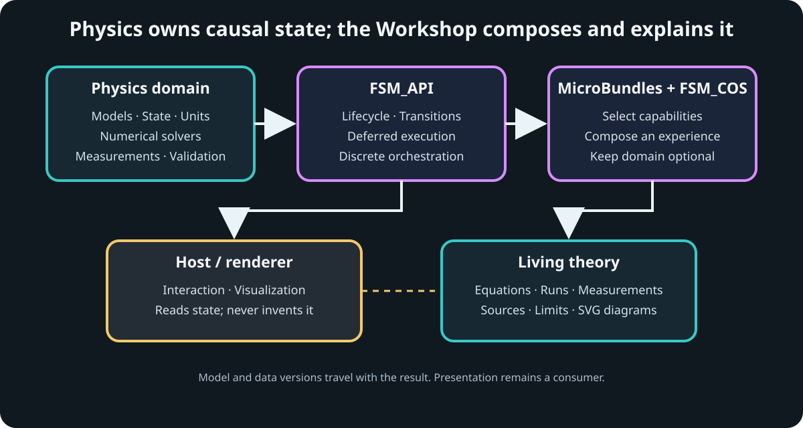
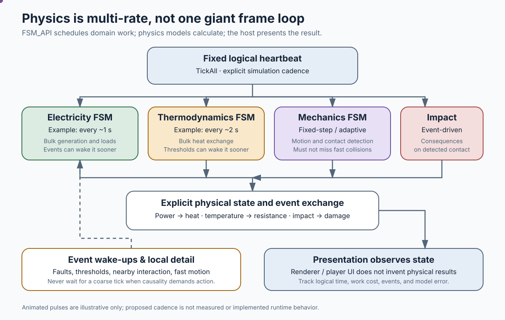

# The Singularity Workshop · Physics

**Physics is the study of what changes, why it changes, and what must follow.** This package is the Workshop's foundation for deterministic, composable physical models—so experiments, simulations, and eventually entire worlds share explainable rules rather than disconnected visual effects.

<p align="center"><strong>What → Why → How → Observe → Explain</strong></p>

---

## ✳ 00 What

TheSingularityWorkshop.Physics is the physics domain for the Singularity Workshop. It will provide small, composable physical capabilities that can be selected for an experiment or world: mechanics, energy, thermodynamics, fluids, materials, electromagnetism, reactions, combustion, waves, and more.

Physics state is authoritative. Rendering and interaction observe that state; they do not invent the underlying result.

> **Status:** foundation and architecture in development. A capability is considered implemented only when its model, assumptions, units, deterministic behavior, and validation are represented in code and tests.

---

## ◇ 01 Why

A spark should be more than a sprite. A fire should change its fuel, temperature, gases, and surroundings. A copper object should not behave like iron merely because both have a metallic shader. A distant fire may use a cheaper representation, but it must continue to evolve and remain coherent when approached again.

The Workshop needs one causal foundation that can explain its results, support repeatable experiments, and scale the detail of computation without silently rewriting history.

---

## △ 02 How

- **FSM_API** coordinates discrete lifecycle and state transitions; numerical solvers calculate physical changes.
- **Ontology-aligned capabilities** keep mechanics, thermodynamics, hydrodynamics, materials, and other domains independently composable.
- **MicroBundles** describe the smallest useful combination of models and data for a particular experiment.
- **Deterministic inputs and explicit time** make runs replayable and comparable.
- **Conservative broadphase screening** finds potential AABB contacts, including linear swept bounds, without treating candidates as confirmed collisions.
- **Measurements, provenance, and validation** connect every result to its model and evidence.
- **Living theory** grows from the same model definitions and observations used by the simulation.

Physics has no dependency on Unity, a renderer, or a particular host application. The initial library is a renderer-independent analytical mechanics kernel; higher-level capability domains are being added in deliberate, testable increments.

---

## ▷ 03 See it in a minute

The constant-acceleration model includes a repeatable experiment runner. Each run captures the initial state and every subsequent logical-step sample. A versioned JSON record can preserve those actual samples with the inputs and units that produced them.

```csharp
using TheSingularityWorkshop.Physics.Experiments;
using TheSingularityWorkshop.Physics.Kinematics;

var experiment = ConstantAccelerationExperiment.Run(
    new ConstantAccelerationExperimentDefinition(
        InitialState: new KinematicState(0d, 0d, 0d),
        Acceleration: 9.81d,
        DeltaTime: 0.1d,
        StepCount: 20));

var finalState = experiment.FinalState;
var runRecord = ConstantAccelerationRunRecord.FromResult(experiment);
var json = runRecord.ToJson();

// 20 completed steps, 21 samples, 2 seconds of logical time.
```

This is a deterministic, one-dimensional constant-acceleration experiment—not a general-purpose rigid-body engine. The run-record format is an initial schema; broad source provenance, uncertainty analysis, the ramp experiment, and coupled models remain future work.






---

## ○ 04 Documentation & theory

- [Architecture](docs/ARCHITECTURE.md) — boundaries, determinism, and execution model
- [Logical time ledger](docs/LOGICAL_TIME_LEDGER.md) — bounded catch-up, committed ticks, and explicit time debt
- [Process-group scheduling](docs/PROCESS_GROUP_SCHEDULING.md) — multi-rate physical domains, logical time, event wake-ups, and validation
- [Electricity & the Singularity Grid](docs/ELECTRICITY_AND_SINGULARITY_GRID.md) — executable resistive-load accounting, transistor teaching models, city-grid coupling, and the Power Plant roadmap
- [Articulated mechanics contract](docs/ARTICULATED_MECHANICS_CONTRACT.md) — proposed Physics-to-controller observations for contacts, joint loads, structural failure, and topology ownership
- [Universe & observer resolution](docs/UNIVERSE_AND_OBSERVER_RESOLUTION.md) — persistent universe state, deterministic cells, relevance tiers, conservative broadphase, and multiscale handoffs
- [Timelines & multiverse](docs/TIMELINES_AND_MULTIVERSE.md) — immutable timeline lineage and the still-unimplemented checkpoint/replay/isolation contract
- [Deterministic history & extensions](docs/DETERMINISTIC_HISTORY_AND_EXTENSIONS.md) — reverse-order limits, replay, optional prediction, rollback, and branch isolation
- [Physics domain map](docs/PHYSICS_DOMAIN_MAP.md) — broad physical territory, domain coupling, primitive foundations, and build order
- [Hydrodynamics world demonstrator](docs/HYDRODYNAMICS_WORLD_DEMONSTRATOR.md) — staged path from a measured wave reference to terrain, shorelines, and bounded boat coupling
- [Thermodynamics: first bounded primitive](docs/THERMODYNAMICS_FIRST_PRIMITIVE.md) — lumped thermal state, sensible energy, assumptions, and limits
- [Acoustic World Model](docs/ACOUSTIC_WORLD_MODEL.md) — listener-centred sound propagation, adaptive acoustic buckets, baking/caching, binaural reception, and sound-derived observations for agents (design roadmap; implementation remains staged).
- [Physics classes & ontology](docs/PHYSICS_CLASSES.md) — capability domains and their relationships
- [Physics ontology map](docs/images/physics-ontology-map.svg) — visual guide to composable domains
- [Theory and evidence](docs/THEORY.md) — how explanations connect to models and results
- [Determinism contract](docs/DETERMINISM.md) — replay, time, ordering, and numerical limits
- [Roadmap](docs/ROADMAP.md) — staged path from mechanics to coupled phenomena
- [Castle Siege physics domain](docs/CASTLE_SIEGE_PHYSICS_DOMAIN.md) — the full causal domain, fidelity ladder, capability gates, and validation principles
- [Castle Siege experiment catalog](docs/CASTLE_SIEGE_EXPERIMENT_CATALOG.md) — a staged catalog of reusable questions, controls, observations, and regression tests
- [Castle Siege WebPageLLM build plan](docs/CASTLE_SIEGE_WEBPAGELLM_BUILD_PLAN.md) — host integration, destination/scene plan, adapter boundary, build slices, and acceptance checklist
- [Physics and Math LUT policy](docs/PHYSICS_MATH_LUTS.md) — LUT types, provenance, interpolation, error budgets, ownership, and dependency gates
- [Castle Siege payloads and versus play](docs/CASTLE_SIEGE_PAYLOADS_AND_VERSUS.md) — data-driven payloads, one-to-many impact, settling, castle construction, alternating turns, and the FPS path
- [Living documentation design](docs/LIVING_THEORY.md) — future generated explainers, measurements, and SVG diagrams

The long-term goal is not a library of static pages about physics. It is living theory: explanations that can show the governing model, expose assumptions, run an experiment, display measurements, and trace each conclusion to its source.

---

## Resources & Support

- [The Singularity Workshop](https://github.com/TrentBest)
- [FSM_API](https://github.com/TrentBest/FSM_API) · [NuGet](https://www.nuget.org/packages/TheSingularityWorkshop.FSM_API/)
- [Workshop ontology](https://github.com/TrentBest/TheSingularityWorkshop.Ontology)
- [MicroBundleDomain](https://github.com/TrentBest/TheSingularityWorkshop.MicroBundleDomain)
- [FSM_COS](https://github.com/TrentBest/TheSingularityWorkshop.FSM_COS)
- [Report an issue](https://github.com/TrentBest/TheSingularityWorkshop.Physics/issues)
- [GitHub profile](https://github.com/TrentBest) · [Coder Legion](https://coderlegion.com/)
- [Support the Workshop on Patreon](https://www.patreon.com/)
- [Support the Workshop on PayPal](https://www.paypal.com/)

<p align="center">
  
</p>

<p align="center"><em>Build understanding. Make reality inspectable.</em><br/><strong>The Singularity Workshop</strong></p>


Timeline history contracts (checkpoint envelopes, ordered event records, and validated history segments) are documented in [Timelines & multiverse](docs/TIMELINES_AND_MULTIVERSE.md).
