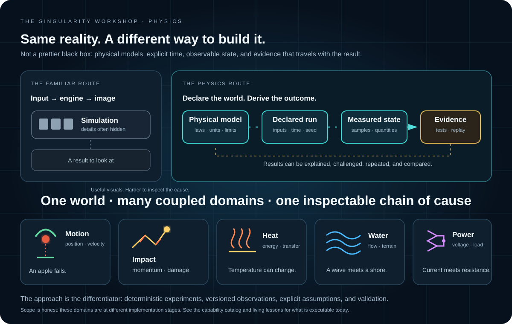

# ✳️ 00 The Singularity Workshop — Physics

[](https://github.com/TrentBest/TheSingularityWorkshop.Physics/actions/workflows/build.yml)
[](LICENSE)

**Physics is the study of what changes, why it changes, and what must follow.** This package is the Workshop's foundation for deterministic, composable physical models—so experiments, simulations, and eventually entire worlds share explainable rules rather than disconnected visual effects.

<p align="center"><strong>What → Why → How → Observe → Explain</strong></p>



**See the difference in evidence:** [watch scale change live](docs/SCALE_FACTOR_LIVING.md) · [watch the apple fall](docs/experiments/apple-free-fall.md) · [compare moving-train observers](docs/experiments/moving-train-projectile.md) · [inspect a recorded 3D trajectory](docs/experiments/projectile-trajectory.md) · [watch a contact impulse change velocity](docs/experiments/contact-impulse.md) · [watch heat transfer](docs/experiments/thermal-conduction.md) · [see spring forces reverse](docs/SPATIAL_DISTANCE_SPRING_DAMPER.md) · [see multi-rate scheduling](docs/PROCESS_GROUP_SCHEDULING.md) · [understand deterministic randomness](docs/DETERMINISTIC_RANDOMNESS.md) · [check implemented capabilities](docs/PHYSICS_CAPABILITY_CATALOG.md)

**Hear a reference source:** this CC0 browser sample demonstrates the audible documentation path; it is not generated by our Physics solver. The [reproducible acoustic observation](docs/experiments/acoustic-observation.md) visualizes actual source-to-listener calculations, and the [controlled distance sweep](docs/experiments/acoustic-distance-sweep.md) compares four listener positions against the same source. The [first-order room-reflection experiment](docs/experiments/first-order-room-reflection.md) records a reproducible direct-path baseline and one computed reflected path from a bounded rectangular room model, with an SVG generated from the same run. These outputs are analytical metadata, not synthesized audio or a combined room response. The [acoustic world model](docs/ACOUSTIC_WORLD_MODEL.md) and [living acoustics plan](docs/ACOUSTIC_LIVING_DEMO.md) document the current boundary.

<audio controls preload="none" aria-label="Reference audio sample: not generated by the Physics solver">
  <source src="https://interactive-examples.mdn.mozilla.net/media/cc0-audio/t-rex-roar.mp3" type="audio/mpeg" />
  Your browser may not support embedded audio. <a href="https://interactive-examples.mdn.mozilla.net/media/cc0-audio/t-rex-roar.mp3">Play or download the reference sample</a>.
</audio>

**Physics is not trying to make reality look physical. It is trying to make physical outcomes explainable.** A conventional engine can be the right tool for a game; this project takes a different architectural route: explicit model identity, units and assumptions, deterministic experiments, recorded state, validation, and living theory. The ambition is not to deny familiar physics, but to make its causes inspectable and its capabilities composable. The visual above is an architectural thesis—not a claim that every pictured domain is already implemented.

---

## ✳ 00 What

TheSingularityWorkshop.Physics is the physics domain for the Singularity Workshop. It will provide small, composable physical capabilities that can be selected for an experiment or world: mechanics, energy, thermodynamics, fluids, materials, electromagnetism, reactions, combustion, waves, and more.

Physics state is authoritative. Rendering and interaction observe that state; they do not invent the underlying result.

> **Status:** foundation and architecture in development. A capability is considered implemented only when its model, assumptions, units, deterministic behavior, and validation are represented in code and tests.

---

## ◇ 01 Why

A spark should be more than a sprite. A fire should change its fuel, temperature, gases, and surroundings. A copper object should not behave like iron merely because both have a metallic shader. A distant fire may use a cheaper representation, but it must continue to evolve and remain coherent when approached again.

The Workshop needs one causal foundation that can explain its results, support repeatable experiments, and scale the detail of computation without silently rewriting history.

---

## △ 02 How

- **FSM_API** coordinates discrete lifecycle and state transitions; numerical solvers calculate physical changes.
- **Ontology-aligned capabilities** keep mechanics, thermodynamics, hydrodynamics, materials, and other domains independently composable.
- **MicroBundles** describe the smallest useful combination of models and data for a particular experiment.
- **Deterministic inputs and explicit time** make runs replayable and comparable.
- **Conservative broadphase screening** finds potential AABB contacts, including linear swept bounds, without treating candidates as confirmed collisions.
- **Measurements, provenance, and validation** connect every result to its model and evidence.
- **Living theory** grows from the same model definitions and observations used by the simulation.

Physics has no dependency on Unity, a renderer, or a particular host application. The initial library is a renderer-independent analytical mechanics kernel; higher-level capability domains are being added in deliberate, testable increments.

---

## ▷ 03 See it in a minute

The constant-acceleration model includes a repeatable experiment runner. Each run captures the initial state and every subsequent logical-step sample. A versioned JSON record can preserve those actual samples with the inputs and units that produced them.

```csharp
using TheSingularityWorkshop.Physics.Experiments;
using TheSingularityWorkshop.Physics.Kinematics;

var experiment = ConstantAccelerationExperiment.Run(
    new ConstantAccelerationExperimentDefinition(
        InitialState: new KinematicState(0d, 0d, 0d),
        Acceleration: 9.81d,
        DeltaTime: 0.1d,
        StepCount: 20));

var finalState = experiment.FinalState;
var runRecord = ConstantAccelerationRunRecord.FromResult(experiment);
var json = runRecord.ToJson();

// 20 completed steps, 21 samples, 2 seconds of logical time.
```

This is a deterministic, one-dimensional constant-acceleration experiment—not a general-purpose rigid-body engine. See the [experiment tests](tests/TheSingularityWorkshop.Physics.Tests/ConstantAccelerationExperimentTests.cs) and [run-record tests](tests/TheSingularityWorkshop.Physics.Tests/ConstantAccelerationRunRecordTests.cs) for the executable acceptance surface. The run-record format is an initial schema; broad source provenance, uncertainty analysis, the ramp experiment, and broader coupled models remain future work. A proposed cross-domain [run-record envelope](docs/PHYSICS_RUN_RECORD_CONTRACT.md) now has an executable validator and a [catalog generated from four representative physics run records](docs/experiments/run-record-catalog.md); the [payload-aware inspector](tools/inspect_physics_run_records.py) also summarizes four domains while preserving their original payloads. This demonstrates a tested prototype, not a universal physics result schema.

### 3D projectile experiment

The 3D projectile experiment builds on the analytical constant-acceleration solver. It converts a declared launch speed, elevation, and azimuth into an initial velocity under a right-handed, z-up convention, then records the initial state and every fixed logical-step sample. The versioned JSON record preserves the run ID, exact inputs, units, model identity, coordinate convention, and samples.

```csharp
using TheSingularityWorkshop.Physics.Experiments;
using TheSingularityWorkshop.Physics.Spatial;

var definition = new ProjectileExperimentDefinition(
    RunId: "castle-baseline-001",
    InitialPosition: new Vector3d(0d, 0d, 2d),
    LaunchSpeed: 30d,
    ElevationDegrees: 45d,
    AzimuthDegrees: 0d,
    Gravity: new Vector3d(0d, 0d, -9.81d),
    DeltaTime: 0.02d,
    StepCount: 250);

var result = ProjectileExperiment.Run(definition);
var record = ProjectileExperimentRunRecord.FromResult(result);
var json = record.ToJson();
```

This is an ideal point-projectile experiment under constant acceleration. A separate analytical intersection capability tests its continuous path against a fixed axis-aligned target during the recorded duration, and impact diagnostics calculate incoming velocity, momentum, and kinetic energy from a confirmed hit. Drag, projectile radius, rotated or moving targets, collision response, material damage, and trebuchet mechanics remain unsupported. See the [projectile experiment tests](tests/TheSingularityWorkshop.Physics.Tests/ProjectileExperimentTests.cs), [target-intersection tests](tests/TheSingularityWorkshop.Physics.Tests/ProjectileTargetIntersectionTests.cs), and [impact-diagnostics tests](tests/TheSingularityWorkshop.Physics.Tests/ProjectileImpactDiagnosticsTests.cs) for the executable acceptance surface.


---

## ○ 04 Documentation & theory

- [Architecture](docs/ARCHITECTURE.md) — boundaries, determinism, and execution model
- [Logical time ledger](docs/LOGICAL_TIME_LEDGER.md) — bounded catch-up, committed ticks, and explicit time debt
- [Process-group scheduling](docs/PROCESS_GROUP_SCHEDULING.md) — multi-rate physical domains, logical time, event wake-ups, and validation
- [Electricity & the Singularity Grid](docs/ELECTRICITY_AND_SINGULARITY_GRID.md) — executable resistive-load accounting, transistor teaching models, city-grid coupling, and the Power Plant roadmap
- [Articulated mechanics contract](docs/ARTICULATED_MECHANICS_CONTRACT.md) — proposed Physics-to-controller observations for contacts, joint loads, structural failure, and topology ownership
- [Universe & observer resolution](docs/UNIVERSE_AND_OBSERVER_RESOLUTION.md) — persistent universe state, deterministic cells, relevance tiers, conservative broadphase, and multiscale handoffs
- [Timelines & multiverse](docs/TIMELINES_AND_MULTIVERSE.md) — immutable timeline lineage and the still-unimplemented checkpoint/replay/isolation contract
- [Deterministic history & extensions](docs/DETERMINISTIC_HISTORY_AND_EXTENSIONS.md) — reverse-order limits, replay, optional prediction, rollback, and branch isolation
- [Physics domain map](docs/PHYSICS_DOMAIN_MAP.md) — broad physical territory, domain coupling, primitive foundations, and build order
- [Hydrodynamics world demonstrator](docs/HYDRODYNAMICS_WORLD_DEMONSTRATOR.md) — staged path from a measured wave reference to terrain, shorelines, and bounded boat coupling
- [Acoustic world model](docs/ACOUSTIC_WORLD_MODEL.md) — listener-centred propagation and the tested free-field observation baseline
- [Living acoustic demonstration](docs/ACOUSTIC_LIVING_DEMO.md) — audible reference source, source/space/listener comparisons, SVG-plus-HTML delivery, and explicit evidence gates for physics-generated sound
- [Stellar physics and planetary energy](docs/STELLAR_PHYSICS_AND_PLANETARY_ENERGY.md) — staged roadmap from inverse-square irradiance to deeper stellar structure
- [Geology: volcanic terrain](docs/GEOLOGY_VOLCANIC_TERRAIN.md) — deterministic volume-accounted terrain deposition and explicit model limits
- [Terrain interactions and MicroBundles](docs/TERRAIN_INTERACTIONS_AND_MICROBUNDLES.md) — terrain-dependent water impacts, emergent effects, and composable physical processes
- [Hydrodynamics: shallow-water basin and bathymetry](docs/HYDRODYNAMICS_SHALLOW_WATER_2D.md) — conservative shallow-water fluxes, terrain-aware reconstruction, wet-dry shoreline support, and current numerical limits
- [Thermodynamics: first bounded primitive](docs/THERMODYNAMICS_FIRST_PRIMITIVE.md) — lumped thermal state, sensible energy, assumptions, and limits
- [Physics capability catalog](docs/PHYSICS_CAPABILITY_CATALOG.md) — implemented source entry points, model scope, limits, and contribution checklist
- [Physics gap register](docs/PHYSICS_GAP_REGISTER.md) — evidence-based audit of missing cross-domain bridges, priorities, and acceptance gates; includes the [capability atlas SVG](docs/images/physics-capability-atlas.svg)
- [Physics run-record contract](docs/PHYSICS_RUN_RECORD_CONTRACT.md) — proposed common metadata envelope for cross-domain experiments without flattening domain-specific observations; [CI validator](tools/validate_physics_run_records.py) checks the required envelope on representative acoustic, room-reflection, and electrical-thermal records
- [Electrical-to-thermal coupling experiment](docs/experiments/electrical-thermal-coupling.md) — first bounded connection between resistive-load power and lumped thermal energy, with a reproducible JSON run record, model-generated SVG, focused tests, and CI checks
- [Numerical validation playbook](docs/NUMERICAL_VALIDATION.md) — analytical checks, conservation residuals, convergence, determinism, and evidence gates
- [Physics classes & ontology](docs/PHYSICS_CLASSES.md) — capability domains and their relationships
- [Physics ontology map](docs/images/physics-ontology-map.svg) — visual guide to composable domains
- [Theory and evidence](docs/THEORY.md) — how explanations connect to models and results
- [Determinism contract](docs/DETERMINISM.md) — replay, time, ordering, and numerical limits
- [Roadmap](docs/ROADMAP.md) — staged path from mechanics to coupled phenomena
- [Castle Siege physics domain](docs/CASTLE_SIEGE_PHYSICS_DOMAIN.md) — the full causal domain, fidelity ladder, capability gates, and validation principles
- [Castle Siege experiment catalog](docs/CASTLE_SIEGE_EXPERIMENT_CATALOG.md) — a staged catalog of reusable questions, controls, observations, and regression tests
- [Castle Siege WebPageLLM build plan](docs/CASTLE_SIEGE_WEBPAGELLM_BUILD_PLAN.md) — host integration, destination/scene plan, adapter boundary, build slices, and acceptance checklist
- [3D projectile kernel](Physics/Kinematics/ProjectileState.cs) — analytical constant-acceleration state advancement with explicit SI units; [focused tests](tests/TheSingularityWorkshop.Physics.Tests/ConstantAccelerationProjectileSolverTests.cs); not a collision or rigid-body solver
- [Recorded 3D projectile trajectory experiment](Physics/Experiments/ProjectileTrajectoryExperiment.cs) — fixed-step sampling and versioned JSON run records; [acceptance tests](tests/TheSingularityWorkshop.Physics.Tests/ProjectileTrajectoryExperimentTests.cs) validate every sample against the closed-form solution; [serialized run fixture, generated SVG, and reproduction instructions](docs/experiments/projectile-trajectory.md) are checked by CI against the renderer
- [Apple free-fall living lesson](docs/experiments/apple-free-fall.md) — an instructional experiment with recorded height/velocity samples, a tree-and-trajectory SVG, calculus intuition, and CI checks tying every displayed state to actual C# output; its [machine-readable lesson manifest](docs/experiments/apple-free-fall.lesson.json) is validated against the run
- [Deterministic math, Squirrel3 randomness, and LUT policy](docs/DETERMINISTIC_MATH_AND_RANDOM.md) — replayable sampling helpers, stream boundaries, and approximation acceptance gates\n- [Physics and Math LUT policy](docs/PHYSICS_MATH_LUTS.md) — LUT types, provenance, interpolation, error budgets, ownership, and dependency gates
- [Castle Siege payloads and versus play](docs/CASTLE_SIEGE_PAYLOADS_AND_VERSUS.md) — data-driven payloads, one-to-many impact, settling, castle construction, alternating turns, and the FPS path
- [Living theory & interactive documentation](docs/LIVING_THEORY.md) — generated explainers, recorded observations, accessible SVG diagrams, and the staged path from reproducible run records to generated artifacts
- [Physics learning path](docs/LEARNING_PATH.md) — organize the domain around curiosity, progressive concepts, reusable lesson experiences, and explicit implementation status

The long-term goal is not a library of static pages about physics. It is living theory: explanations that can show the governing model, expose assumptions, run an experiment, display measurements, and trace each conclusion to its source.

---

### Living images are documentation

The rule is simple: if a picture materially improves understanding, put it beside the explanation. The [Living Image Standard](docs/LIVING_IMAGE_STANDARD.md) distinguishes model-backed outputs from analytical references and conceptual diagrams. Start with the [capability atlas](docs/images/physics-capability-atlas.svg), the [moving-train observer comparison](docs/experiments/moving-train-projectile.md), [lookup-table interpolation](docs/PHYSICS_MATH_LUTS.md), [shallow-water concepts](docs/HYDRODYNAMICS_SHALLOW_WATER_2D.md), and the run-backed [thermal-conduction experiment](docs/experiments/thermal-conduction.md).

## Resources & Support

- [The Singularity Workshop](https://github.com/TrentBest)
- [FSM_API](https://github.com/TrentBest/FSM_API) · [NuGet](https://www.nuget.org/packages/TheSingularityWorkshop.FSM_API/)
- [Workshop ontology](https://github.com/TrentBest/TheSingularityWorkshop.Ontology)
- [MicroBundleDomain](https://github.com/TrentBest/TheSingularityWorkshop.MicroBundleDomain)
- [FSM_COS](https://github.com/TrentBest/TheSingularityWorkshop.FSM_COS)
- [Report an issue](https://github.com/TrentBest/TheSingularityWorkshop.Physics/issues)
- [GitHub profile](https://github.com/TrentBest) · [Coder Legion](https://coderlegion.com/)
- [Support the Workshop on Patreon](https://www.patreon.com/)
- [Support the Workshop on PayPal](https://www.paypal.com/)

<p align="center">
  
</p>

<p align="center"><em>Build understanding. Make reality inspectable.</em><br/><strong>The Singularity Workshop</strong></p>


Timeline history contracts (checkpoint envelopes, ordered event records, and validated history segments) are documented in [Timelines & multiverse](docs/TIMELINES_AND_MULTIVERSE.md).
