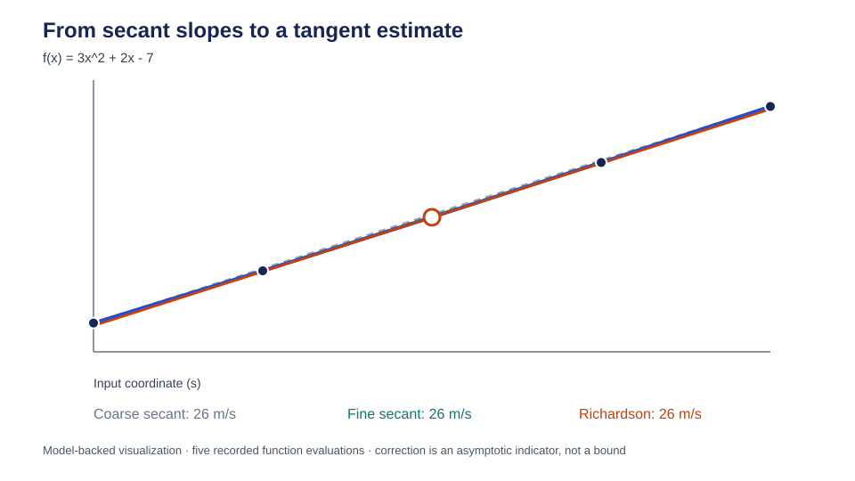

<!-- The Singularity Workshop moniker -->
<p align="center"><a href="https://github.com/TrentBest"></a></p>

# Calculus I — Estimating a Derivative from Samples

**Status:** Implemented bounded numerical primitive; source-checked against the development branch. Central difference and a Richardson-refined estimate are covered by focused automated tests. The reported error is an asymptotic indicator, not a rigorous bound.

## 01 — What: a derivative is a local rate of change

Imagine measuring the position of a moving object at nearby times. Average velocity over an interval is displacement divided by elapsed time. Instantaneous velocity asks a sharper question: what rate of change applies at one instant?

For a scalar function \(f\), the derivative at \(x\) is the limit of the secant slope as the two sample locations approach one another:

\[
f'(x)=\lim_{h\to 0}\frac{f(x+h)-f(x)}{h}.
\]

The derivative has units of *output units per input unit*. If \(f\) is position in metres and \(x\) is time in seconds, \(f'(x)\) is velocity in metres per second.

## 02 — Why: measurements and models are often sampled

A closed-form derivative is not always available. A model may be a numerical procedure, a measured data stream, or a function whose formula is supplied by another component. Finite differences estimate local rates from function evaluations.

The central difference samples symmetrically on both sides of the target:

\[
D_h f(x)=\frac{f(x+h)-f(x-h)}{2h}.
\]

Symmetry cancels the leading first-order bias found in a one-sided difference. It is a useful first derivative estimator when the function can be evaluated on both sides of the requested point.

## 03 — How: truncation error and Richardson extrapolation

Assume \(f\) is sufficiently smooth near \(x\), and choose a positive step \(h\). Taylor expansion gives:

\[
D_h f(x)=f'(x)+\frac{h^2}{6}f'''(x)+O(h^4).
\]

For a sufficiently smooth function, the leading truncation error is proportional to \(h^2\). Halving the step therefore reduces that leading term by approximately four, provided the calculation is in its asymptotic regime and roundoff is not dominant.

Let \(D_h\) be the estimate at step \(h\), and \(D_{h/2}\) the estimate at half that step. Their leading error terms can be cancelled:

\[
D_{\mathrm{R}}=D_{h/2}+\frac{D_{h/2}-D_h}{3}.
\]

The magnitude of the correction,

\[
E_{\mathrm{est}}=\left|\frac{D_{h/2}-D_h}{3}\right|,
\]

is returned as an **estimated absolute error indicator**. It is not a proof or guaranteed upper bound. It can be misleading near discontinuities, when the selected steps are outside the asymptotic regime, or when floating-point cancellation dominates.

Making \(h\) arbitrarily small does not always improve the answer. When \(f(x+h)\) and \(f(x-h)\) are nearly equal, subtraction can lose significant digits. A practical step balances truncation error against roundoff and the scale of the function.

A step-size sweep makes this tradeoff observable. For a known function such as \(f(x)=\sin x\), evaluate the Richardson estimate over a logarithmic sequence of decreasing steps and compare each result with the analytical reference \(\cos x\). The absolute difference is the actual error for this reference problem; the Richardson correction is only an indicator. In the truncation-dominated region, refinement should improve the estimate. Eventually, roundoff and finite-precision sampling can stop that improvement or reverse it. The best observed step is specific to the function, coordinate, precision, and implementation; it is not a universal constant.

The implementation validates finite coordinates, positive finite steps, distinct finite sample coordinates, finite function samples, and finite arithmetic. The Richardson method evaluates the function four times, so the function should be deterministic and side-effect free. Neither method infers units, selects an optimal step, or differentiates vector-valued functions.

## 04 — See it in a minute: compute and refine a known derivative

For \(f(x)=3x^2+2x-7\), the analytical derivative is \(f'(x)=6x+2\). At \(x=4\), the expected result is \(26\).

```csharp
using TheSingularityWorkshop.Physics.Numerics;

DerivativeEstimate estimate =
    FiniteDifferences.CentralDifferenceWithErrorEstimate(
        x => (3d * x * x) + (2d * x) - 7d,
        x: 4d,
        step: 1e-3);

Console.WriteLine(estimate.Value);
Console.WriteLine(estimate.EstimatedAbsoluteError);
```

The focused tests compare central differences against analytical polynomial and trigonometric derivatives, verify Richardson refinement for sine, verify cancellation of the leading error term for a quartic polynomial, and exercise invalid inputs, non-finite samples, overflow, and the four-evaluation contract.

A structured derivation can also be generated from the actual function evaluations. The renderer-independent record stores the four secant sample coordinates and values plus the center anchor, the coarse and fine secant slopes, the Richardson correction, three named rule steps, assumptions, and caller-declared unit labels. Run the deterministic teaching experiment with:

```bash
dotnet run --project tools/DerivativeDerivationRunRecordGenerator/DerivativeDerivationRunRecordGenerator.csproj --configuration Release -- /tmp/derivative-derivation.run.json
```

The generator compares the recorded estimate with the analytical derivative for this known quadratic. CI independently checks the schema, samples, rule sequence, unit labels, numerical result, and exact generated SVG. A separate Python renderer draws the sampled function, coarse and fine secants, and Richardson tangent from that JSON record. This is structured numerical evidence, not symbolic differentiation or a proof engine.



The step-size experiment is recorded in [derivative-step-size-sweep.run.json](experiments/derivative-step-size-sweep.run.json) and visualized in [the living error plot](experiments/derivative-step-size-sweep.svg). Blue circles show actual error against the analytical cosine derivative; orange squares show the Richardson correction indicator. The plotted indicator is not a guaranteed bound.

**Evidence classification:** source-backed implementation with focused automated tests and a reproducibly generated, model-backed SVG tied to the actual C# sample record. The analytical derivative of the selected quadratic is an independent reference identity. A reproducible twelve-step sweep record compares Richardson estimates of \(\sin x\) with the independent \(\cos x\) reference. Its living logarithmic plot keeps actual absolute error and the Richardson correction indicator in separate series; zero indicators are displayed at a visual floor. CI executes the C# generator, compares its output with the committed reference within floating-point tolerances, renders the generated result, and verifies the committed SVG against its committed run record. No measured physical data is involved.

## 05 — Choose your next step

- Implementation: [FiniteDifferences.cs](../Physics/Math/FiniteDifferences.cs)
- Tests: [FiniteDifferencesTests.cs](../tests/TheSingularityWorkshop.Physics.Tests/Math/FiniteDifferencesTests.cs)
- Domain inventory: [Mathematics Domain Map](MATHEMATICS_DOMAIN_MAP.md)
- Numerical evidence rules: [Numerical Validation](NUMERICAL_VALIDATION.md)
- Learning route: [Physics Learning Path](LEARNING_PATH.md)

Next: [Calculus II — Composite Simpson Quadrature](CALCULUS_II_COMPOSITE_SIMPSON_QUADRATURE.md) adds a bounded numerical-integration primitive with an explicit refinement indicator.

---

<p align="center"></p>
