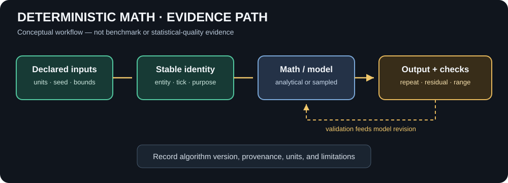

# Deterministic Math: Randomness, LUTs, and Numerical Truth

**Status:** the Squirrel3 hash, seeded helper stream, stateless keyed sampler, bounded uniform 1D LUT, and structure-of-arrays Vector3d batch operations are implemented with focused tests. These batch operations are CPU reference code, not SIMD/GPU acceleration. This document distinguishes working primitives from future math capabilities; it does not claim that a general-purpose LUT engine, GPU math backend, or separate Math MicroBundle exists.



*Conceptual workflow diagram. Its arrows describe the evidence path; they are not simulation output or a statistical-quality claim.*

## 1. Randomness that can be replayed

Simulation randomness must be reproducible, addressable, and explicit about what it does *not* guarantee. The initial random primitive is a 32-bit Squirrel3 hash. The first LUT primitive is a separate bounded uniform one-dimensional table with linear interpolation, documented in [Physics Math LUTs](PHYSICS_MATH_LUTS.md):

- `Squirrel3.Hash(position, seed)` is stateless: the same pair always produces the same 32-bit result.
- `Squirrel3Random(seed)` is a mutable deterministic stream. Its output depends on both the seed and call order.
- `Fork(streamId)` creates a repeatable stream derived from a stable stream ID. Use stable IDs, not runtime object hashes or allocation order.
- `NextInt(minInclusive, maxExclusive)` uses rejection sampling to avoid modulo bias.
- `NextDouble()` returns a value in `[0, 1)` with 32 bits of source precision; ranged doubles and `Chance`, `NextBool`, `Pick`, and Fisher–Yates `Shuffle` are convenience operations.
- `Squirrel3Keyed.Hash(seed, entityId, logicalTick, purposeId)` is a stateless four-part key for simulation work that can run in parallel or in a different order. `UnitDouble(...)` maps that sample into `[0, 1)`.

```csharp
using TheSingularityWorkshop.Physics.Numerics;

var random = new Squirrel3Random(seed: 12345u);
var massJitter = random.NextDouble(-0.05d, 0.05d);
var fragmentCount = random.NextInt(4, 12); // 4 through 11
var useCopper = random.Chance(0.25d);
var material = random.Pick(new[] { "iron", "copper", "stone" });

// Stateless per-entity/per-tick variation; does not depend on update order.
var damageVariation = Squirrel3Keyed.UnitDouble(
    seed: 12345u, entityId: 812u, logicalTick: 600u, purposeId: 2u);
```

The sample illustrates API usage only; those distributions and values are not a physical material model. For contiguous bulk vector arithmetic, see [Vector3dBatch](../Physics/Math/Vector3dBatch.cs); for the future acceleration boundary, see [GPU Computation Readiness](GPU_COMPUTATION_READINESS.md).

### Determinism rules

1. Record the seed, algorithm identity/version, and relevant call order as part of the experiment inputs.
2. For parallel or reordered simulation work, use the keyed sampler with stable IDs: seed + entity ID + logical tick + purpose ID. Purpose IDs should be named constants in consuming code so separate decisions do not accidentally share a key. Never use runtime object hashes, allocation order, wall-clock time, or thread IDs as stable identifiers.
3. The key fields are each 32-bit, and the result is 32-bit. Different keys can collide; this API is not a unique ID generator. Very large simulations may need a wider hash/output in a future version.
4. A seed alone does not guarantee identical results if call order, algorithm version, integer overflow semantics, or floating-point execution changes. Keyed sampling removes dependence on evaluation order for the same key, but does not make the surrounding simulation automatically deterministic.
5. Squirrel3 is **not cryptographically secure** and must not be used for secrets, tokens, security decisions, or gambling.
6. The 32-bit output space and stream counter are finite. This primitive is for simulation/content variation, not a claim of an unlimited-period generator.

## 2. Why this belongs before broad LUT work

Random sampling is useful for controlled experiments, Monte Carlo exploration, authored variation, and reproducible stress fixtures. It is not a substitute for uncertainty analysis or a probability model. A simulation should distinguish:

- a deterministic pseudorandom sample;
- an assumed probability distribution;
- measured uncertainty in an input;
- uncertainty in the model itself;
- and numerical error introduced by approximation.

Those categories must not collapse into one generic “randomness” field.

## 3. LUT policy remains explicit

Lookup tables are valuable when profiling and a bounded error budget justify them. Each table should state:

- function/model identity and version or content digest;
- input units, coordinate conventions, and valid bounds;
- sampling grid and interpolation method;
- boundary and out-of-range behavior;
- analytical or measured reference used to validate it;
- memory/build cost, timing, and error across endpoints and interior samples;
- whether it changes authoritative physics or only presentation.

Start with an analytic function whose correct answer is known. Compare direct evaluation and table lookup at exact samples and between samples, then report maximum and typical error, memory footprint, and end-to-end cost. Do not put every equation into a LUT by default.

A presentation/LOD LUT may choose how an established physical event is drawn. It must not decide whether an impact happened, change momentum, create energy, or determine material failure.

## 4. Capability boundary

Implemented today: `Squirrel3.Hash`, the seeded `Squirrel3Random` stream, bounded integer and floating-point sampling, Bernoulli choice, list choice, in-place shuffle, stream forking, stateless four-part keyed sampling, plus `LookupTable1D` with uniform samples, linear interpolation, strict domain bounds, payload-size reporting, and focused accuracy/edge-case tests.

Not claimed yet: multi-dimensional tables, higher-order or monotone interpolation, a validated probability-distribution library, cryptographic randomness, GPU execution, or a separate Math package/MicroBundle. Add those as independently tested capabilities when there is a real consumer and a measurable acceptance criterion.

## 5. Acceptance gates for future numerical primitives

- [ ] Deterministic golden vectors and repeatability tests.
- [ ] Defined invalid-input and out-of-range behavior.
- [ ] Analytical or trusted reference comparisons.
- [ ] Error and memory accounting for approximations.
- [ ] Algorithm/table version included in experiment provenance.
- [ ] CPU baseline stays correct before optional SIMD/GPU paths.
- [ ] No physical outcome is delegated to a presentation-only lookup.
