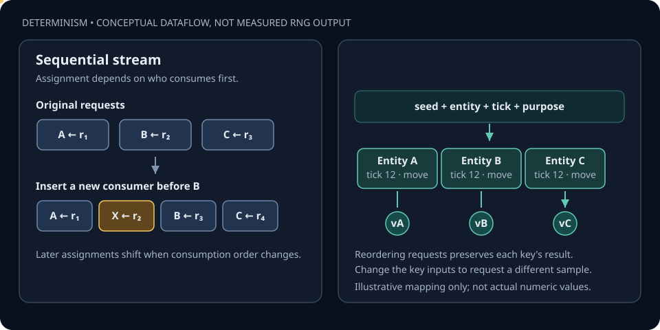

# Deterministic Randomness: Stream or Key?

Randomness in a simulation is a source of input, not an excuse for nondeterminism. The right API depends on what needs to remain stable when execution order changes.

## Two different contracts

**Sequential stream —** `Squirrel3Random` represents a deterministic stream. Given the same seed and the same sequence of calls, it returns the same sequence. Insert an extra call before an existing consumer and later consumers receive different values. That is expected stream behavior, not a bug.

**Keyed sample —** `Squirrel3Keyed` derives a sample from explicit identity inputs: seed, entity ID, logical tick, and purpose ID. A consumer can request its sample without consuming a shared stream, so changing call order does not reassign the sample to another entity or purpose. This is useful for deterministic parallel work and replayable per-entity variation.

The image is a **conceptual dataflow illustration**. It does not show measured or actual numeric output from either implementation.

## Choose the contract deliberately

- Use a sequential stream when ordered consumption is part of the experiment or algorithm.
- Use keyed sampling when a value belongs to a stable entity/tick/purpose tuple and must not depend on scheduler order.
- Give purpose IDs stable meanings; changing the key inputs intentionally changes the sample.
- Record seeds and relevant key inputs as part of reproducible experiment configuration.
- Remember that a 32-bit hash can collide. Keyed sampling is deterministic, not cryptographic, and does not prove collision-free uniqueness.
- Deterministic random inputs do not make an otherwise nondeterministic simulation deterministic by themselves.

## Implementation

- [Squirrel3Random.cs](../Physics/Math/Squirrel3Random.cs) — seeded sequential stream and helper operations.
- [Squirrel3Keyed.cs](../Physics/Math/Squirrel3Keyed.cs) — stateless key-based sample derivation.

The SVG and this page explain the API contract; the C# implementation and tests remain the authority for exact numeric results.
