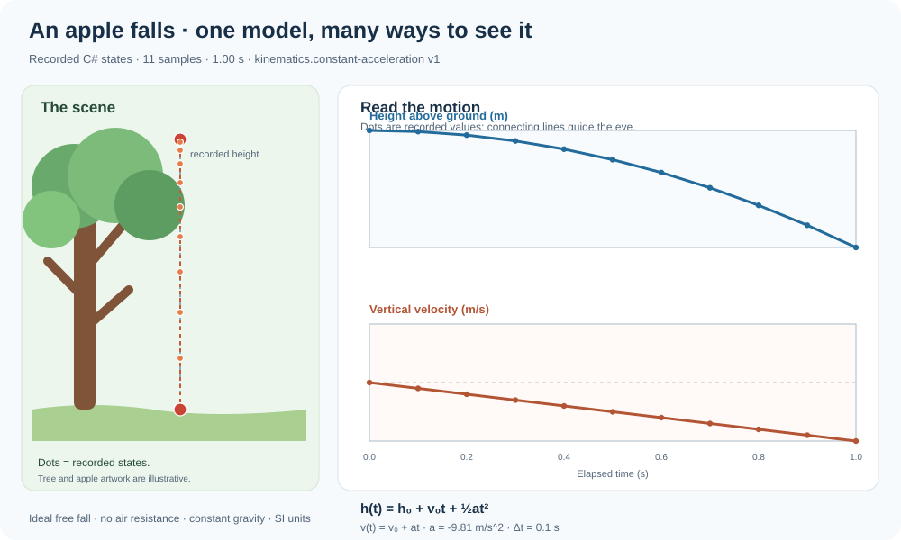

# Physics Learning Path: Learn by Watching the World

The Workshop should make learning feel like curiosity, not a prerequisite. A visitor notices something, changes one input, sees what changed, asks why, and can open the mathematics only when ready.

This is an instructional map for the Physics domain, not a claim that every listed model or lesson is implemented. Each lesson must link to the capability catalog and carry an explicit status.

## The learning loop

**Notice → Wonder → Predict → Change one thing → Observe → Explain → Test the explanation → Transfer**

1. **Notice:** start with a familiar phenomenon or a useful scene.
2. **Wonder:** ask one physical question in ordinary language.
3. **Predict:** offer an optional prediction before showing the result.
4. **Change one thing:** expose only inputs supported by the selected model.
5. **Observe:** show the scene, measurements, plots, units, and state changes together.
6. **Explain:** connect the result to a small equation or principle, with assumptions visible.
7. **Test:** compare against a closed-form prediction, invariant, or sourced reference.
8. **Transfer:** reuse the same idea in a new situation—a falling apple, a projectile, a falling piece of masonry, or a boat on a wave.

The lesson is the entry point. The same model and measurements remain available to engineers and researchers who want to inspect every detail.

## Progressive route through the domain

| Stop | Learner's question | Concept introduced | Evidence surface | Status |
|---|---|---|---|---|
| 00 · Observe | What am I looking at, and what is actually simulated? | Observation versus model versus authored illustration | Capability badge, model identity, assumptions | Contract defined; experience integration remains host work |
| 01 · Motion | How does position change over time? | Position, velocity, acceleration; slopes and derivatives | [Apple free-fall lesson](experiments/apple-free-fall.md), recorded SVG and run values | **First teaching slice implemented** |
| 02 · Launch | How do launch direction and gravity change a path? | Vector components, projectile motion, coordinate frames | [Projectile trajectory experiment](experiments/projectile-trajectory.md) | Analytical trajectory and recorded run implemented |
| 02b · Moving train | Why can two observers describe the same cannonball differently? | Galilean transformations, relative velocity, invariance of vertical motion | [Paired moving-train experiment](experiments/moving-train-projectile.md) | Paired train/ground states and focused tests implemented; shared run-record/SVG is next |
| 03 · Contact | Does the path reach the target? | Geometry, boundary crossing, point-versus-volume assumptions | Projectile/AABB intersection result | Bounded implementation; point projectile and fixed AABB |
| 04 · Impact | What arrives at a target? | Velocity, momentum, kinetic energy | Run-linked projectile impact diagnostics | Incoming diagnostics implemented; no projectile impact response coupling |
| 04b · Contact response | How does a contact change motion? | Relative normal speed, mass, restitution, impulse | [Living contact-impulse experiment](experiments/contact-impulse.md) | Single-contact frictionless normal response implemented; not coupled to projectile impact or a general rigid-body solver |
| 05 · Force | What changes motion? | Newton's laws, force, mass, acceleration, free-body diagrams | Force arrows, declared inputs, solver residuals | Partial primitives; general force-driven rigid-body solver remains future work |
| 06 · Energy | Where does energy go? | Work, kinetic/potential energy, power, storage and transfer | Balance ledger and residuals | Cross-domain accounting contract still required |
| 07 · Materials | Why does stone fail differently from metal or timber? | Constitutive properties, stress, strain, yield, fracture | Source-backed property cards and failure tests | Planned; do not fabricate material properties |
| 08 · Heat | Why does a hot object cool? | Temperature, thermal energy, heat transfer, equilibrium | Temperature/energy plot and balance residual | Lumped thermal state exists; transfer and spatial gradients are future work |
| 09 · Water | How do waves move around terrain and boats? | Surface height, flow, wave speed, boundary conditions | Height field, wave profile, volume checks | Bounded shallow-water/wave models exist; full world coupling remains future work |
| 10 · Electricity | What changes when a load is connected? | Voltage, current, resistance, power, capacity | Circuit quantities and power accounting | Ideal fixed-voltage DC/resistive-load accounting exists; general circuit solving remains future work |
| 11 · Waves and sound | How does a disturbance travel—and why does a sword clash sound different from cloth contact? | Frequency, wavelength, amplitude, contact excitation, propagation and attenuation | [Acoustic causality theory map](images/acoustic-causality.svg); future run-linked time series and spatial wavefronts | Theory contract documented; material-driven source and contact coupling planned |
| 12 · Reactions and fire | How does fuel become heat and gas? | Species, reaction rates, energy release, oxygen and transport | Explicit species/energy balances | Planned; no universal combustion model implied |
| 13 · Coupled world | How do many processes remain coherent at different update rates? | Causality, logical time, observation fidelity, replay | Timeline, event trace, conservation and cost/error comparisons | Logical-time ledger and observer/broadphase primitives exist; complete multi-rate orchestration remains planned |

## What every lesson should contain

A lesson should be consumable as a small, composable experience—not as a large page that must be read from top to bottom.

- **One-sentence question** in ordinary language.
- **Prerequisites** expressed as earlier lesson or capability IDs.
- **Capability manifest** identifying the actual model, model version, schema version, and dependencies.
- **Default experiment** that works immediately without configuration.
- **A few bounded controls** whose labels explain the physical quantity and unit.
- **A living visual** derived from the same recorded state as the numeric output.
- **A small result panel** with the important numbers, units, and assumptions.
- **Revealable theory**: equation, term-by-term explanation, coordinate/sign convention, and when the equation applies.
- **Validation**: analytical comparison, invariant, residual, or a sourced reference with uncertainty.
- **Misconceptions and limits**: the most likely wrong inference and what the model leaves out.
- **A transfer prompt** that connects the concept to another supported phenomenon.
- **Traceability** from the displayed result back to the run record and source model.

Do not require the learner to understand every detail before they can explore. Do not hide the details from someone who needs them.

## Make the visual honest

Use distinct visual language for three things:

- **Physical state:** positions, temperatures, velocities, fields, contacts, and other values actually emitted by the model.
- **Measurement or derived result:** a calculation tied to a recorded state, with units and formula.
- **Authored illustration:** a tree, cartoon, castle facade, arrow style, or decorative effect that makes the lesson approachable but is not itself a simulated object.

The SVG can be charming. Its data cannot be fictional while presented as computed. A learner should be able to inspect a marker, see its time/value, and find the corresponding recorded sample.

## The same lesson serves different depths

- **Casual visitor:** watch the phenomenon and change a safe, bounded input.
- **Curious learner:** inspect the graph, units, and one equation.
- **Student:** predict a result, compare the prediction, and explain the residual.
- **Educator:** reuse a lesson, select a starting question, and discuss assumptions or misconceptions.
- **Developer:** inspect definitions, serialization, deterministic ordering, tests, and the model's limits.
- **Researcher:** add reference data, uncertainty, sensitivity studies, and stronger validation.

These are different entry points into the same evidence—not six separately implemented versions of the physics.

## Implementation gates

A topic moves from planned to implemented only when the repository contains:

1. a bounded model and input contract;
2. declared units, coordinates, boundary conditions, and assumptions;
3. deterministic execution and explicit failure behavior;
4. focused tests against equations, limits, or invariants;
5. a reproducible run record;
6. a living visual or measurement view that consumes the record;
7. a lesson that distinguishes established theory from assumptions and outputs;
8. CI checks that keep the source, tests, explanation, and visual aligned.

The [capability catalog](PHYSICS_CAPABILITY_CATALOG.md) remains the source for implementation status. This learning path determines how to teach and compose those capabilities; it must not promote roadmap ideas into claims of working physics.
