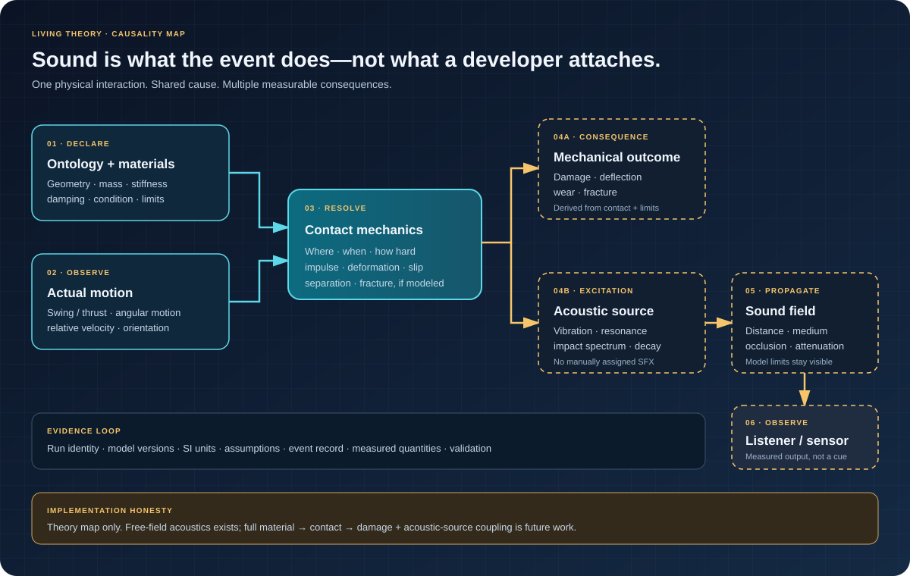

# Living Theory & Interactive Documentation

The Workshop should generate physics explanations from the same versioned definitions, experiments, and measurements that drive simulations. This is the direction, not a claim that a universal automatic theory generator already exists. The [Physics Learning Path](LEARNING_PATH.md) organizes those evidence-backed capabilities into small experiences that teach through observation before requiring formal theory.

## One source of truth

**Ontology identity → Model definition → Experiment configuration → Deterministic run → Measurements → Explanation artifact**

The explanation is a view over those records, not a second, hand-maintained physics implementation.

## What a living page can show

- **What:** the physical phenomenon and quantities involved.
- **Why:** governing relationships and assumptions.
- **How:** the actual model and numerical method.
- **Interact:** bounded changes to declared inputs.
- **Observe:** measurements, plots, and state transitions.
- **Validate:** analytical comparisons, residuals, invariants, and reference data.
- **Trace:** model/data versions, source provenance, and run identity.

## SVG as an explanatory instrument

SVG diagrams should be generated from or bound to real model values where possible. Axes, arrows, dimensions, labels, and color encodings need explicit units and accessible text. Interactivity exposes the value it changes and the state it observes.

GUI.SVG and other rendering technologies are optional consumers of physics contracts. No SVG/DOM types belong in the physics core.

## A living-image rule for every explanation

When a concept can be made clearer by watching a value change, **include the living image in the explanation itself**—not merely in a gallery or a future roadmap. Ask this for every section, example, equation, and capability page:

1. Can a reader see the important variable change (scale, time, force, energy, distance, resolution, temperature, or another declared input)?
2. Can the resulting shape, trajectory, graph, state, or comparison update in response?
3. Can the displayed value and units be read while the change happens?
4. Is the image driven by the actual model/run data where a model exists? If it is conceptual, is that clearly labelled?
5. Does the animation have a useful reduced-motion/static state and accessible title/description?

Prefer an embedded, self-contained living SVG when it explains the concept. For physical experiments, render from the same recorded C# output and make CI compare the committed image with freshly generated output. Never let an illustrative animation impersonate a solver, and never leave a known visual gap described as future work when it can be built now.

### Example: change a property, see the consequence

The [scale-factor lesson](SCALE_FACTOR_LIVING.md) shows the property and its visible consequence in the same image. This is a conceptual illustration—not a Physics solver—and demonstrates the minimum expected pattern for property-focused explanations.

## Reproducible evidence

Every generated artifact points to the run configuration and model versions used. A reader should be able to rerun a supported experiment and compare measurements. Illustrative or synthetic data must be labeled as such.

## Build in stages

1. Keep theory metadata alongside model contracts.
2. Give experiments structured inputs, outputs, measurements, and provenance.
3. Produce static Markdown/SVG summaries from real run records.
4. Add interactive controls connected to bounded experiment inputs.
5. Add version-aware comparison and replay.
6. Let the Workshop host combine those pages into the Singularity Laboratory's navigable research spaces.

## First concrete path: from a run record to a living experiment

The repository has a narrow working example: `ConstantAccelerationExperiment` records the initial one-dimensional state and every completed fixed step, while `ConstantAccelerationRunRecord` serializes inputs, SI units, model/schema versions, and actual samples. See the [experiment implementation](../Physics/Experiments/ConstantAccelerationExperiment.cs), [run-record implementation](../Physics/Experiments/ConstantAccelerationRunRecord.cs), and [theory/evidence contract](THEORY.md). This is a foundation, not a general experiment or provenance framework.

The 3D trajectory experiment connects the existing analytical solver to recorded samples. `ProjectileTrajectoryExperiment` stores declared inputs, coordinate-frame convention, initial state, and each solver state; `ProjectileTrajectoryRunRecord` preserves those samples with model/schema identity and SI units. See the [experiment and record implementation](../Physics/Experiments/ProjectileTrajectoryExperiment.cs) and [trajectory acceptance tests](../tests/TheSingularityWorkshop.Physics.Tests/ProjectileTrajectoryExperimentTests.cs).

The X/Z trajectory SVG and the marked “Declared experiment” Markdown summary are generated from recorded run data by tools outside the Physics assembly. CI executes the C# trajectory experiment, serializes its actual run record to a temporary file, then verifies that both the committed SVG and the committed Markdown summary match that actual output. CI separately checks the SVG against the checked-in, reviewable JSON fixture. The C# model therefore guards both visual and tabular evidence; neither renderer duplicates the solver, and the Markdown tool changes only its explicitly marked section. [The page](experiments/projectile-trajectory.md), [serialized fixture](experiments/projectile-trajectory.run.json), [C# record generator](../tools/ProjectileRunRecordGenerator/Program.cs), [SVG renderer](../tools/render_projectile_trajectory.py), and [Markdown renderer](../tools/render_projectile_trajectory_markdown.py) are linked. This is one narrow reproducible path, not yet a universal theory generator.

A second, deliberately educational slice uses the same pattern for [apple free fall](experiments/apple-free-fall.md). The existing constant-acceleration experiment records eleven states from a declared 4.905 m initial height, rest, and −9.81 m/s² acceleration. The [lesson generator](../tools/FreeFallRunRecordGenerator/Program.cs) validates the one-second ground-level prediction; the [SVG](experiments/apple-free-fall.svg) shows the recorded descent and height/velocity plots. CI checks that the SVG carries the model identity, equations, and every recorded state label. This gives a learner an informal entry to derivatives and graph slopes without pretending the tree art is collision geometry or that an apple anecdote proves Newtonian mechanics.

### Implemented trajectory experiment contract

- **Identity:** stable model ID, model-contract version, and run-record schema version.
- **Initial state:** position and velocity vectors, elapsed logical time, and SI units.
- **Environment:** constant acceleration vector and caller-declared coordinate-frame/sign convention.
- **Schedule:** positive finite fixed timestep and positive step count, with invalid-input and overflow behavior defined.
- **Samples:** initial state plus each completed logical step, in stable order.
- **Validation:** analytical comparison, repeatability, invalid-input checks, and serialization tests.
- **Limitations:** a point-projectile kinematics experiment, not aerodynamic flight, launch accuracy, target intersection, or impact physics.

Do not invent external measurement provenance for a purely analytical demonstration. If a later experiment uses measured gravity, wind, launch speed, or other external data, record the source and uncertainty separately from computed output.

## Sound is an observation of physical events, not an SFX assignment

The target is a physics-based sound system, not a library of authored effects that developers must attach to every item. An object contributes its ontology and physical/material properties; a simulation derives an interaction; an acoustic model turns the event's physical excitation into sound. Presentation consumes that result but does not invent the cause.

Consider a player forging a sword. The player defines the sword's identity and material characteristics, not a list of sounds. When it is swung into a hard metal surface, another blade, armor, cloth, or a compliant target, the simulation should use the actual motion and contact to determine the mechanical result. Relative velocity, contact location, impulse, deformation, damping, and fracture—where the relevant models exist—provide causal inputs to both damage and acoustic excitation. A thrust and a glancing parry should not become equivalent just because both are categorized as a “sword hit.”

This is a coupling contract, not a claim that the complete system already exists:

1. **Describe the thing:** ontology and material data define the physical properties the model actually uses.
2. **Resolve the event:** motion and contact mechanics determine whether and how contact occurs.
3. **Derive consequences:** the same event drives damage/deflection/wear and an acoustic source model.
4. **Propagate and observe:** vibration, resonance, damping, and the current propagation model determine what an observer hears.
5. **Record evidence:** keep the event state, model versions, assumptions, and acoustic observations reproducible.

Material labels alone are insufficient: steel alloys, heat treatments, geometry, and damage state can differ. Likewise, damage must follow the modeled swing/thrust and contact mechanics, not a hand-authored damage number tied to a sound cue.

Physics currently includes a bounded analytical free-field acoustics primitive. The material-driven source model and its coupling to contact, fracture, damage, and richer propagation are future work. Build this as an incremental chain of testable physical models; do not hide the missing links behind a convincing sound effect.

## Next steps

1. Add bounded input controls that rerun an experiment or clearly identify the exact run being displayed.
2. Extend the provenance contract before mixing measured data, model versions, and derived observations.
3. Generalize the evidence pipeline only after another physical model demonstrates the same end-to-end contract.

---

## Resources & Support

[Physics home](../README.md) · [FSM_API](https://github.com/TrentBest/FSM_API) · [Workshop ontology](https://github.com/TrentBest/TheSingularityWorkshop.Ontology) · [MicroBundleDomain](https://github.com/TrentBest/TheSingularityWorkshop.MicroBundleDomain) · [Issues](https://github.com/TrentBest/TheSingularityWorkshop.Physics/issues)

  

<em>Build understanding. Make reality inspectable.</em> <strong>The Singularity Workshop</strong>

