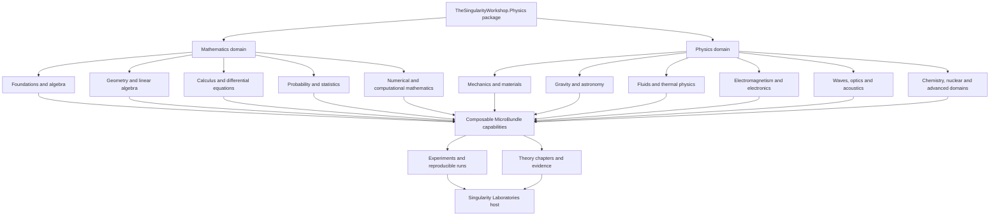

# Physics and Mathematics: MicroBundle Architecture

**Status:** foundational architecture and execution program. The taxonomy describes intended coverage; it does not claim that every capability is implemented.

**Owning package:** TheSingularityWorkshop.Physics  
**Top-level knowledge domains:** Mathematics and Physics  
**Program tracking:** [Issue #56](https://github.com/TrentBest/TheSingularityWorkshop.Physics/issues/56)

## The central decision

Mathematics and Physics are two peer knowledge domains inside the Physics package. Mathematics provides the formal and computational foundations; Physics uses those foundations to model natural phenomena. Both live in one owning package, while their capabilities remain independently addressable and composable as MicroBundles.

The package is not one giant solver. Nor does every source class need its own bundle. A MicroBundle represents a meaningful, independently consumable capability boundary.

The scientific core remains host-neutral. MicroBundle adapters expose actual typed behavior to composition hosts. Theory, implementation, validation, and learning resources remain connected through stable identities and provenance.

## Architecture at a glance

The diagram is a conceptual architecture, not a claim that all boxes are implemented.

## Domain taxonomy

### Mathematics

| Subdomain | Intended coverage |
|---|---|
| Foundations | Logic, proof, sets, relations, functions, notation, types, dimensional reasoning |
| Arithmetic and algebra | Exact and floating arithmetic, expressions, equations, inequalities, polynomials, roots, systems, symbolic methods |
| Number theory and discrete mathematics | Divisibility, modular arithmetic, combinatorics, graphs, recurrence, automata, finite structures |
| Geometry and topology | Euclidean, analytic, projective and differential geometry; coordinate systems, topology, manifolds, spatial predicates |
| Linear algebra | Vectors, matrices, tensors, bases, transforms, decompositions, conditioning, sparse and batch operations |
| Calculus | Limits, derivatives, integrals, multivariable and vector calculus, differential forms |
| Differential equations | ODEs, PDEs, difference equations, initial/boundary value problems, stiffness and stability |
| Probability | Probability spaces, distributions, random variables, sampling, stochastic processes |
| Statistics and inference | Descriptive statistics, estimation, regression, uncertainty, hypothesis tests, Bayesian methods |
| Numerical analysis | Floating-point behavior, error analysis, roots, interpolation, quadrature, numerical linear algebra, ODE/PDE methods |
| Optimization | Constrained, unconstrained, convex, nonconvex, discrete, multiobjective optimization and scheduling |
| Information and signal mathematics | Fourier and wavelet methods, transforms, filtering, information theory, coding |
| Computational mathematics | Deterministic algorithms, complexity, reproducibility, parallel/GPU contracts, approximation and lookup tables |

### Physics

| Subdomain | Intended coverage |
|---|---|
| Foundations | Quantities, units, dimensions, frames, time, measurement, uncertainty, conservation, boundary and initial conditions |
| Classical mechanics | Kinematics, dynamics, statics, rigid bodies, contact, friction, impacts, constraints, mechanisms, oscillators |
| Continuum mechanics and materials | Stress, strain, elasticity, plasticity, viscoelasticity, fracture, granular matter, rheology |
| Gravity and celestial mechanics | Fields, potentials, orbits, N-body dynamics, tides, planetary and stellar systems |
| Fluids | Hydrostatics, hydrodynamics, free surfaces, turbulence models, multiphase flow, transport, aerodynamics |
| Thermodynamics and statistical physics | State, heat, work, entropy, equilibrium, non-equilibrium, phase transitions |
| Heat and mass transfer | Conduction, convection, radiation, diffusion, advection, coupled transport |
| Electromagnetism and electronics | Electrostatics, circuits, magnetism, induction, fields, semiconductor devices, signal and power electronics |
| Waves, optics and acoustics | Oscillation, propagation, sound, resonance, geometric and physical optics, photonics |
| Atomic, nuclear and particle physics | Atomic structure, nuclear processes, radiation, particle interactions, detector models |
| Quantum physics | Quantum states, operators, measurement, dynamics, approximation regimes |
| Relativity and spacetime | Special and general relativity, metrics, geodesics, relativistic fields |
| Plasma physics | Charged media, collective behavior, magnetohydrodynamics, ionization |
| Geophysics and planetary science | Geological media, tectonics, seismology, planetary interiors and atmospheres |
| Chemistry and reactions | Elements, compounds, species, reaction kinetics, thermochemistry, electrochemistry, combustion |
| Biophysics and environmental physics | Transport, energy, mechanics, radiation, environmental systems |
| Cosmology and astrophysics | Stellar structure, radiation, compact objects, large-scale evolution |

Chemistry and electronics have recognizable laboratory identities and ontology placement. Their models may compose with thermodynamics, materials, electromagnetism, fluids, and other Physics capabilities; they should not be flattened into generic labels.

## MicroBundle boundaries and contracts

A bundle should represent a coherent capability, not merely a namespace or a class. For example, a contact detector and a normal-impulse resolver are distinct capabilities because their inputs, outputs, assumptions, and validation differ. A coupled experiment can compose them without merging their identities.

Each bundle's declarative metadata and typed provider contract should identify:

- Stable semantic bundle ID, title, domain/subdomain, version, and compatibility.
- Capability identity and provider identity. A declared provider is not automatically a globally registered or loadable provider.
- Required and provided contracts, dependencies, optional capabilities, and composition constraints.
- Quantities, dimensions, units, frames, time semantics, state schemas, boundaries, and supported ranges.
- Model identity/version, governing equations or algorithms, assumptions, approximations, and excluded phenomena.
- Inputs, outputs, observations, events, diagnostics, uncertainty, and failure semantics.
- Determinism/replay guarantees, numerical method, timestep/stability constraints, and resource/work bounds.
- Validation evidence, analytical benchmarks, conservation/residual thresholds, convergence evidence, and known gaps.
- Theory chapter, derivation, diagrams, worked examples, exercises, references, licenses, and provenance.
- Experiment templates that compose capabilities without embedding scientific implementation in the presentation layer.

Keep scientific model source independent of MicroBundleDomain, FSM_COS, UI, browser, Renderer, Visualization, Pages, and ServerApp. The adapter assembly may reference the MicroBundle host contract and the Physics core. Renderer and Visualization remain MicroBundle-consumed capabilities, not NuGet dependencies of Physics.

## The textbook is part of the product

The documentation corpus should be adoptable as a textbook by professors, not merely useful to developers. Each capability should have a stable theory chapter or an explicit theory gap.

### Chapter contract

1. Learning objectives and prerequisites.
2. The mathematical or physical question.
3. Definitions, notation, dimensions, units, and conventions.
4. Governing principles and derivations, with assumptions made explicit.
5. Model hierarchy: ideal/exact, analytical approximation, numerical approximation, empirical model.
6. Worked examples with units and intermediate steps.
7. Implementation map to MicroBundle contracts and source.
8. Experiments, controls, observations, graphs, and reproducible run records.
9. Validation: analytical cases, invariants, residuals, convergence, determinism, uncertainty.
10. Limits, failure modes, out-of-domain warnings, and what is not modeled.
11. References with author, title, edition, section/page, URL/DOI, license and access details.
12. Exercises, instructor notes, and laboratory extensions.

The textbook index should navigate domain → subdomain → capability → chapter → experiment. Stable chapter IDs, citation-ready references, prerequisites, learning outcomes, instructor notes, and accessible/printable outputs make adoption practical.

Write original explanations and diagrams. Preserve provenance and licensing for external sources. Do not reproduce copyrighted textbook passages or figures without permission.

### Evidence vocabulary

Every chapter and experiment must distinguish:
- Definition or convention.
- Established law or relationship and its conditions.
- Measured datum and its source/uncertainty.
- Derived analytical result.
- Numerical simulation output and its method.
- Assumption or idealization.
- Hypothesis under investigation.
- Interpretation beyond direct observation.

A beautiful animation is not validation. A generated SVG must be traceable to a model/run or labeled conceptual.

## Singularity Laboratories

Singularity Laboratories is a future host experience over this same ontology and MicroBundle catalog, not a second physics engine.

A laboratory composes:
- Ontology location and learning objectives.
- Experiment definition and permitted parameter controls.
- Exact bundle versions and typed providers.
- Model assumptions and boundary conditions.
- Run lifecycle and deterministic execution contract.
- Synchronized animation, graphs, measurements, and evidence inspector.
- Theory chapter, validation evidence, and references.
- Run provenance and replayable record.

The visitor journey is:

**Campus → Department → Laboratory → Experiment → Run → Observation/Evidence → Theory**

The complex can grow into mechanics, materials, fluids, thermal, chemistry, electronics, acoustics, optics, astronomy, geology, and mathematical methods laboratories. A visitor should be able to move from a physical question to the governing theory, run the experiment, inspect measurements, and trace every conclusion back to its model and evidence.

The same experiment definition should work in local Pages, desktop, and eventually Singularity City. Host-specific identity, collaboration, persistence, or shared computation belong in adapters and ServerApp when justified—not in the Physics core.

## Execution sequence

### Phase 0 — Inventory and truth
Inventory source projects/namespaces, tests, manifests, experiments, chapters, generated artifacts, and dependencies. Map existing work to the taxonomy. Identify duplicate concepts, orphan source, missing tests, unowned concepts, and theory/evidence gaps. Produce a status matrix; documentation titles are not proof of implementation.

### Phase 1 — Shared contracts
Set identity conventions, manifest schema, compatibility policy, typed provider and composition contracts, and common quantity/unit/frame/time/state/observation/provenance envelopes. Preserve domain-specific semantics rather than forcing all domains into one generic state.

### Phase 2 — Mathematical foundations
Prioritize shared numerical primitives by downstream use. Expand geometry, linear algebra, calculus, probability/statistics, numerical analysis, optimization, and differential-equation support. Each primitive requires analytical/reference tests, invalid-input behavior, numerical edge cases, complexity/work bounds, and theory.

### Phase 3 — Physical foundations
Strengthen mechanics, gravity, materials, fluids, thermal, electromagnetism/electronics, waves/acoustics, chemistry/reactions, and astronomy. Build coupled phenomena only after each participating contract is explicit and independently validated. Prefer end-to-end vertical slices over disconnected class catalogs.

### Phase 4 — Textbook and laboratory generation
Establish chapter metadata, theory templates, citation/provenance conventions, lesson manifests, and generated-artifact checks. Connect implemented capabilities to reproducible experiments where pedagogically useful. Build the ontology-driven lab index and synchronized evidence experiences.

### Phase 5 — Scale and adoption
Add GPU/parallel backends behind backend-neutral contracts and CPU reference validation. Expand advanced domains as numerical methods and evidence mature. Provide instructor pathways, course modules, printable material, and stable references. Integrate with Singularity City only through host adapters.

## Completion gates

- Every shipped bundle has stable identity, version, typed behavior, explicit contract, and tests.
- Every model states supported range, units, frame/time semantics, assumptions, and exclusions.
- Every numerical method states error/stability/resource limits and has appropriate validation.
- Every generated observation/diagram is traceable to model/run provenance or labeled conceptual.
- Every chapter distinguishes established theory, implementation, simulation output, assumption, and hypothesis.
- Cross-domain composition validates unit, state, frame, timestep, and coupling compatibility.
- No experiment UI invents results independently of Physics source.
- No capability is marked complete solely because a document or manifest exists.
- No master promotion, publication, deployment, or branch deletion occurs without explicit authorization.

## Current repository foundations

This program extends existing work: [Physics classes and ontology](PHYSICS_CLASSES.md), [Mathematics domain map](MATHEMATICS_DOMAIN_MAP.md), [Physics domain map](PHYSICS_DOMAIN_MAP.md), [capability catalog](PHYSICS_CAPABILITY_CATALOG.md), [theory and evidence](THEORY.md), [living theory](LIVING_THEORY.md), [numerical validation](NUMERICAL_VALIDATION.md), [run-record contract](PHYSICS_RUN_RECORD_CONTRACT.md), and [roadmap](ROADMAP.md).

The first delivery is a complete inventory and gap register against this architecture, followed by incremental validated MicroBundles and professor-ready theory chapters.

---

[Track the architecture and implementation program in issue #56](https://github.com/TrentBest/TheSingularityWorkshop.Physics/issues/56).
