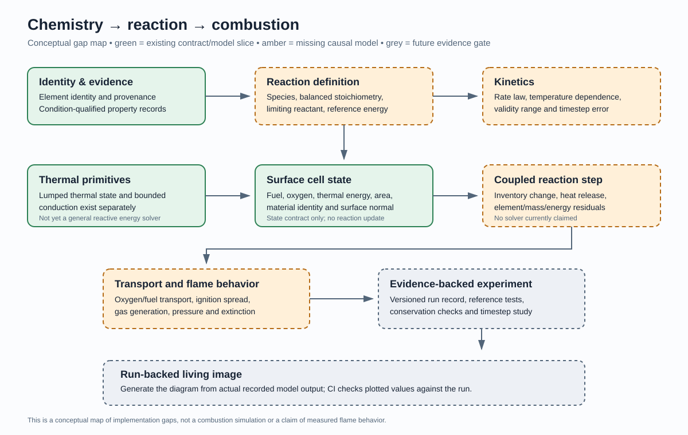

# Physics and Mathematics Branch Atlas

**Purpose:** map the known domain of the Physics package into distinct branches, distinguish executable capability from architecture, and choose the next branch by evidence-backed maturity rather than visual appeal.

**Status:** repository inventory and planning guide, not a claim of complete coverage of all known physics. The scope is deliberately bounded to the current package and its documented roadmap. Each branch can be expanded as knowledge, models, and evidence are added.

## How to read this atlas

- **Implemented slice** means code exists for a named, bounded behavior and has focused tests.
- **State/data contract** means a data shape or validation contract exists, but does not itself calculate a physical outcome.
- **Reference model** means a deliberately limited model useful for comparison or learning.
- **Design / gap** means the concept is mapped but not yet supported by a complete executable model.
- **Living image** means a visualization whose displayed physical values are derived from actual model output. A conceptual diagram is labeled as such and must not be mistaken for simulation evidence.

This is an inventory, not a maturity score. A larger number of files does not imply broader or more reliable physical coverage.

## Branch inventory

| Physics / mathematics branch | Current evidence in this repository | Important unproven or missing territory |
|---|---|---|
| Spatial geometry and frames | 2D vectors, robust orientation and segment predicates, polygon validation/area/triangulation/point location, frame-aware 2D transforms, 3D vector/quaternion/pose types | Transform graphs, unit conversion, broader 3D geometry, mesh quality, uncertainty-aware tolerances |
| Kinematics | Constant-acceleration solver, projectile state and trajectory experiments, recorded samples | General force-driven motion, drag-coupled trajectories, broader analytic/numerical comparison |
| Dynamics and rigid bodies | Bounded free rigid-body integrator and state contracts | General constraint solving, friction, angular impulse/contact coupling, articulated multibody systems |
| Collision and impact | AABB broadphase, sphere contact, single frictionless normal impulse, position correction, impact diagnostics | Robust multi-contact response, friction, persistent contact, damage/topology consequences |
| Mechanics and compliant links | Axial and spatial spring-damper models; threshold monitoring for link force | Validated structural failure and load transfer through articulated assemblies |
| Astronomy and gravity | Newtonian field, fixed-step N-body stepper, encounter coordination, swept collision, merge handling, simplified tidal potential table | Broader independent reference tests, robust close-encounter integration, physically coupled tides and planetary evolution |
| Thermodynamics and heat transfer | Lumped thermal state, bounded thermal conduction, electrical-to-thermal coupling experiment | Phase change, temperature-dependent properties, convection, radiation, spatial heat equation, larger conservation-audited worlds |
| Hydrodynamics and waves | 1D linear wave model, 2D shallow-water basins, bathymetry and rainfall fields | General 3D flow, turbulence, solid-fluid coupling, boats and structures, broader mass/energy validation |
| Acoustics | Free-field source/listener observation and first-order room-reflection path metadata | Waveform synthesis, frequency-dependent materials, diffraction, absorption, phase-aware reflection summation, validated room response |
| Electricity | Ideal DC resistive-load/capacity model and an electrical/thermal coupling experiment | Transients, source dynamics, switching, field effects, broader circuit and electromagnetic coupling |
| Geology and terrain | Prescribed-volume volcanic terrain/deposition model | Erosion, transport, stratigraphy, tectonic evolution, calibrated material and fluid interactions |
| Materials and physical assemblies | Material identity arbitration, property definitions/ranges, assembly mapping, source-attributed property records | Populated verified property warehouse, condition matching, constitutive laws, fracture, deformation, melting and shattering |
| Chemistry, reactions and combustion | Element identity/provenance and condition-qualified property records; validated surface-cell state contract; deterministic bounded CPU step for reactant-limited fuel/oxygen consumption, declared heat release, and blocked-edge graph oxygen exchange (focused tests added; test run pending) | Balanced reaction profiles and product ledger, reference-grounded kinetics, ambient oxygen boundaries, inter-cell heat transfer, source-driven ignition/propagation, gas generation, and validation against trusted references |
| Deterministic mathematics and statistics | Lookup-table interpolation, 3×3 matrix operations, online mean/variance, deterministic Squirrel3 stream/keyed sampler, Galilean frame transform, vector batch reference operations | General ODE solvers, root finding, convergence/error tooling, probability distributions, covariance/regression/inference, signal processing and optimization |
| Universe, logical time and history | Deterministic cell generation, universe grid, logical-time ledger, checkpoints and timeline replay/branch records | Full scheduler integration, persistent large-world execution, coupled-domain replay and quantified cost/error across scales |
| Numerical evidence and living documentation | Versioned experiment records, C# generators, SVG renderers and CI consistency checks for selected experiments | A common provenance/uncertainty/residual contract across domains; more independent reference comparisons and measured datasets |

See [Physics Domain Map](PHYSICS_DOMAIN_MAP.md), [Mathematics Domain Map](MATHEMATICS_DOMAIN_MAP.md), [Capability Catalog](PHYSICS_CAPABILITY_CATALOG.md), [Gap Register](PHYSICS_GAP_REGISTER.md), and [Living Image Standard](LIVING_IMAGE_STANDARD.md) for the detailed source/test links and limitations.

## Selection: make chemistry and combustion the next deeply defined branch

The least mature area is not necessarily the area with the fewest source files. For this first pass, chemistry/reactions/combustion is selected because the current code has useful identity, property-evidence, and cell-state contracts but lacks the causal solver that turns them into a validated outcome.

The SurfaceCombustionCellState type remains a state contract, not a solver. A first bounded CPU stepper now consumes declared reaction parameters, exchanges oxygen only over explicit unblocked graph edges, limits reaction by available fuel and oxygen, and records heat release. This is not yet a validated combustion model: the rate law is a threshold/max-rate approximation, oxygen exchange assumes equal control volumes rather than modeling airflow, and inter-cell heat transfer, ambient boundaries, product chemistry, and source-driven ignition remain unimplemented.

### Domain tree: known territory to be mapped

1. **Chemical identity and composition**
   - Elements, isotopes, species, molecular composition, charge and phase.
   - Source identity, dataset version, licensing, uncertainty and validity conditions.
   - Current boundary: element identity and property-evidence records are present; a complete species/isotope warehouse is not claimed.
2. **Reaction definition and stoichiometry**
   - Reactants/products, balanced elemental counts, limiting reactant, conversion extent and mass balance.
   - Reaction energy, reference state, units and sign convention.
   - Current boundary: no general balanced-reaction or reaction-network solver is claimed.
3. **Kinetics**
   - Rate law, rate coefficients, reaction order, activation energy, temperature and concentration dependence.
   - Validity ranges, stiffness, integration method and convergence checks.
   - Current boundary: no general reaction-rate or chemical-kinetics solver is claimed.
4. **Thermochemical coupling**
   - Sensible and reaction energy, heat capacity, enthalpy, temperature update and energy residual.
   - Explicit material properties and reference states; no double-counting reaction heat.
   - Current boundary: bounded thermal models exist elsewhere, but are not yet a general reactive-chemistry engine.
5. **Surface combustion**
   - Fuel and oxidizer inventories, exposed area, ignition criterion, reaction rate, heat release, residual mass and boundary exchange.
   - Cell-to-cell heat/oxygen transport and deterministic update ordering.
   - Current boundary: a validated cell-state contract exists; no executable surface reaction model is claimed.
6. **Gas and flame behavior**
   - Product gases, gas expansion, pressure, buoyancy, advection, radiation, flame spread and extinction.
   - Current boundary: these are planned, coupled phenomena, not features implied by the cell contract.
7. **Evidence and visualization**
   - Analytical limiting cases, mass/element/energy residuals, sensitivity to timestep, trusted reference data and explicit uncertainty.
   - Run records feed plots, SVGs and eventually interactive WebPage experiences.
   - A visual must never imply flame propagation or reaction chemistry that the model does not calculate.

### Recommended build order

1. Define a minimal reaction record with balanced reactants/products, units, reference state, source/provenance and a validity range.
2. Test stoichiometric balance and limiting-reactant calculations independently of any visual renderer.
3. Add one intentionally bounded reaction extent / inventory update with explicit conservation residuals.
4. Couple released energy to the existing thermal state only after the energy reference and sign convention are explicit.
5. Build one run-record generator and derive both the plot and the SVG from its actual samples.
6. Add a refinement/reference test and record where the model stops being valid.
7. Only then introduce ignition, spatial propagation, gas expansion or fire-world effects as separate tested capabilities.

Do not invent material constants or reaction rates to make a compelling picture. Start with declared user-supplied parameters or sourced data and label illustrative scenarios honestly.

## Living-image acceptance gate

A model-backed diagram for this branch is complete only when:
- source and tests define the behavior and its assumptions;
- run inputs and outputs are serializable with units and model identity;
- the SVG is rendered from that run record, not from a second implementation of the physics;
- CI checks the generated record and displayed values against the committed artifact;
- mass/element/energy residuals and model limitations are visible;
- the page links to source, tests, run record, and renderer.

The accompanying chemistry-to-combustion branch diagram is intentionally a **conceptual gap map**, not simulation output. It shows which causal links a future living experiment must implement before it can honestly visualize a burning surface.
