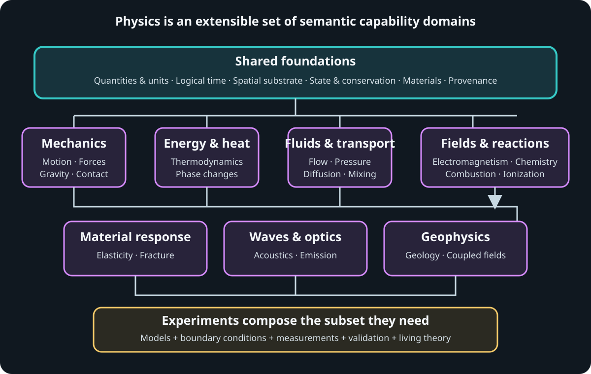
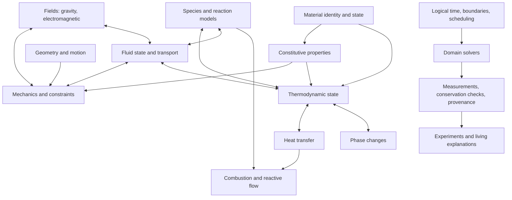

# Physics Domain Map

**Purpose:** establish the broad physical territory before implementation narrows into individual solvers. This is an architecture map and build order, not a claim that these capabilities already exist.

A domain becomes implemented only when it has an explicit state model, units and conventions, governing assumptions, validated numerical behavior, tests, and observable outputs. A name on this page is a planned domain unless its implementation is linked and tested. The broader mathematical foundation is tracked in the [Mathematics Domain Map](MATHEMATICS_DOMAIN_MAP.md); the data-layout and numerical contracts for future acceleration are in [GPU Computation Readiness](GPU_COMPUTATION_READINESS.md).

Material composition and discovery now have an initial implementation slice: explicit assembly/part declarations, per-part material identity arbitration, provenance-aware property records, and a mapper from resolved part identities to matching property evidence. The next layer is cross-provider discovery and compatibility matching from those properties to models and solvers; it is not yet implemented. See [Composable Physics: composition-level material discovery](COMPOSABLE_PHYSICS_MODELS_SOLVERS_EXPERIENCES.md#composition-level-material-discovery-and-physics-mapping) for the staged contract.

The expanded contract for brittle fracture, shattering, melting, illumination, gas expansion, dam-break/coastal flow, orbital forcing, precomputed tidal fields, and non-Earth world time is in [Physical failure, lighting, hydrodynamics, orbital fields, and world time](PHYSICAL_FAILURE_LIGHTING_HYDRODYNAMICS_AND_ORBITAL_FIELDS.md). These are planned domains unless individually linked to tested implementations.

Marble Run and Domino Studio are planned **experiences consuming Physics**, not Physics MicroBundles. Their geometry editing, image interpretation, layout conversion, and presentation stay in the experience layer; shared body state, contact mechanics, deterministic stepping, and physical observations stay in Physics. See [Marble Run and Domino Studio](MARBLE_RUN_AND_DOMINO_STUDIO.md) for staged acceptance gates. This is a design contract, not a claim that a general rigid-body or high-count marble solver is complete.

## The physical picture

A world contains matter and fields. They carry state and energy; models describe how that state changes; solvers advance it through declared logical time; observations report what happened. Coupled domains exchange quantities through explicit interfaces rather than secretly reaching into each other's internals.

The diagram shows conceptual coupling, not a solver dependency graph or a statement that every coupling is implemented. A domain may be independently useful before all its neighbors exist.

## Shared primitives every domain needs

These are the cross-cutting foundations to establish once, then reuse:

1. **Quantities and units.** SI by default; quantity meaning is explicit. Temperature uses kelvin for calculations, with display conversions at boundaries. Distinguish mass, force, energy, power, pressure, impulse, heat transfer, and material-specific properties.
2. **State and identity.** Immutable or transactionally committed snapshots; stable identities; explicit spatial frame, logical step, elapsed time, and model/schema version where applicable.
3. **Material data.** Separate material identity from measured properties and from the constitutive model that interprets them. Track source, version, license, valid ranges, uncertainty, and temperature/pressure dependence when known.
4. **Boundary and initial conditions.** Every experiment declares its environment, boundaries, initial state, constraints, and assumptions. Missing physics must not be silently fabricated.
5. **Model versus solver.** A governing law or constitutive relation is not a numerical integrator. Keep the physical model, discretization, stepping strategy, and convergence/error checks distinguishable.
6. **Conservation and accounting.** Track relevant mass, momentum, and energy entering, leaving, being stored, or transformed. Report residuals; do not promise exact conservation where a chosen numerical method only approximates it.
7. **Determinism and scheduling.** Explicit logical time, stable ordering, bounded work, and reproducible inputs. Coupled domains declare their exchange cadence and how delayed work is handled.
8. **Observation and evidence.** Publish measured state and derived values with units, model identity, and limitations. Rendering and controllers consume observations; they do not become the source of physical truth.

## Domain atlas

### A. Mechanics and motion
- **Covers:** kinematics, forces, rigid bodies, constraints, contacts, deformation, fracture, and multibody systems.
- **Key exchanges:** momentum and energy; contact forces; constraint reactions; deformation and failure state.
- **First usable slice:** analytical motion followed by bounded rigid-body and constraint scenarios.
- **Current status:** bounded constant-acceleration kinematics, spatial value/state types, AABB sweep-and-prune candidate screening, sphere-sphere contact observations, single-contact frictionless normal-impulse response, positional correction, and axial spring-damper/failure primitives are implemented and tested on `development`. These are composable narrow slices, not a general rigid-body, frictional, multi-contact, or articulated solver.

### B. Thermodynamics and energy
- **Covers:** internal energy, temperature, heat capacity, equations of state where supported, thermal equilibrium, phase change, and energy accounting.
- **Key exchanges:** heat and work; temperature-dependent material properties; latent heat; reaction energy.
- **First usable slice:** validated material thermal properties plus a closed, lumped thermal body whose energy/temperature relation is explicit. Then heating/cooling and phase-change cases.
- **Guardrail:** temperature is not energy; heat is energy transfer, not a stored substance. Do not assume constant heat capacity or a single phase outside the model's declared range.
- **Current status:** a bounded lumped thermal-state primitive is implemented on `development` ([first thermodynamics primitive](THERMODYNAMICS_FIRST_PRIMITIVE.md)). It calculates sensible energy relative to a declared reference temperature and applies net energy transfers under constant specific heat; heat transfer, phase change, spatial gradients, and reaction energy remain unimplemented.

### C. Heat transfer
- **Covers:** conduction, convection, and radiation as distinct mechanisms with explicit assumptions.
- **Key exchanges:** thermal boundary fluxes and energy balance with solids, fluids, and reacting material.
- **First usable slice:** a one-dimensional conduction case with specified boundary conditions and a conservation/residual check, then bounded convection/radiation models.
- **Guardrail:** do not combine all transfer mechanisms into one unexplained temperature adjustment.

### D. Hydrodynamics and fluid mechanics
- **Covers:** fluid state, density, pressure, velocity, flow, viscosity, compressibility where supported, buoyancy, and fluid/solid interaction.
- **Key exchanges:** mass and momentum flux; pressure and shear forces; advection of thermal energy and species.
- **First usable slice:** a documented low-complexity incompressible flow case with explicit geometry, boundary conditions, stability limits, and convergence checks. Add buoyancy and fluid-solid coupling only as separate validated increments.
- **Guardrail:** distinguish a fluid parcel's state from a spatial fluid field. State whether a model is incompressible, compressible, inviscid, viscous, laminar, or turbulent; do not imply general fluid simulation from one special case.
- **Current status:** `LinearWaveBasin1D`, flat-bed `ShallowWaterBasin2D`, and terrain-aware `BathymetricShallowWaterBasin2D` are implemented on `development`, including bounded wet-dry shoreline behavior. These are explicit numerical references, not general 3D Navier–Stokes, turbulent flow, breaking-wave, boat-coupling, or full rainfall/runoff solvers.

### E. Materials and continuum response
- **Covers:** elements, compounds, mixtures, alloys, density, thermal properties, elasticity, plasticity, damage, fracture, and phase-dependent behavior.
- **Key exchanges:** stress/strain, thermal expansion, phase changes, reaction species, and failure thresholds.
- **First usable slice:** provenance-aware property records with units/ranges; then one bounded constitutive response with tests.
- **Guardrail:** a material label alone does not determine every property. Properties can depend on temperature, pressure, composition, direction, and phase.

### F. Species, chemistry, and combustion
- **Covers:** species identity, stoichiometry, reaction rates, reactant/product accounting, ignition, flame/combustion approximations, and extinction.
- **Key exchanges:** species and mass fractions, reaction enthalpy/energy, temperature, pressure, and fluid transport.
- **First usable slice:** a closed reaction ledger with balanced stoichiometry and explicit heat release; only then couple it to heat transfer and gas transport.
- **Guardrail:** combustion is not a visual effect and ignition is not merely a temperature threshold. Rates and limits must come from a declared model and supported data.
- **Current status:** planned; no chemical reaction or combustion model is implemented on `development`.

### G. Fields and long-range interaction
- **Covers:** gravity, electromagnetic fields, and later supported field-matter coupling.
- **Key exchanges:** forces, field energy, charge/current, and energy transfer.
- **First usable slice:** declare a field representation and a simple analytically checkable interaction before adding field solvers.
- **Guardrail:** keep field equations, source terms, boundary conditions, and approximations explicit.

### H. Waves, acoustics, and optics
- **Covers:** propagation, oscillation, sound, reflection/refraction, and later more advanced wave phenomena.
- **Key exchanges:** energy/momentum transport, material response, and field coupling.
- **First usable slice:** a one-dimensional wave model with known propagation speed and measurable reflection/boundary behavior.
- **Guardrail:** visually moving patterns are not evidence of physically correct propagation.
- **Current status:** `LinearWaveBasin1D` provides a bounded 1D linear-wave reference; `FreeFieldAcoustics` provides analytical propagation delay, listener direction, and idealized free-field SPL estimates. Neither is a general wave/acoustic solver; reflections, occlusion, moving-source Doppler, frequency spectra, and binaural reception remain future work.

### I. Statistical, quantum, and nuclear extensions
- **Covers:** microscopic statistical models and other regimes that cannot be honestly reduced to classical continuum rules.
- **First usable slice:** define the intended scale, observable, and approximation before choosing a model.
- **Guardrail:** keep these as explicit future regimes; do not present classical models as universally valid.

### J. Geology, tectonics, and geomorphology
- **Covers:** terrain elevation, volcanic deposition, tectonic uplift/subsidence, crustal deformation, weathering, erosion, sediment transport, and long-term landscape evolution.
- **Key exchanges:** mass/volume transfer, heat, stress/strain, fluid forces, material properties, and time scale.
- **First usable slice:** a volume-accounted terrain height field changed by a prescribed volcanic deposition event; then explicit bed-elevation coupling to water and erosion/sediment accounting.
- **Guardrail:** generated elevation is physical state; labels such as “cliff,” “ridge,” or “volcanic cone” are expert-domain interpretations of measured geometry and material evidence. Do not confuse a procedural shape kernel with a full tectonic or eruption model.
- **Current status:** `VolcanicTerrain2D` is implemented on `development` as a prescribed-volume, deterministic deposition model. Tectonic motion, magma dynamics, cooling, and erosion remain future work.

### K. Stellar physics and planetary energy
- **Covers:** stellar energy generation and structure at declared levels of fidelity; luminosity and spectral output; radiation through space; planetary absorption, reflection, thermal storage, and later atmosphere/ocean coupling.
- **Key exchanges:** luminosity and spectrum; irradiance at distance; absorbed/emitted power; thermal energy; orbital and surface geometry.
- **First usable slice:** a source model with explicit luminosity and a tested inverse-square radiation law, coupled to an energy-accounted planetary thermal budget.
- **Deeper model:** a spherically symmetric stellar-structure solver using mass continuity, hydrostatic equilibrium, energy generation, an equation of state, opacity, and radiative/convective transport assumptions; later compare with trusted stellar reference models.
- **Guardrail:** do not simulate microscopic fusion events when an effective model preserves the required observables. Distinguish luminosity, irradiance, and received energy; a radiation source alone is not a stellar interior or a climate model.
- **Current status:** planned; see [Stellar physics and planetary energy roadmap](STELLAR_PHYSICS_AND_PLANETARY_ENERGY.md). No stellar solver or planetary irradiation coupling is claimed implemented.

### L. Persistent worlds, scale, and history
- **Covers:** deterministic spatial addressing, multirate simulation, coarse/fine representations, persistence, checkpointing, replay, and isolated timeline branches.
- **Key exchanges:** conservative state handoffs, elapsed logical time, provenance, and authoritative state.
- **Current status:** deterministic grid, logical-time ledger, and timeline/replay contracts exist; durable world persistence, conservative multiscale handoffs, and complete world reconstruction remain future work.

## Recommended build order: broad strokes, then depth

1. **Map and name the territory** — this document plus the roadmap; expose dependencies and gaps without marking them implemented.
2. **Finish shared state conventions** — quantities, stable identity, logical time, model provenance, boundaries, observations, and conservation diagnostics.
3. **Establish a minimum viable vertical slice per major domain** — mechanics, thermal state/energy, fluid state/flow, material response, species/reaction accounting, and fields/waves. Each slice must run and test independently.
4. **Couple the slices through explicit exchanges** — first heat ↔ material, then fluid ↔ heat/material, then reaction ↔ heat/species/flow.
5. **Use fire as an integration experiment** — a deliberately bounded ignition/combustion scenario that accounts for fuel consumption, released energy, heat transfer, gas/species transport, and material change. State exactly what is modeled and omitted.
6. **Backfill numerical depth** — stronger solvers, stability/convergence studies, property databases, uncertainty, additional regimes, and validated models for effects not required by the first scenario.
7. **Complete the domain** — cover the wider capability space without making the initial demo a prerequisite for unrelated physics.

The fire experiment is a demanding integration test, not the definition of Physics. A capability that is not needed for it can still belong in the domain atlas and be implemented later.

## Definition of done for a physical capability

- Governing assumptions and supported regime are stated.
- State variables and units are explicit and validated.
- Initial/boundary conditions and time-stepping behavior are declared.
- Numerical limits, stability/convergence, and error behavior are tested where applicable.
- Relevant conservation balances or residuals are observable.
- Determinism/replay expectations are tested.
- Material/model provenance and version are recorded where data or empirical laws are used.
- Scope and omitted effects are documented; unsupported behavior fails clearly rather than silently inventing an answer.

## Current truth

This map is a plan, not a claim of completion. On `development`, bounded executable slices include constant-acceleration mechanics, spatial state and contact primitives, lumped thermal state, 1D linear waves, 2D shallow-water flow over flat and fixed terrain beds with wet-dry shorelines, volume-accounted volcanic deposition, and free-field acoustic observations. Each has deliberately limited scope; broad coupled solvers, heat transfer, material constitutive response, chemistry/combustion, erosion, stellar physics, and complete articulated mechanics remain future work.

---
[Physics roadmap](ROADMAP.md) · [Physics classes & ontology](PHYSICS_CLASSES.md) · [Theory and evidence](THEORY.md)

## MicroBundle packaging boundary

The separate `TheSingularityWorkshop.Physics.MicroBundles` adapter project exposes only existing tested sphere-sphere contact observation and translational normal-impulse response. It depends downward on Physics core and MicroBundleDomain; the core does not depend on MicroBundleDomain, Experiences, a renderer, or a host. These wrappers are not a full rigid-body simulation. Typed provider lookup remains a composition-host responsibility, as documented in the [MicroBundle provider resolution contract](https://github.com/TrentBest/TheSingularityWorkshop.MicroBundleDomain/blob/development/docs/PROVIDER_RESOLUTION_CONTRACT.md).
