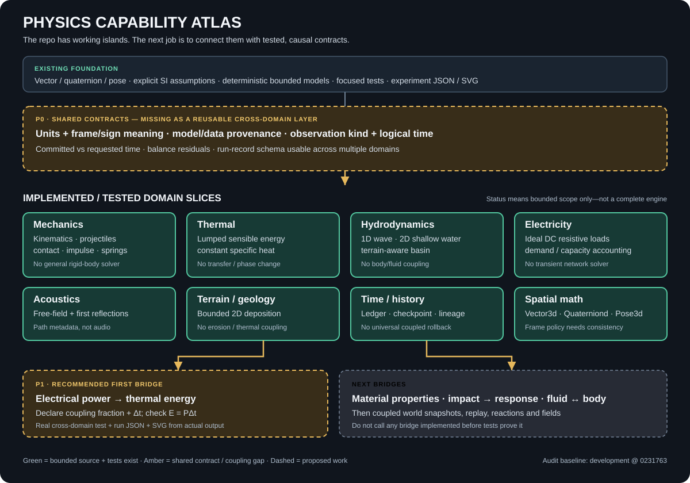

# Physics Gap Register — What Exists, What Connects, What Comes Next

**Status:** evidence-based planning document, reviewed against the `development` tree after material-property provenance and two-body thermal-conduction evidence were added (2026-10-17). Roadmap items below remain unimplemented unless the source, focused tests, and evidence pipeline support the stated scope.

The goal is to prevent the repository from becoming a collection of individually polished primitives that never combine into useful worlds. A domain is counted as *implemented* only at the scope supported by source, focused tests, and documented limits.

## The diagnosis

Physics is no longer an empty skeleton. It already contains tested slices in spatial math, kinematics, collision/contact, axial mechanics, thermal accounting, shallow-water models, terrain, electrical load accounting, acoustics, deterministic cell addressing, and timeline/history contracts. The problem is that these capabilities are mostly **islands**: they do not yet form a validated, causal, multi-domain world.

The highest-value work is not another isolated showcase or another round of polishing the same model. It is to establish reusable contracts and make adjacent models exchange quantities correctly. **A first electrical-to-thermal coupling experiment now exists in source with focused tests, a C# run-record generator, a committed JSON fixture, and an SVG rendered from that record. The first test attempt exposed incorrect test assumptions; those were corrected, and the corrected build-and-test run passed. The new run-record/SVG consistency checks passed in CI, alongside the full test suite and package-build step.**

## Current evidence and missing bridges

| Area | What is present on `development` | What is not yet established | Practical consequence |
|---|---|---|---|
| Spatial math | `Vector2d`, exact-sign `Geometry2d.Orient` predicate over represented binary64 coordinates, closed-segment intersection classification and bounded unique-point construction (`SegmentIntersection2d`), simple-polygon point location (`Geometry2dPolygon.LocatePoint`), absolute-distance tolerance, `CoordinateFrame2d`/`Point2d`, frame-aware `RigidTransform2d`, `Vector3d`, `Quaterniond`, `Pose3d`, finite `Matrix3x3d`, focused tests; allocation-free SoA vector batch add/scale/dot reference operations | Adversarial intersection-coordinate rounding policy and broader degeneracy coverage, polygon simplicity validation/area/triangulation and broader region operations, transform graph and unit-conversion policy, uncertainty-derived tolerance selection, general matrix solves/decompositions, SIMD/GPU backend | Orientation sign is robust for supplied coordinates; closed-segment intersection classification covers crossing, touch, overlap, disjoint, and degenerate-point cases. Explicit absolute-distance comparison does not encode measurement uncertainty. Pairwise 2D rigid transforms now support frame-checked point application, inverse, and ordered composition, but do not provide transform-graph lookup or unit conversion. Unique-point intersection construction uses exact integer line equations over the supplied binary64 coordinates for general proper crossings, then converts the rational result back to binary64; axis-aligned crossings reuse input coordinates directly. Regression tests include extreme mixed-scale axis-aligned and non-axis-aligned crossings, a subnormal-scale intersection coordinate, and a non-dyadic rational crossing whose result is rounded to binary64; the expanded test workflow passed. Remaining work includes broader adversarial rounding/degeneracy analysis and an explicit accuracy/error policy; exact construction over represented inputs does not eliminate physical measurement uncertainty. Simple-polygon point location now distinguishes inside/outside/boundary using a non-zero winding rule, but does not validate polygon simplicity or provide area/triangulation; broader geometry remains open. Batch operations are CPU reference code only |
| Mechanics | Constant-acceleration motion, projectile trajectory/intersection/diagnostics, broadphase, sphere contact, normal impulse, position correction, axial spring-damper and link failure | General rigid-body stepping; friction/angular/multi-contact response; impact connected to damage and structural state | A hit can be observed, but does not yet cause a supported cascade of material/structure changes |
| Thermal | Lumped sensible energy with constant heat capacity; tested two-body conduction transfer with explicit conductivity, area, path length, validity range, and an overshoot guard | Spatial heat equation, contact resistance, convection/radiation, phase change, temperature-dependent properties, sourced material data | A bounded pair of bodies can exchange conserved energy, but this is not yet a general thermal world or material-state cascade |
| Fluids | 1D wave reference and 2D shallow-water / bathymetric basins | Coupled solid/fluid forces, boat/body motion, 3D flow, validated mass/energy exchanges with other domains | Water surfaces are models, not yet a coupled world of water, objects and structures |
| Electricity | Ideal fixed-voltage DC bus with resistive loads and capacity accounting | Source dynamics, voltage droop, switching/transients, heat generated by loads, arcs or field effects | A grid can account for demand, but electrical events do not yet produce cross-domain consequences |
| Acoustics | Free-field observations and first-order room reflection path metadata | Source waveform, propagation/occlusion beyond the bounded model, receiver/signal processing and measured reference cases | Sound paths are analytical observations, not audible output or a full acoustic world |
| Materials | Spring/link failure primitives and material-specific concepts in design docs | A reusable, provenance-bearing material property record and tested constitutive response | “Copper”, “iron”, “stone”, “wood” or “water” cannot yet carry one shared authoritative set of properties through every model |
| Time/history | Logical tick ledger, checkpoint/branch/lineage/replay-plan types | A canonical world snapshot and atomic commit/replay contract for *coupled* solver state | Timeline types alone do not guarantee that every domain can be rewound or replayed consistently |
| Evidence | Focused tests and multiple experiment JSON/Markdown/SVG outputs | Common run provenance, cross-domain conservation/residual records, measured/independent reference data where feasible | Individual experiments can be inspectable without proving their composition is correct |
| Mathematics / compute | Squirrel3 stream and keyed sampling, 1D LUT, finite Matrix3x3d primitive, SoA Vector3d batch CPU reference operations, single-pass online mean/variance, and exact-sign 2D orientation predicate; math and GPU contracts documented | General algebra/calculus APIs, covariance/regression/inference, optimization, general matrix dimensions/solvers, explicit numeric quantity/dimension system, adversarial intersection-coordinate conditioning, and actual SIMD/GPU backend | Do not imply domain completeness or acceleration before implementation and reference validation |
| Runtime/composition | Renderer-independent net8 library; scheduling and MicroBundle boundaries documented | No claim of a complete process-group scheduler or a universal physics MicroBundle runtime in this project | Avoid confusing architecture documents with executable orchestration |

Source-of-truth index: [Physics Capability Catalog](PHYSICS_CAPABILITY_CATALOG.md), [Domain Map](PHYSICS_DOMAIN_MAP.md), [Numerical Validation Playbook](NUMERICAL_VALIDATION.md), [LUT design contract](PHYSICS_MATH_LUTS.md), and the focused tests under `tests/TheSingularityWorkshop.Physics.Tests`.

## Priorities: build bridges, not more islands

### P0 — Shared numerical and observation contracts

Before building a general “units framework,” define the minimum common contract that current and future models can actually use:

- quantities expose explicit unit and sign/frame meaning at API and experiment boundaries; keep SI as the default, do not wrap every `double` prematurely; coordinate-frame transforms must be explicit rather than inferred from matching numeric coordinates;
- model identity/version and input/boundary-condition declaration;
- a deterministic step/result record that distinguishes requested time from committed time;
- domain observations carry source identity, logical time, units, and whether they are direct state, derived estimate, or presentation-only;
- validation reports include a residual/error metric and state what reference the metric compares against.

**Deliverable:** a small shared record shape and tests proving it can represent at least mechanics, thermal, fluid, and acoustic observations without hiding their different meanings. Prefer a small contract plus examples over a sprawling abstraction layer.

### P1 — Material properties and one causal cross-domain slice

**First causal bridge implemented and verified in CI:** [`ElectricalThermalCouplingExperiment`](../Physics/Experiments/ElectricalThermalCouplingExperiment.cs) connects the ideal electrical-load observation to the lumped thermal state. Focused tests cover (E=P\Delta t), a declared absorbed fraction, energy accounting, invalid inputs, overload reporting, and repeatability. The [experiment page](experiments/electrical-thermal-coupling.md), [C# run-record generator](../tools/ElectricalThermalCouplingRunRecordGenerator/Program.cs), [committed JSON run record](experiments/electrical-thermal-coupling.run.json), and [SVG](experiments/electrical-thermal-coupling.svg) are in the repository. CI regenerates the record from the C# model, compares it byte-for-byte with the committed fixture, renders an SVG from fresh output, and verifies the committed SVG against both fresh output and the record. These checks, the full test suite, and package build passed on `development`.

This is deliberately bounded: the absorbed fraction is authored, not predicted by a heat-transfer model; the experiment does not model where untransferred energy goes, changing resistance, external heat exchange, phase change, or spatial gradients. It is not a validated appliance or electrical-arc model.

**Second thermal bridge implemented:** [`ThermalConduction`](../Physics/Thermodynamics/ThermalConduction.cs) transfers signed energy between two lumped bodies using a declared conductivity, area, path length, and interval. It checks the conductivity property’s temperature-validity range, rejects an explicit step that would overshoot equilibrium, and records the total sensible-energy residual. The [focused tests](../tests/TheSingularityWorkshop.Physics.Tests/Thermodynamics/ThermalConductionTests.cs), [run record](experiments/thermal-conduction.run.json), and [SVG](experiments/thermal-conduction.svg) make the result inspectable. Conductivity remains illustrative; this is not a spatial heat solver or a measured real-material prediction.

**Next P1 work:** add sourced properties only when source/version and applicability can be verified; then use property validity ranges in a temperature-dependent response (for example, heat capacity changing with temperature) and add explicit heat exchange with the environment. Keep the current conduction fixture explicitly illustrative until real material data is sourced.

### P2 — Make collision response causal

Connect the existing contact and projectile capabilities only after defining a supported body/target state. First prove a small two-body case with known mass, incoming velocity, normal, restitution assumption, and impulse. Then expose momentum/energy before and after and state what is dissipated or unaccounted for. Only after this should impact feed a spring/link failure or material response. Do not describe projectile impact diagnostics as a damage model.

### P3 — Fluid/solid coupling

Build a small, deterministic floating-body test in a shallow-water basin, not a “massive bathtub” all at once. Declare buoyancy approximation, displaced volume, body mass, force cadence, water/body exchange order, and stability limits. Validate still-water equilibrium and a small perturbation. Waves, boats, terrain, buildings, and shoreline then become additions to a real coupling contract.

### P4 — World state and time travel

Before promising reverse simulation, define the smallest coupled world snapshot that contains every participating domain's state, model/data versions, and logical time. Prove checkpoint → advance → restore → replay yields the declared equality contract. Branch metadata is not rollback. Avoid arbitrary reverse integration as a substitute for state restoration.

### P5 — Fields, reactions, and combustion

Keep combustion as an integration target, not the next isolated spectacle. Prerequisites include provenance-bearing material/fuel properties, explicit species/stoichiometry, a declared heat-release model, thermal state/transfer, and fluid transport. Until these exist, a fire sprite or temperature threshold is presentation/trigger logic, not a combustion solver.

## Acceptance gate for any next slice

A slice is not done when a class exists or a diagram looks plausible. It is done when:

1. the public inputs and outputs, units, frame/sign conventions, and valid range are documented;
2. source and focused tests cover ordinary values, boundary cases, invalid inputs, and deterministic reruns;
3. a hand-checkable analytical result or justified invariant/residual is asserted;
4. coupling tests prove each transfer is applied exactly once and in the intended logical step;
5. a run record contains the actual inputs and outputs; the SVG/table is generated from that record rather than separately authored numbers;
6. unsupported behavior is listed beside the evidence;
7. CI runs the focused tests and evidence consistency check.

## What I would do next

Validate the **P1 electrical-to-thermal evidence pipeline** end to end: its run record and SVG are now committed and CI is wired to compare them with fresh output. The run-record/SVG consistency checks passed on the last recorded run, but the latest workflow after the frame-aware transform documentation commit failed at `Test with coverage`; its detailed test output was not available during this audit. Treat the latest .NET suite status as unresolved until the failure is inspected and a subsequent run passes. Continue with the minimum reusable **P0 observation/run contract** only after resolving that validation signal, rather than designing a generic framework before one real exchange proves what it needs.

This audit is intended to change priorities: stop deepening isolated capabilities by default; prioritize one tested causal connection at a time.
