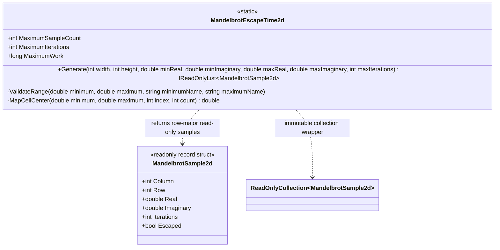

# MandelbrotEscapeTime2d — class diagram

## Use case

A caller requests a bounded sample grid. The evaluator validates dimensions, finite half-open bounds, iteration cap, and worst-case work before allocating and computing samples. Downstream systems consume the recorded coordinates and classifications.

## Boundary

The type performs CPU mathematical evaluation only. It does not render pixels, emit SVG, or submit GPU work.
