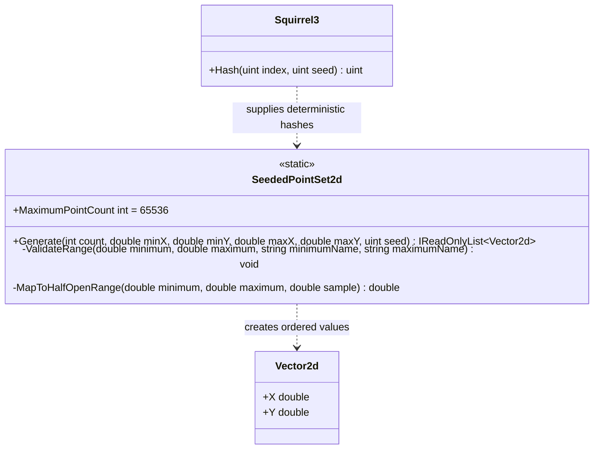

# SeededPointSet2d — UML

**Source:** [`Physics/Spatial/SeededPointSet2d.cs`](../../Physics/Spatial/SeededPointSet2d.cs)  
**Companion and use case:** [SeededPointSet2d.cs.md](SeededPointSet2d.cs.md)

## Structural contract

The public operation is static and bounded. Each point index is hashed independently for X and Y with separate domain constants; values are mapped to finite half-open coordinate ranges. The output is read-only and unit-agnostic. Duplicate points are permitted.
