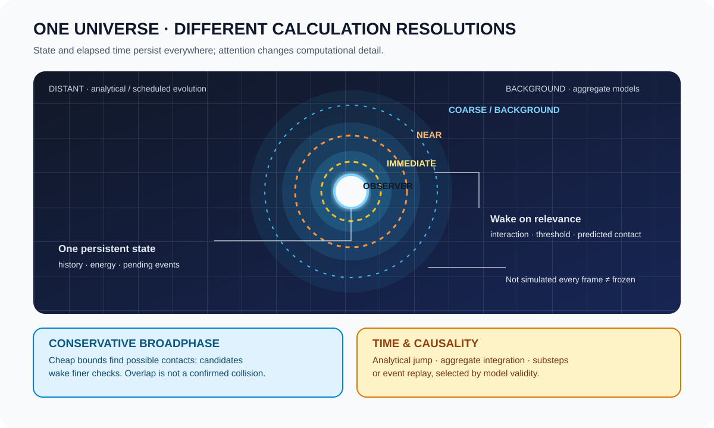
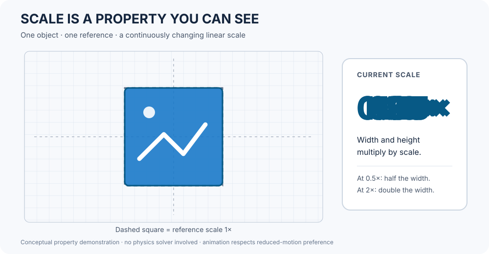

# Universe Representation & Observer-Driven Resolution

**Status:** partially implemented foundation. Deterministic finite-grid addressing, seeded cell-value derivation, finite axis-aligned bounds, swept bounds for linear translation, and a deterministic sweep-and-prune candidate generator are implemented and tested. Persistence, evolving universe state, observer policy, wake-up reconciliation, narrowphase collision response, and multiscale solvers remain future work. No performance claim is implied.

## The central rule

Represent one persistent universe. Vary the cost and precision of calculations performed for each part of it; do not create a separate "real" world around the player and discard the rest.

An unobserved region still has state, history, causal relationships, and elapsed logical time. It may be advanced by a cheaper valid model, an analytical prediction, an aggregate representation, or deferred work that is reconciled before its result is needed. It is not silently frozen.

Scale is one visible parameter, not a complete observer-resolution policy. Actual horizon and resolution selection must also account for observer relevance, model validity, error bounds, and state reconciliation.

## One universe, addressable cells

A universe representation can be partitioned into spatial cells, hierarchical regions, or another address scheme suited to its scale. A cell is an addressable container for model state and references—not a promise that all physics fit neatly inside a cube. Long-range fields, global constraints, and cross-cell relationships must remain explicit.

A deterministic procedural universe is a useful option:
- Choose and record a seed, generation algorithm version, coordinate/address scheme, and parameters.
- Generate cells on demand or generate a static canonical data set when that is more appropriate.
- Derive cell content from stable coordinates and the recorded seed, not from the order in which cells happen to be visited.
- Keep generated initial conditions distinct from the physical evolution that follows.
- Persist important changes and causal events so returning to a cell does not regenerate its original state over a modified history.

A 10 × 10 × 10 grid and a repeatable test at linear cell index 42 would make a good **fixture** for proving deterministic address lookup and revisit behavior. It should not become a hard-coded universal location or a constraint on the eventual universe topology. Define the coordinate-to-index mapping explicitly, including bounds and ordering.

## Observer containment and resolution

The observer is not the author of physical truth; it is one input to a policy that decides which model detail is currently worth calculating.

| Tier | Typical trigger | Possible work | Required invariant |
|---|---|---|---|
| Immediate | Direct interaction, contact, visible rapid change | Fine-step mechanics, local collision response, interactive equipment | No waiting on a distant region's coarse cadence |
| Near | Nearby cells or likely incoming interactions | More frequent updates, richer contact candidates, detailed local fields | Refinement starts from existing state and history |
| Background | Connected or consequential regions outside immediate focus | Aggregate energy/load, coarse dynamics, scheduled event checks | Elapsed time and causal events remain accounted for |
| Distant | Regions with low relevance and slow-changing state | Analytical evolution, compact summaries, long scheduled intervals | Wake-up reconciles the interval before detailed interaction |
| Global | Universe-wide constraints or long-range influences | Shared fields, conservation ledgers, global boundary conditions | Local simplification cannot silently break global consistency |

These tiers are policy examples, not fixed distances or prescribed update rates. Observer containment can include distance, line of sight, predicted interaction time, uncertainty, player intent, and the importance of a region's state to other regions. Multiple observers can request different detail for the same region; the policy must reconcile those requests rather than duplicate or fork physical state.

## Time is preserved even when computation is deferred

Every evolving state needs a declared logical time. When a region wakes, calculate the interval from its last authoritative update to the requested time.

Choose the least expensive valid method for that model:
- **Analytical advancement** where a supported model has a valid closed-form solution.
- **Aggregate integration** where the assumptions remain valid over the whole interval.
- **Bounded substeps** when stability, nonlinear behavior, or event timing requires them.
- **Event-ledger replay or checkpoint advancement** when intermediate events change the result.
- **Explicit slowdown or unresolved status** when the catch-up budget is exhausted; never quietly pretend the region reached the target time.

A coarse model may approximate the detailed trajectory, but the approximation and its error limits must be declared. If a fire consumes its fuel, a battery discharges, a circuit trips, or an object crosses a phase boundary while distant, that transition must not be lost merely because no observer was nearby.

Determinism requires more than a seed. It also needs stable inputs, event ordering, model/data versions, explicit time, and defined rules for concurrent or coupled updates. Determinism can make alternate solver paths comparable; it does not make physically different approximations equivalent by itself.

## Broadphase contact: cheap candidates, precise consequences

A periodic spatial broadphase can identify pairs whose conservative bounds may overlap. A maximum bounding cube is one possible cheap bound, especially when objects are represented by hierarchical or cubic cells.

1. Expand or sweep bounds enough to account for motion over the broadphase interval.
2. Collect candidate pairs without claiming that every candidate is a collision.
3. Wake or promote candidate pairs to more frequent contact checks.
4. Use narrower bounds and the appropriate collision/constraint solver to confirm and resolve contact.
5. Keep pairs active while contact, proximity, or predicted time-to-impact requires it; retire them only when safe.

**Conservative means no false negatives within the declared motion/bounds assumptions.** A cube that is too small, or a check that ignores motion between broadphase passes, can miss a real contact. A large cube may produce extra candidates; that is usually a performance cost, not a correctness failure. Fast objects may require swept bounds, continuous collision detection, or substeps. Contact detection cadence and impact/damage consequence processing are separate decisions.

The same pattern applies outside collisions: a cheap screening pass identifies where a more expensive solver may be needed, and event wake-ups protect important transitions between scheduled passes.

## Microscopic to macroscopic

Do not force one numerical method to serve every scale. The shared universe can host distinct models with declared interfaces:
- microscopic or particle-scale approximations where needed and supported;
- object mechanics and contact;
- thermal/material state and phase changes;
- electrical networks and energy transfer;
- fluids, atmosphere, weather, and large-scale transport;
- orbital or planetary motion;
- aggregate regional and universe-scale fields.

Cross-scale coupling must exchange explicit quantities, units, time intervals, and ownership. For example, a detailed local heater can draw power from an aggregate electrical network; the energy transfer must be counted once, and the network's next coarse update must account for that committed load. Refining or coarsening a region must preserve relevant mass, energy, momentum, pending events, and provenance within the declared model's limitations.

## Responsibilities and implementation sequence

- **Physics core:** physical state, models, time advancement, broadphase contracts, measurements, and validation. No renderer or FSM_API dependency.
- **FSM_API adapter:** lifecycle and process-group scheduling, wake-up coordination, and domain callback orchestration.
- **Universe/world layer:** deterministic addresses, cell/region identity, relationships, observer requests, and persistence/checkpoints.
- **Renderer:** presents state and may report observer/input information; it does not author physical truth.
- **Measurements:** update counts, elapsed-time debt, candidate-pair counts, wake-up reasons, conservation residuals, error estimates, and compute cost.

Implemented foundations:
- `UniverseGrid` defines stable zero-based finite-grid addressing with X varying fastest.
- `DeterministicCellGenerator` derives repeatable initial-condition values from universe seed and coordinates; it does not generate or evolve a complete universe.
- `AxisAlignedBounds` validates finite ordered bounds and supports intersection, union, expansion, and swept bounds for linear translation.
- `SweepAndPruneBroadphase` deterministically returns intersecting AABB candidate pairs, given bounds that conservatively cover the interval. Candidate pairs are not confirmed collisions.

Recommended increments:
1. Prove stable revisit behavior: generate, evolve, leave, advance logical time, return, and reconcile.
2. Add narrowphase contact confirmation and appropriate collision/constraint response.
3. Add observer-driven promotion/demotion with state-preserving handoffs and explicit wake-up reasons.
4. Compare coarse advancement against finer-step references and measure cost against error.
5. Add coupled domains and global accounting only after their ownership and validation contracts are explicit.

This is a direction for the architecture, not a claim that the universe generator, observer policy, broadphase, or multiscale solvers already exist.

## Resources & Support

[Physics home](../README.md) · [Architecture](ARCHITECTURE.md) · [Process-group scheduling](PROCESS_GROUP_SCHEDULING.md) · [Roadmap](ROADMAP.md) · [FSM_API](https://github.com/TrentBest/FSM_API) · [SimpleDemos](https://github.com/TrentBest/SimpleDemos) · [Issues](https://github.com/TrentBest/TheSingularityWorkshop.Physics/issues)

  

<em>Build understanding. Make reality inspectable.</em> <strong>The Singularity Workshop</strong>

