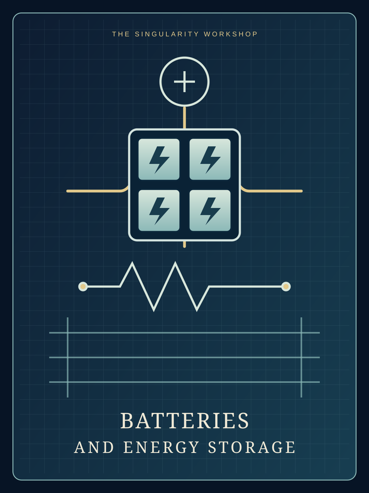

# Singularity Universal Roleplaying System - Domain - LOD 1 - Batteries and Energy Storage

**Descriptor:** [batteries-and-energy-storage.book.json](batteries-and-energy-storage.book.json)

**Status:** first sourcebook outline. The generic Physics storage ledger is implemented; electrochemical cell models, battery-pack behavior, thermal safety, degradation, and technology-specific storage models remain planned.

## 1. Why storage matters

Energy storage separates the time at which energy is produced from the time at which it is used. It connects portable devices, vehicles, buildings, factories, isolated communities, and large electrical grids.

A storage system is not defined by capacity alone. Its behavior depends on:
- stored energy and usable energy;
- charge and discharge power;
- conversion efficiency and losses;
- response time and duty cycle;
- operating temperature and thermal management;
- state of charge and state of health;
- cycle life, calendar aging, and degradation;
- safety limits, monitoring, protection, and maintenance;
- system boundary, controls, inverter/charger, and grid interface.

## 2. Storage technologies

| Technology | Stored form | Important physical questions | Book status |
|---|---|---|---|
| Electrochemical batteries | Chemical free energy | Cell voltage, current, reaction state, internal resistance, heat, capacity, aging | Planned specialist model |
| Lithium-ion families | Intercalation chemistry | Electrode chemistry, voltage curves, thermal response, degradation, protection | Planned; no chemistry-specific parameters claimed |
| Lead-acid | Reversible electrochemical reaction | State of charge, discharge rate, temperature, sulfation, ventilation and service limits | Planned |
| Flow batteries | Electrolyte chemical state | Tank inventory, flow, stack power, membrane losses, pumps, crossover | Planned |
| Sodium-based systems | Electrochemical/thermal storage | Operating temperature, materials, conversion, containment | Planned |
| Pumped hydro | Gravitational potential energy | Reservoir volume, elevation head, flow, turbine/pump conversion | Planned |
| Flywheels | Rotational kinetic energy | Rotor inertia, speed, containment, bearing and motor/generator losses | Planned |
| Compressed-air storage | Pressure energy | Pressure, volume, heat exchange, turbomachinery, cavern boundary | Planned |
| Thermal storage | Internal energy / phase change | Sensible and latent heat, insulation, heat-exchanger power, losses | Partial thermal primitives |
| Hydrogen and synthetic fuels | Chemical energy | Production pathway, compression/liquefaction, conversion chain, system efficiency | Planned |

These technologies are not interchangeable. A fair comparison declares the same system boundary and compares energy capacity, power, response, duration, efficiency, lifetime, cost basis, materials, and environmental constraints without hiding auxiliary loads.

## 3. Shared vocabulary and accounting

- **Energy capacity** is an inventory limit, measured in joules or a declared multiple.
- **Power rating** is a rate limit, measured in watts. A large energy capacity does not imply high power.
- **State of charge (SoC)** is the current stored-energy fraction relative to a declared usable or nominal capacity.
- **State of health (SoH)** describes retained capability relative to a declared reference condition; it is not the same as SoC.
- **Charge efficiency** compares energy retained in storage with energy accepted at the charging boundary.
- **Discharge efficiency** compares energy delivered at the output boundary with energy removed from the stored inventory.
- **Round-trip efficiency** must state whether auxiliary equipment, thermal management, inverter losses, and standby consumption are inside the system boundary.
- **C-rate** expresses charge/discharge current relative to a declared rated capacity; it is chemistry- and rating-convention-dependent.
- **Cycle life** depends on depth of discharge, temperature, current, rest periods, and the end-of-life criterion.

For every simulated interval, close both sides of the ledger:

- Requested input = input not accepted + accepted input.
- Accepted input = stored-energy increase + input energy not retained.
- Stored energy removed = delivered output + energy not delivered as output.

Unretained or undelivered energy is not automatically heat. A battery thermal model must explicitly receive the appropriate loss terms and explain which mechanisms generate heat.

## 4. Existing Physics implementation

[EnergyStorageState](../../Physics/Energy/EnergyStorageState.cs) is a generic immutable energy reservoir with:
- stored energy and capacity;
- maximum charge and discharge power;
- separate charge and discharge efficiencies;
- power- and capacity-limited operations;
- immutable before/after state observations;
- explicit input energy not accepted, input energy not retained, output energy not delivered, and stored energy removed but not delivered as output.

The focused tests verify energy closure, capacity and power limits, deterministic results, immutable state transitions, invalid inputs, and overflow rejection.

This is a generic accounting primitive. It does **not** model cell voltage, electrochemical potential, current/voltage curves, internal resistance, state of health, temperature, thermal runaway, degradation, balancing, battery-management systems, or a particular battery chemistry.

Other reusable foundations include [generic energy conversion](../../Physics/Energy/EnergyConversion.cs), [thermal power conversion](../../Physics/Energy/ThermalPowerConversion.cs), [lumped thermal state](../../Physics/Thermodynamics/LumpedThermalState.cs), and [phase-change thermal state](../../Physics/Thermodynamics/PhaseChangeThermalState.cs). Their limits remain those documented in the [Physics capability catalogue](../PHYSICS_CAPABILITY_CATALOG.md).

## 5. Battery packs and facilities

A battery pack composes cells, modules, electrical interconnects, sensors, cooling/heating, contactors, fuses, enclosure, and control. A pack model must not assume that a single average cell represents every cell under imbalance, fault, or thermal gradient.

Facility-scale storage composes the pack or reservoir with:
- charger, inverter, and power conversion;
- transformer and grid connection;
- protection and isolation;
- dispatch policy and reserve requirements;
- thermal management and auxiliary consumption;
- monitoring, alarms, maintenance, and end-of-life handling.

Factories add production scheduling, process loads, backup power, peak shaving, and demand response. Grids add ramping, reserve, curtailment, congestion, and restoration. The scenario layer may turn these into resource and scheduling challenges; Physics must continue to own the actual physical quantities and conservation rules.

## 6. Safety and evidence

This is an educational and simulation sourcebook, not a battery construction guide, installation code, certification document, or safety procedure. Real cells and packs can store hazardous amounts of energy and can fail through short circuit, overcharge, overheating, mechanical damage, or incompatible charging.

Any technology-specific model must use traceable public material data and published reference behavior. Do not fabricate cell ratings, safe operating limits, thermal-runaway thresholds, or protection setpoints. Distinguish:
- measured or manufacturer-published parameters;
- values inferred from a documented test;
- illustrative teaching values;
- scenario-authored fictional inputs.

No model should be presented as a substitute for manufacturer instructions, applicable electrical codes, fire codes, or qualified engineering review.

## 7. Staged development

1. Keep the generic storage ledger technology-neutral and validated.
2. Define a public-data property contract for a single reference cell chemistry, including voltage/capacity curves, internal resistance, temperature applicability, provenance, and uncertainty.
3. Add a bounded cell energy/charge-state model with explicit current, voltage, and state variables; validate against published reference curves.
4. Add internal-resistance heating and a lumped thermal coupling with explicit heat accounting.
5. Compose cells into a pack only after cell-level behavior and imbalance assumptions are tested.
6. Add degradation only with a declared empirical model, operating history, and calibration evidence.
7. Add grid dispatch and factory scheduling as separate system-level capabilities consuming the same storage interface.

## 8. Limitations

A capacity ledger is not a battery simulator. A battery simulator is not automatically a battery safety model. A pack model is not a certified design. Every step must declare its physical boundary, data provenance, validity range, numerical behavior, and omitted effects.
