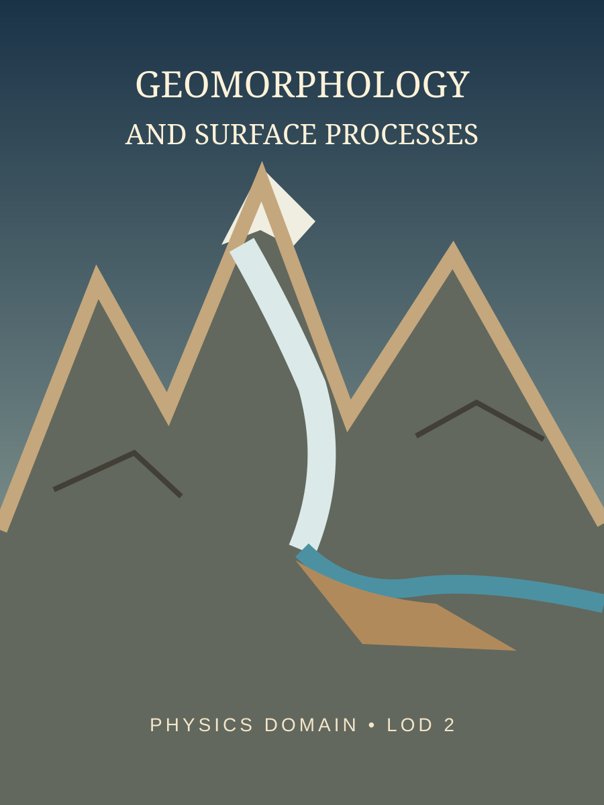

# SURPS — Physics Domain — LOD 2 — Geomorphology and Surface Processes

**Descriptor:** [geomorphology-and-surface-processes.book.json](geomorphology-and-surface-processes.book.json)  
**Status:** Detailed domain sourcebook and simulation roadmap. It describes causal process families; it does not claim every listed process has a solver.

## 1. The landscape is always changing

Geomorphology studies the forms of the land and the processes that create, modify, and connect them. A mountain range may begin through tectonic uplift, but its cliffs, ridges, gullies, talus, valleys, floodplains, caves, and beaches are shaped by many later processes.

Keep five concepts distinct:
- **Weather:** atmospheric conditions and forcing.
- **Weathering:** physical, chemical, or biological alteration of material in place.
- **Erosion:** detachment and removal of material.
- **Transport:** movement of detached material by water, ice, wind, or gravity.
- **Deposition:** storage of transported material in a new location.

These processes form connected causal chains, but they are not synonyms.

## 2. Material and terrain controls

Surface response depends on more than slope and elevation. Relevant properties include lithology, grain size, mineralogy, porosity, permeability, cementation, fractures, bedding, weathering state, vegetation/land cover, soil depth, and water/ice content.

Every material model should identify which properties are measured, prescribed, or approximated. A color or material tag is not a strength, permeability, erodibility, or thermal model. Avoid applying one universal erosion coefficient to every rock and sediment type.

## 3. Weathering

### Mechanical weathering
Processes include freeze-thaw, thermal expansion, salt crystallization, unloading and exfoliation, abrasion, and wetting/drying. Each requires environmental conditions and material response; a temperature crossing alone does not prove a fracture occurred.

### Chemical weathering
Dissolution, hydrolysis, oxidation, carbonation, and hydration alter minerals and can change porosity, strength, and material composition. Rates depend on water, temperature, chemistry, reactive surface area, and transport.

### Biological weathering
Roots, burrowing organisms, microbial activity, and organic acids can fracture, displace, or chemically alter material. Biological influence should be modeled at a declared fidelity rather than represented as unexplained terrain noise.

Weathering changes material in place. It can prepare material for erosion without itself transporting it away.

## 4. Hillslopes, gravity, and mass movement

Hillslope processes include creep, rockfall, slides, slumps, debris flows, and snow avalanches. Their behavior depends on geometry, material strength, pore-water pressure, saturation, loading, vegetation, and disturbance history.

A simple slope rule may classify a potential failure region, but a predictive stability model needs explicit resistance and driving forces, material parameters, pore pressure assumptions, and a failure criterion. A landslide event should record source region, displaced volume, path, deposit, time, and material provenance. Do not teleport material downslope or silently discard mass.

## 5. Rivers, runoff, and drainage networks

Rain and snowmelt become interception, infiltration, storage, runoff, and groundwater recharge. Flow concentrates into rills, gullies, streams, and rivers. Channel form responds to discharge, slope, sediment supply, bed/bank material, and base level.

A river model should distinguish:
- water routing and storage;
- channel hydraulics;
- erosion and bed incision;
- sediment entrainment and transport;
- deposition, bars, floodplains, fans, and deltas;
- floodplain exchange and avulsion.

Drainage networks evolve as terrain changes. A fault can offset a channel; a landslide can dam it; a flood can breach the dam; incision can later expose the deposits. Preserve the event sequence and water/sediment accounting.

## 6. Groundwater, karst, and caves

Groundwater follows hydraulic gradients through pores and fractures. It influences springs, wetlands, slope stability, dissolution, and subsurface storage. Karst landscapes develop where soluble rock is dissolved by water, producing enlarged fractures, conduits, sinkholes, sinking streams, and caves.

Cave formation is not the same as placing an empty voxel. A physical dissolution model needs chemistry, water flow, reactive surface, and time. Cave collapse or sinkhole formation needs a separate structural or geometric event model. Preserve the distinction between natural voids, mines, excavations, and constructed tunnels.

## 7. Glaciers, snow, and periglacial terrain

Snow accumulation, compaction, melt, refreezing, and glacier flow depend on climate forcing, elevation, slope, energy balance, and ice rheology. Glaciers erode through abrasion and quarrying, transport debris, and deposit moraines and outwash. Cirques, arêtes, horns, U-shaped valleys, hanging valleys, and fjords are outcomes of interacting processes and inherited geology—not independent stamps.

Periglacial processes include patterned ground, solifluction, frost heave, and freeze-thaw breakdown. A model must state whether it represents seasonal snow, persistent ice, glacier dynamics, or a prescribed glacial landform.

## 8. Wind and aeolian systems

Wind can deflate, abrade, sort, transport, and deposit sediment. Dune shape and migration depend on wind regime, sediment availability, grain properties, moisture, vegetation, and obstacles. Distinguish a static dune geometry from a transport model that predicts migration and sediment exchange.

## 9. Coasts, lakes, and shorelines

Waves, tides, currents, water level, sediment supply, geology, and storms shape shorelines. Processes include cliff retreat, abrasion, longshore transport, barrier formation, spits, beaches, estuaries, deltas, wetlands, and coastal flooding. Lake levels and changing base levels influence river incision and sediment storage.

Coastal models need explicit bathymetry/topography coupling, water boundaries, wave/current forcing, and sediment assumptions. Do not infer a storm surge from a high-water mark without evidence.

## 10. Soils, sediment, and landscape memory

Soils develop through parent material, climate, organisms, relief, and time. Horizons, organic matter, moisture, texture, and chemistry influence vegetation and infiltration. Sediment should retain provenance, grain-size class, transport history, depositional age, and later burial or reworking.

Use sediment budgets: identify sources, sinks, transfers, and boundary fluxes. If a model tracks only volume, state that limitation; if it tracks mass, density assumptions must be explicit. A closed landscape should not lose material because a renderer clipped it.

## 11. Terrain detail and environmental authenticity

A convincing landscape has coherent causes at multiple scales:
- regional structure from tectonics and inherited geology;
- ridges, valleys, basins, and drainage from long-term uplift and erosion;
- cliffs, talus, terraces, fans, bars, and dunes from local processes;
- soils, fractures, vegetation niches, wet areas, snow patches, and exposed strata from material and environmental conditions.

Avoid independent random overlays that contradict the underlying process history. Fine detail should be conditioned by slope, aspect, lithology, drainage, climate, elevation, and disturbance. The renderer may reveal these patterns but does not own the authoritative material or terrain state.

## 12. Coupling and time

Weather and climate provide forcing; hydrology routes water; surface-process models change material and geometry; geology supplies structure and boundary conditions. Couple through explicit inputs and outputs, immutable revisions, declared units, and time intervals.

Use process-specific clocks and subcycling. A flood peak, seasonal snowpack, soil development, and million-year river incision cannot share one undifferentiated timestep. Preserve deterministic replay, event provenance, and atomic commit behavior.

## 13. Validation

Use analytical cases and published benchmark scenarios for flow, sediment transport, slope stability, glacier motion, dissolution, and coastal response as those models are implemented. Test:
- water and sediment budgets;
- mass/volume balance for tracked materials;
- channel response to controlled boundary changes;
- slope failure thresholds and deposit geometry;
- repeatability under fixed inputs;
- sensitivity to resolution and timestep;
- stratigraphic and provenance preservation.

A visually attractive valley is not evidence that the river model is correct. State what is geometric, prescribed, physically modeled, calibrated, or validated.

## 14. Connected books and implementation

- [Geology and Planetary Evolution](geology-and-planetary-evolution.md) establishes the deep-time origin and structure of the landscape.
- [Weather and Climate](weather-and-climate.md) defines atmospheric forcing.
- [Ocean, Atmosphere, and Maritime Phenomena](ocean-atmosphere-maritime-phenomena.md) covers ocean/coastal context and maritime interaction.
- [Geological formation and terrain evolution architecture](../GEOLOGICAL_FORMATION_AND_TERRAIN_EVOLUTION.md) records Physics implementation boundaries.

This book is the rulebook for how landscapes are modified after and during their formation. Its process list is a roadmap, not a false claim that every solver already exists.
