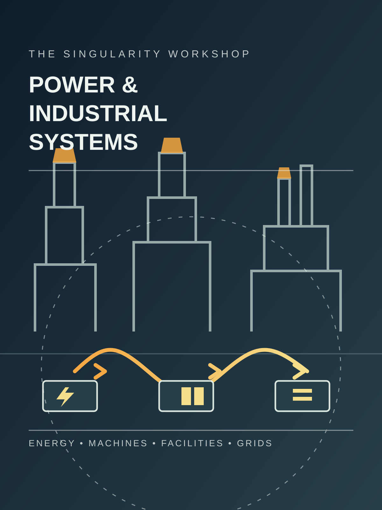
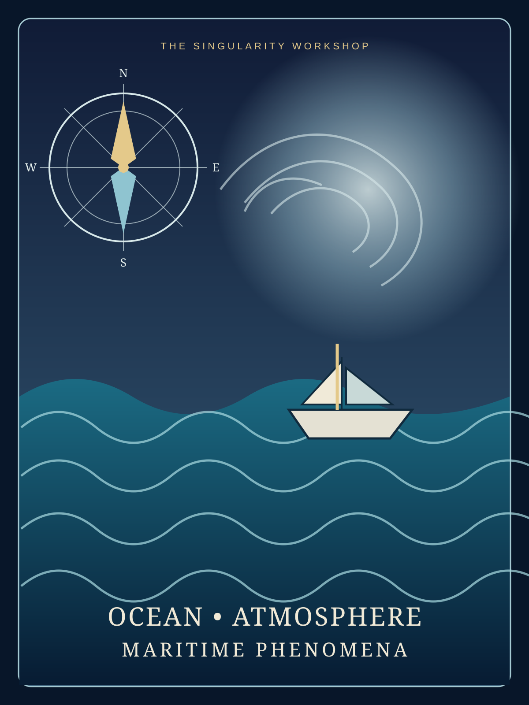
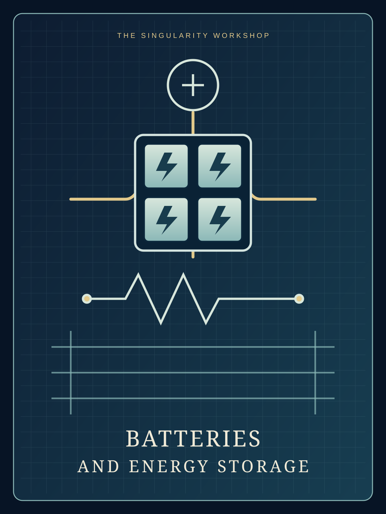

# Singularity Universal Roleplaying System — Physics Sourcebooks

Physics sourcebooks are owned by the Physics domain. They explain the physical subject, connect theory to authoritative implementation, and distinguish implemented capabilities from research plans. SURPS owns cross-domain rulebook semantics and catalogue composition; it does not duplicate Physics solvers.

## Domain sourcebooks — LOD 1

### Power and Industrial Systems

[Read Power and Industrial Systems](power-and-industrial-systems.md) · [Descriptor](power-and-industrial-systems.book.json)

A map of energy conversion, generation, storage, grids, manufacturing, and industrial facilities. The first sourcebook is an outline linked to existing electrical and thermal capabilities; facility-level simulators remain staged work.

### Ocean, Atmosphere, and Maritime Phenomena

[Read Ocean, Atmosphere, and Maritime Phenomena](ocean-atmosphere-maritime-phenomena.md) · [Descriptor](ocean-atmosphere-maritime-phenomena.book.json)

An evidence-led domain outline covering oceanography, atmospheric science, vessel physics, navigation, maritime hazards, and historical incident investigation. The Bermuda Triangle appears as a case study in evidence, uncertainty, and the boundary between documented history, interpretation, and fiction—not as an assumed physical anomaly.

### Batteries and Energy Storage

[Read Batteries and Energy Storage](batteries-and-energy-storage.md) · [Descriptor](batteries-and-energy-storage.book.json)

A domain outline for electrochemical and mechanical/thermal storage, cell-to-pack composition, grid and factory integration, energy accounting, and evidence-led safety boundaries. The generic Physics storage ledger is implemented; chemistry-specific models remain planned.

## Planned book family

These are candidate titles for future descriptor-backed books, not completed sourcebooks:

| Candidate | Intended scope | Current evidence |
|---|---|---|
| Foundations of Physics | Measurement, units, frames, conservation, modeling, uncertainty | Existing theory and primitives across Physics |
| Classical Mechanics | Motion, forces, work, energy, contact, mechanisms | Multiple bounded implementations |
| Gravitation and Orbital Mechanics | Gravity fields, orbits, encounters, tides | Existing bounded astronomy models |
| Thermodynamics and Heat Transfer | Thermal state, heat, phase change, engines, cycles | Partial thermal primitives |
| Batteries and Energy Storage | Electrochemical storage, state of charge, limits, aging | Planned |
| Electricity and Electrical Grids | Circuits, loads, networks, protection, dispatch | Ideal resistive load accounting |
| Thermal Power Stations | Coal, gas, steam cycles, turbines, generators, rejected heat | Planned |
| Nuclear Fission Facilities | Educational reactor physics, thermal removal, conversion, residual heat, protective concepts | Planned educational model |
| Hydroelectric and Water Power | Reservoirs, head, flow, turbines, generation | Planned |
| Renewable Generation | Solar, wind, resource variability, conversion, storage | Planned |
| Industrial Manufacturing | Process energy, machines, material transformation, throughput, automation | Planned |
| Particle, Nuclear, and Collider Physics | Particle identity, collision kinematics, detectors, nuclear processes | Domain map and staged roadmap |

A candidate becomes a separate book when it has a clear scope, descriptor, cover, LOD assignment, chapters, and a traceable link to Physics evidence. Do not assign LOD by guesswork or imply planned models are implemented.

## Editorial contract

- Use the canonical SURPS [rulebook identity and cover standard](https://github.com/TrentBest/TheSingularityWorkshop.SingularityUniversalRoleplayingSystem/blob/development/docs/rulebook-identity-and-covers.md).
- The descriptor is the single source of truth for stable identity, category, LOD, title, version, publisher, cover, and badge.
- Use the shared Workshop moniker and SURPS LOD badge; keep each book's cover artwork distinct from the badge.
- Include theory, assumptions, units, worked examples, implementation links, validation evidence, and explicit limitations.
- Link to Physics source rather than copying solver implementations into SURPS.
- Label content as implemented, partial, experimental, specified, or planned.

## Ownership

Physics owns physical laws, equations, materials, numerical methods, models, solvers, and evidence. SURPS owns shared rulebook semantics, cross-domain ontology, and campaign/tabletop composition. A scenario/game repository owns its narrative, interface, objectives, and player progression.

---

