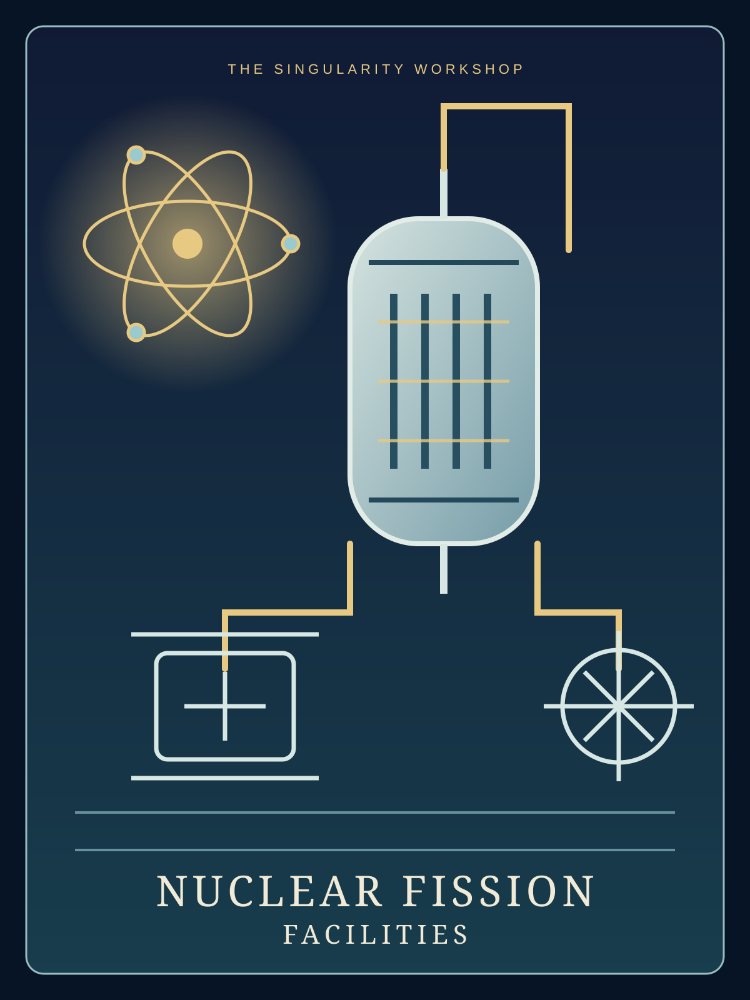

# Singularity Universal Roleplaying System - Domain - LOD 1 - Nuclear Fission Facilities

**Descriptor:** [nuclear-fission-facilities.book.json](nuclear-fission-facilities.book.json)

**Status:** public-information educational sourcebook outline. No reactor kinetics, plant dynamics, control-system model, or facility simulator is claimed implemented.

## 1. Purpose and boundary

This book explains the public physics and systems concepts behind nuclear fission power facilities and defines a staged educational simulation path. It is designed for learning, tabletop worldbuilding, and non-operational game experiences.

The sourcebook is deliberately limited to public, general scientific and engineering concepts. It does not reproduce plant-specific operating procedures, operating setpoints, real control-room layouts, security-sensitive facility details, or safety-critical training. It is not a substitute for professional reactor engineering, operator qualification, regulator guidance, or plant documentation.

Physics owns the physical equations, material properties, numerical models, energy/thermal/fluid balances, and validation evidence. SURPS owns book identity and rulebook composition. A game or escape-room repository owns narrative, HUD, objectives, player progression, fictional time displacement, and prior-attempt apparitions.

## 2. Fission as an energy source

The learning path begins with atomic structure, nuclear binding energy, mass-energy equivalence, and the distinction between nuclear energy release and the useful electrical energy eventually delivered by a facility.

The book should explain:
- nuclei, isotopes, neutron interactions, and fission products at a conceptual level;
- why energy release is associated with changes in nuclear binding energy;
- the distinction between a fission event, a sustained chain reaction, reactor power, and accumulated thermal energy;
- the role of fuel composition and geometry in broad terms without reproducing operational design details;
- why released energy first enters the facility as heat and must be transported and converted.

No facility-specific fuel loading, core geometry, enrichment specification, or operating recipe belongs in this educational model.

## 3. Neutron population and delayed response

A future educational model may use a bounded point-kinetics approximation to illustrate how a simplified neutron population changes over logical time. Its state variables, units, parameter provenance, validity range, and numerical method must be explicit.

The model should distinguish:
- prompt response from delayed response;
- a conceptual reactivity input from an actual control-rod operation;
- neutron-population state from thermal power and stored thermal energy;
- a simplified teaching model from spatial neutron transport or a real reactor calculation.

Any point-kinetics implementation must be independently checked against published, non-sensitive reference examples and tested for positivity, conservation/normalization properties where applicable, timestep sensitivity, and numerical stability. No operational reactivity values, plant-specific response curves, or real-world control sequences are prescribed here.

## 4. Heat removal and power conversion

A fission facility is a coupled energy system. The educational model should trace heat from a declared source boundary through a generic coolant/working-fluid abstraction, heat exchanger, thermal cycle, shaft work, generator, and electrical output.

Physics already provides reusable foundations:
- [LumpedThermalState](../../Physics/Thermodynamics/LumpedThermalState.cs) for a declared constant-specific-heat thermal state;
- [ThermalConduction](../../Physics/Thermodynamics/ThermalConduction.cs) for bounded lumped-body conduction;
- [PhaseChangeThermalState](../../Physics/Thermodynamics/PhaseChangeThermalState.cs) for one equilibrium phase-change case;
- [ThermalPowerConversion](../../Physics/Energy/ThermalPowerConversion.cs) for a Carnot-bounded heat-to-shaft-to-electric energy ledger;
- [EnergyStorageState](../../Physics/Energy/EnergyStorageState.cs) for generic stored-energy accounting.

These are building blocks, not a reactor or steam-cycle solver. A future working-fluid model must declare pressure, temperature, phase, mass flow, property source, and validity range. Do not insert arbitrary steam tables or pretend the Carnot ledger predicts a real plant's efficiency.

## 5. Shutdown, stored heat, and residual heat

A teaching scenario must not conflate a change in the modeled chain reaction with an instantaneous disappearance of thermal energy. The model should distinguish the reactor-power abstraction, energy already stored in modeled materials and fluids, ongoing heat transfer, and a separately declared residual/decay-heat input when that effect is included.

The first implementation may use an explicitly authored residual-heat curve as an educational input, but it must be labelled as scenario data until a validated public-data model exists. Heat-removal failure, thermal inertia, and protective-state transitions should be represented as physical state changes with visible assumptions, not as arbitrary game penalties.

## 6. Instrumentation and protective concepts

The book can explain the purpose of generic measurement, alarms, interlocks, permissives, and protective shutdown at a high level. A simulation may expose abstract state indicators and generic protective transitions so learners can understand that control commands, measured state, and achieved physical state are different things.

It must not reproduce real plant alarm tables, safety setpoints, control-room layouts, operator checklists, or facility-specific procedures. A toy state machine is not a nuclear safety system and must never be presented as one.

## 7. Facility subsystems and energy accounting

A facility-level educational model may compose:
- a declared fission heat-source abstraction;
- a primary heat-transport abstraction;
- a heat exchanger and secondary working-fluid abstraction;
- a turbine/shaft/generator conversion chain;
- electrical switchgear and a simplified grid interface;
- cooling and heat-rejection boundaries;
- storage and auxiliary loads;
- instrumentation and generic protective-state abstractions.

Every subsystem needs a system boundary and a ledger. Track source energy, stored energy, useful output, rejected heat, unallocated losses, and numerical residuals separately. A plant diagram is not evidence that these components have executable models.

## 8. Playable educational experiences

The facility can become a systems-thinking game without becoming a real-plant simulator.

A scenario may begin in an abandoned or unstaffed fictional facility after a disaster. Players learn through observation, diagnosis, and abstract station interactions. The machine's physical state changes only through the declared Physics model. The game may reward:
- finding the right subsystem from incomplete but fair evidence;
- restoring a generic energy/heat-flow path;
- balancing power demand and stored energy;
- reducing repeated manual travel through reliable automation;
- completing objectives under a fictional time or resource budget.

For a time-displacement story, the experience layer may derive a fictional temporal-reach score from declared machine performance. That score is a game rule, not a physical law. Ghosts or apparitions from prior attempts are narrative manifestations owned by the experience repository; Physics supplies only the causal machine state and deterministic observations.

Manual and automated actions should produce the same physical result when they issue the same model input at the same logical time. Automation changes latency, reliability, and player workload—not the underlying laws.

## 9. Validation and evidence

Before a model is labelled implemented, require:
- traceable public reference sources and source/version provenance;
- explicit equations, units, assumptions, initial conditions, and validity domain;
- analytical limiting cases and independent reference comparisons;
- deterministic run records with model version, inputs, timestep, and outputs;
- positivity and boundedness checks for state variables;
- energy-balance residuals across each coupled boundary;
- timestep and parameter sensitivity studies;
- visible separation between model output, authored scenario input, and illustrative placeholder.

No model-generated image or game panel should imply greater fidelity than the source model supports.

## 10. Staged implementation

1. Complete the public theory chapters and source bibliography.
2. Extend the generic thermal conversion ledger with reference cases and conservation residuals.
3. Define a working-fluid property contract with traceable public data and applicability conditions.
4. Implement a bounded heat-exchanger/working-fluid teaching model.
5. Add a generic turbine/shaft/generator state model.
6. Implement a separate educational point-kinetics model only after its assumptions, references, and numerical tests are ready.
7. Add a transparent residual-heat input/model and couple it to thermal state.
8. Compose the subsystems into a facility-level educational scenario through host adapters; keep narrative and game mechanics outside Physics.

## 11. Limitations

This sourcebook is an outline, not a completed nuclear engineering textbook. It does not implement a reactor, predict the behavior of a real plant, specify operational controls, or certify a training environment. All future models remain bounded educational approximations and must be labelled accordingly.
