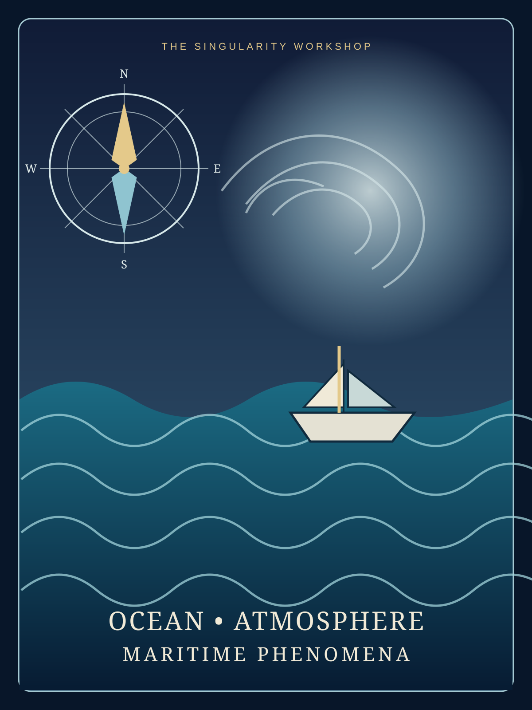

# Singularity Universal Roleplaying System - Domain - LOD 1 - Ocean, Atmosphere, and Maritime Phenomena

**Descriptor:** [ocean-atmosphere-maritime-phenomena.book.json](ocean-atmosphere-maritime-phenomena.book.json)

**Status:** first sourcebook outline. This book establishes an evidence-led domain map and teaching path; it does not claim a complete ocean, atmosphere, vessel, or navigation simulator.

## 1. The domain

The ocean and atmosphere are coupled physical systems. Maritime outcomes emerge from their interaction with vessels, coastlines, seabeds, navigation systems, infrastructure, people, and decisions.

The book connects:
- fluid mechanics, buoyancy, hydrostatics, waves, currents, tides, and coastal processes;
- atmospheric pressure, wind, convection, storms, precipitation, visibility, and electrical weather;
- vessel stability, loading, propulsion, maneuvering, structural response, and damage;
- navigation, measurement, charts, instruments, communications, and human factors;
- hazards, uncertainty, search, rescue, and the interpretation of historical incident records.

Physics owns the equations, models, numerical methods, and measurable physical consequences. Domain experts own the specialist interpretation of meteorological, oceanographic, naval-architectural, and historical evidence. SURPS owns the rulebook composition. A scenario repository owns narrative, characters, objectives, and player-facing presentation.

## 2. Physical foundations

### Water and waves

A useful learning sequence begins with density, pressure, buoyancy, hydrostatic balance, flow, and wave motion. It then develops currents, tides, bathymetry, shoreline interaction, and coupled vessel response.

Every model must identify whether it is:
- a static analytical relation;
- a prescribed environmental input;
- a bounded numerical simulation;
- a calibrated forecast or engineering model.

A beautiful ocean visualization is not evidence of a fluid solver. The current Physics repository has bounded shallow-water and bathymetric capabilities, but these do not constitute a global ocean circulation, wave forecasting, storm surge, or operational marine forecast system.

### Atmosphere and weather

Atmospheric chapters should cover pressure fields, temperature gradients, wind, convection, cloud and precipitation formation, thunderstorms, tropical and extratropical storms, visibility, and lightning. A staged educational model may connect simplified atmospheric fields to wind loading, wave generation, and vessel exposure.

The book must distinguish measured observations, forecast products, analytical examples, and synthetic scenario inputs. It must not label a toy weather field as a forecast.

### Vessels and human systems

A vessel is a coupled physical system: displacement and buoyancy, centre of gravity, restoring moments, free-surface effects, hull resistance, propulsion, steering, structural limits, cargo movement, and environmental loading. Operational play should use a declared fidelity level and should not present a simplified game model as a naval-architecture or mariner-certification tool.

Navigation adds another layer: chart reference systems, magnetic versus true directions, instrument error, dead reckoning, satellite and radio aids, communications, visibility, and human decision-making. A navigation error is a causal hypothesis to investigate, not a default explanation for every missing vessel.

## 3. Maritime hazards as coupled systems

The book should treat hazards as interactions and changing margins rather than as a catalogue of supernatural events:

| Hazard family | Physical questions | Model status in Physics |
|---|---|---|
| Severe weather | Wind fields, pressure gradients, precipitation, visibility, lightning, storm evolution | Educational components and future coupling; not a forecast system |
| Waves and swell | Wave period, wavelength, propagation, superposition, shoaling, breaking, vessel response | Staged; no general ocean-wave forecast solver claimed |
| Currents and tides | Flow fields, bathymetry, boundary conditions, water-level variation, transport | Bounded shallow-water foundations; no global tide/current predictor claimed |
| Rogue or extreme waves | Wave groups, nonlinear effects, encounter conditions, uncertainty | Research/education topic; no validated predictor claimed |
| Vessel instability | Loading, centre of gravity, free surfaces, restoring response, flooding | Future bounded naval-architecture models |
| Navigation and communications | Reference frames, instrument errors, signal availability, human factors | Separate models and scenario evidence required |
| Seafloor and coastal hazards | Bathymetry, sediment, slope failure, tsunami generation and propagation | Separate geology/hydrodynamics capabilities required |

The aim is not to make every hazard model equally detailed. It is to expose which variables matter, which are measured, which are assumed, and where uncertainty dominates.

## 4. Bermuda Triangle: an evidence-led case study

The Bermuda Triangle is a useful case study in the difference between a real geographic region, documented maritime incidents, competing causal explanations, and later cultural storytelling.

This book does **not** assume that the region has a unique physical anomaly. Nor does it dismiss an incident merely because popular accounts embellished it. Each case should be evaluated on its own evidence.

A responsible case-study record should include:
1. the incident identity, date, location source, vessel/aircraft identity, and source provenance;
2. what was known at the time versus what was reconstructed later;
3. weather, sea state, currents, visibility, and relevant environmental observations where records exist;
4. vessel/aircraft condition, loading, equipment, route, communications, and human factors where documented;
5. search-and-rescue timeline, last known position, search area, and limits of available evidence;
6. competing explanations with supporting and contradicting evidence;
7. uncertainty, missing records, and the boundary between established fact and conjecture.

Do not invent weather observations, routes, distress messages, or wreck locations. Do not infer a cause from a map illustration. A claim that an event is mysterious is not a physical measurement.

### Reality, reconstruction, and fiction

Use explicit content labels:
- **Documented:** supported by traceable primary or authoritative evidence.
- **Supported interpretation:** a reasoned explanation with stated uncertainty.
- **Unresolved:** evidence is insufficient to choose among plausible explanations.
- **Based on:** a fictional scene or scenario draws from a documented event, person, or setting but changes details.
- **Fiction:** invented content presented as such.

A historian or relevant specialist may contribute a better-supported interpretation. Their expertise should be visible as attribution and evidence, not silently converted into certainty. The same standard applies to other maritime legends, disappearances, shipwrecks, and alleged anomalies.

## 5. Learning and playable experiences

The domain supports several kinds of experiences:
- a wave tank where boundary conditions and bathymetry alter propagation;
- a vessel-stability laboratory where loading and free-surface effects change restoring behavior;
- a storm-navigation scenario where route choices trade time, exposure, fuel, and uncertainty;
- a search-and-rescue exercise where the player works with incomplete observations and a changing search area;
- a historical case investigation that separates source evidence, expert interpretation, and dramatization.

The experience layer owns narrative, missions, scoring, UI, and character roles. Physics supplies the causal model only to the fidelity level actually implemented. Historical sourcebooks and scenarios must retain source attribution and clearly mark reconstruction or fiction.

## 6. Existing Physics foundations

- [Bathymetric shallow-water basin](../../Physics/Hydrodynamics/BathymetricShallowWaterBasin2D.cs): bounded terrain-aware shallow-water behavior with wet/dry treatment; fixed bed, not sediment transport or global ocean dynamics.
- [Shallow-water basin](../../Physics/Hydrodynamics/ShallowWaterBasin2D.cs): renderer-independent 2D water foundation; not a forecast model.
- [Terrain and volcanic deposition](../GEOLOGY_VOLCANIC_TERRAIN.md): prescribed, volume-accounted terrain deposition; not eruption prediction.
- [Physics capability catalogue](../PHYSICS_CAPABILITY_CATALOG.md): implementation status, tests, and limitations.

## 7. Staged development

1. Expand the theory chapters and cite authoritative public references for fluid mechanics, meteorology, navigation, vessel stability, and incident investigation.
2. Add a validated surface-wave teaching model with analytical limiting cases before coupling it to shorelines or vessels.
3. Add explicit current/tide boundary conditions and distinguish astronomical forcing from local hydrodynamic response.
4. Build a bounded vessel hydrostatics/stability model with declared hull geometry and loading assumptions.
5. Couple environmental loads to vessel motion only after independent subsystem tests pass.
6. Build evidence-backed historical case records, beginning with source provenance and uncertainty rather than a fictional causal conclusion.
7. Add living pictures driven by actual model outputs and run records.

## 8. Limitations and editorial rules

- Publicly available sources only; cite the source and access/version date for every external dataset.
- No fabricated incident evidence, weather observations, navigation logs, or causal certainty.
- No claim of paranormal activity as a physical explanation without evidence.
- No operational substitute for professional weather, navigation, vessel design, or maritime safety systems.
- Keep physical models, domain interpretations, historical evidence, and fictional adaptations distinct.
