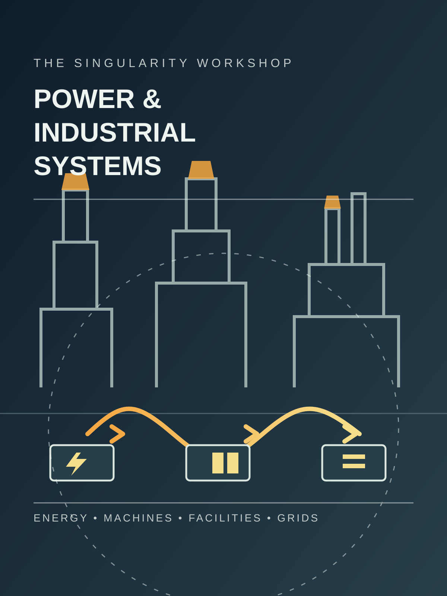

# Singularity Universal Roleplaying System - Domain - LOD 1 - Power and Industrial Systems

**Descriptor:** [power-and-industrial-systems.book.json](power-and-industrial-systems.book.json)

**Status:** first sourcebook outline, grounded in existing Physics capabilities and roadmap. The book is a domain map and teaching path; it does not claim that full power plants, reactor dynamics, industrial control systems, or manufacturing lines are implemented.

## 1. The domain

Power systems convert, transfer, store, distribute, and consume energy. Industrial systems combine those processes with materials, machines, people, control systems, logistics, and time-dependent production.

A facility is not a single machine. It is a network of coupled physical processes:

- energy sources and inventories;
- conversion equipment;
- working fluids and heat exchangers;
- rotating machinery and electrical generators;
- transmission, distribution, and protection;
- storage and demand;
- instrumentation, control, automation, and human intervention;
- maintenance, degradation, faults, and recovery.

Physics owns the causal physical models and measurable consequences. SURPS owns rulebook presentation and tabletop composition. A game or escape-room experience owns its fictional facility, objectives, narrative, player interface, and challenge pacing. None of those layers should silently substitute for the physical model.

## 2. A family of facilities

The sourcebook family should cover technologies across history and scale, from mechanical workshops and waterwheels to modern grids and advanced industrial campuses.

| Facility / system | Core physical questions | Book status |
|---|---|---|
| Batteries and electrochemical storage | Stored energy, state of charge, charge/discharge power, losses, thermal behavior, aging | Planned specialization |
| Electrical grids and substations | Voltage, current, frequency where modeled, transmission losses, reserve, protection, load priority | Existing ideal load accounting; broader network planned |
| Coal-fired thermal plants | Fuel energy, combustion, boiler heat transfer, steam cycle, turbine work, generator output, rejected heat | Planned specialization |
| Gas-fired and combined-cycle plants | Combustion, gas turbine work, heat recovery, steam cycle, dispatch | Planned specialization |
| Nuclear fission educational plants | Fission energy, bounded neutron-population response, delayed response, heat removal, steam cycle, decay heat, protective shutdown | Planned educational model; not operating guidance |
| Hydroelectric stations | Head, flow, hydraulic losses, turbine conversion, reservoir constraints | Planned specialization |
| Wind and solar generation | Resource variability, conversion efficiency, inverter/grid interface, storage and dispatch | Planned specialization |
| Manufacturing facilities | Motors, drives, process heat, material transformation, throughput, queues, waste heat, resource constraints | Planned specialization |
| District heating and industrial utilities | Thermal networks, pumps, heat exchangers, storage, demand response | Planned specialization |

These are distinct facility books or modules only when they need enough subject depth to justify their own sourcebook. The umbrella book remains the navigational map.

## 3. Shared physical language

The same quantities recur across many facilities:

- **Energy** is measured in joules; it is stored, transferred, or transformed.
- **Power** is the rate of energy transfer, measured in watts.
- **Temperature** describes thermal state; it is not a synonym for heat or stored energy.
- **Heat** is energy transferred because of a temperature difference.
- **Efficiency** compares declared useful output with declared input over a stated boundary and interval. It is not a universal score independent of what the system boundary includes.
- **Capacity** is a declared operating or conversion limit; it is not the same as actual output.
- **Reserve** is available capacity relative to a defined demand or contingency, not simply unused energy.
- **Control state** is a command or controller state. It must not be confused with the achieved physical state.

Every model must declare its system boundary, units, initial conditions, assumptions, valid operating range, and omitted effects. Energy accounting should identify input, stored energy, useful output, rejected energy, losses, and any unclosed residual.

## 4. Existing Physics implementation

The following are real bounded capabilities on the Physics development branch:

- [ElectricalGrid](../../Physics/Electricity/ElectricalGrid.cs) observes ideal fixed-voltage DC resistive loads, computes current and power, aggregates demand, and reports declared capacity exceedance.
- [EnergyConversion](../../Physics/Energy/EnergyConversion.cs) performs a deterministic, fixed-interval conversion ledger from declared input power and efficiency to useful output and energy not delivered as useful output. It does not claim the remainder is all heat or model a specific machine.
- [Electrical-to-thermal coupling experiment](../../Physics/Experiments/ElectricalThermalCouplingExperiment.cs) connects a resistive electrical load's power to a bounded thermal-energy accounting experiment.
- [Lumped thermal state](../../Physics/Thermodynamics/LumpedThermalState.cs) provides a declared constant-specific-heat thermal state.
- [Thermal conduction](../../Physics/Thermodynamics/ThermalConduction.cs) provides a bounded one-dimensional conduction primitive.
- [Phase-change thermal state](../../Physics/Thermodynamics/PhaseChangeThermalState.cs) models a declared equilibrium phase-change case.

These are useful building blocks, not a plant simulator. In particular, the current electrical grid model does not solve feeder voltage drops, AC transients, generator dynamics, frequency response, automatic protection, or load shedding. The current thermal primitives do not by themselves model a boiler, steam cycle, reactor, or industrial process line.

See [Electricity: from charge carriers to the Singularity Grid](../ELECTRICITY_AND_SINGULARITY_GRID.md) for the existing roadmap and explicit implementation boundaries.

## 5. Nuclear energy: a responsible educational model

A public-information educational reactor experience can teach the physical and systems concepts without reproducing plant-specific control-room procedures, sensitive facility details, or operational setpoints.

A staged model may expose:

1. **Energy origin:** a simplified account of energy released by fission and the distinction between reactor power and stored thermal energy.
2. **Neutron population:** a declared educational point-kinetics approximation with explicit state variables, delayed-response representation, validity range, and numerical stability tests.
3. **Thermal removal:** heat transfer from a modeled heat source into a coolant/working-fluid abstraction, with explicit energy balance.
4. **Conversion:** a generic steam/thermal cycle that converts heat into shaft work and electrical output, with rejected heat visible.
5. **Shutdown and residual heat:** distinguish stopping the modeled chain reaction from the continuing removal of stored and decay heat in the educational model.
6. **Protection and instrumentation:** generic alarms, permissives, interlocks, and protective-state transitions whose semantics are documented and not presented as real-plant procedures.
7. **Evidence:** every panel value comes from the model state or is visibly labelled as an authored scenario input.

The first version should be a transparent educational approximation, independently checked against published, non-sensitive reference material. It should not provide real-world plant operating instructions, plant-specific sequences, real control-room layouts, or safety-critical setpoints. No toy model should be marketed as a training simulator or engineering safety case.

## 6. The facility as a playable system

A facility game can turn physical understanding into meaningful play without turning the Physics package into a game engine.

A scenario can present a dark, unstaffed facility with incomplete documentation and a machine whose state has drifted while unattended. The player learns by observing instruments, tracing energy and material flows, testing safe abstract controls, and discovering what each subsystem does. Their actions change the physical model; the HUD and world reveal those consequences.

For a time-displacement scenario, the machine's achieved operating state can determine a fictional temporal reach metric. The scenario may reward faster traversal, better diagnosis, and the installation of reliable automation that removes repeated manual travel. That temporal metric is a game rule derived from declared machine performance; it is not a physical law.

The experience layer can own:
- mystery, world state, characters, and the reason the facility is unstaffed;
- navigation, HUD overlays, station objectives, and interaction affordances;
- speed-run scoring, checkpoints, narrative branches, and prior-attempt apparitions;
- the fictional time machine and the player's ability to change history.

Physics should own:
- machine component state and physical interactions;
- energy, heat, fluid, mechanical, and electrical balances where implemented;
- the consequences of a valve, switch, actuator, or automatic controller in the declared model;
- deterministic logical-time progression and evidence records.

A manual action and an automated action should reach the same physical outcome when they issue the same valid command under the same conditions. Automation changes the labor, latency, reliability, and scenario opportunity cost—not the underlying physical law.

## 7. Manufacturing and production

Manufacturing is more than a collection of animated machines. A useful facility model eventually needs:

- material inventories and provenance;
- transformations with mass and energy accounting;
- machine capabilities, operating envelopes, and state;
- cycle times and process dependencies;
- queues, buffers, transport, and bottlenecks;
- waste, scrap, emissions, heat, and maintenance;
- worker/automation interfaces and fault recovery.

Production throughput belongs to the composed process model. A fast machine cannot exceed upstream material supply or downstream capacity. A production line should expose why it is waiting, blocked, degraded, or idle.

## 8. Recommended implementation ladder

1. Extend the electrical domain from ideal load aggregation to small validated DC networks.
2. Add explicit power/energy ledgers and conversion efficiencies with declared boundaries.
3. Build a generic thermal-to-shaft-to-electric conversion chain with conservation residuals.
4. Add a generic thermal plant before technology-specific boiler or reactor specializations.
5. Add bounded storage state and charge/discharge limits.
6. Add renewable resource variability and grid dispatch as independent capabilities.
7. Add educational reactor kinetics only after the shared thermal and conversion foundations are validated.
8. Add manufacturing process graphs, machine state, inventory, and throughput accounting.
9. Compose facility scenarios and SURPS books from the proven providers.

Each stage requires tests, explicit assumptions, reference comparisons where appropriate, and an honest capability-catalog entry before being labelled implemented.

## 9. Related implementation and sourcebooks

- [Electricity and the Singularity Grid](../ELECTRICITY_AND_SINGULARITY_GRID.md)
- [Physics domain map](../PHYSICS_DOMAIN_MAP.md)
- [Physics capability catalog](../PHYSICS_CAPABILITY_CATALOG.md)
- [Thermodynamics and heat transfer](../THERMODYNAMICS_FIRST_PRIMITIVE.md)
- [Electrical-to-thermal experiment](../experiments/electrical-thermal-coupling.md)
- [SURPS Physics sourcebook integration](../SURPS_RULEBOOK_PHYSICS_INTEGRATION.md)

---

