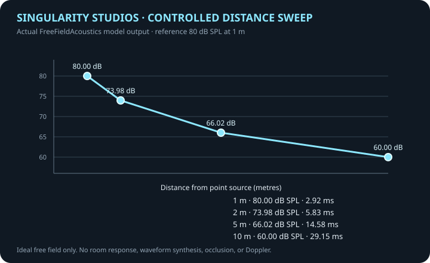

# Controlled free-field acoustic distance sweep

**Status: model experiment defined; CI reproducibility check pending.** This sweep runs the current C# `FreeFieldAcoustics.Observe` implementation against four listener positions and records the computed distance, propagation delay, and estimated received level.



## Fixed conditions

- One point source at `(0, 0, 0)` metres.
- Reference level: 80 dB SPL at 1 metre.
- Sound speed: 343 m/s.
- Listeners at 1, 2, 5, and 10 metres along the positive X axis.
- Only listener position changes; source and model parameters remain fixed.

## Observed model output

| Distance | Estimated level | Propagation delay |
|---:|---:|---:|
| 1 m | 80.00 dB SPL | 2.92 ms |
| 2 m | 73.98 dB SPL | 5.83 ms |
| 5 m | 66.02 dB SPL | 14.58 ms |
| 10 m | 60.00 dB SPL | 29.15 ms |

The result demonstrates the model's idealized inverse-distance pressure-level estimate and linear propagation delay. It is not a recording or synthesized waveform, and it is not evidence of room acoustics.

## Reproduce

From the repository root:

```sh
dotnet run --project tools/AcousticDistanceSweepRunRecordGenerator/AcousticDistanceSweepRunRecordGenerator.csproj --configuration Release -- /tmp/acoustic-distance-sweep.json
dotnet run --project tools/AcousticDistanceSweepRunRecordGenerator/AcousticDistanceSweepRunRecordGenerator.csproj --configuration Release -- docs/experiments/acoustic-distance-sweep.run.json --check
python3 tools/render_acoustic_distance_sweep.py /tmp/acoustic-distance-sweep.json /tmp/acoustic-distance-sweep.svg
python3 tools/render_acoustic_distance_sweep.py /tmp/acoustic-distance-sweep.json docs/experiments/acoustic-distance-sweep.svg --check
```

## Limits and next step

This is a free-field baseline only: no reflections, absorption, occlusion, frequency response, source motion, Doppler, or waveform synthesis. The next physically meaningful studio comparison should introduce a declared room geometry and separately validated reflection/absorption behavior, while preserving this free-field case as a baseline.
