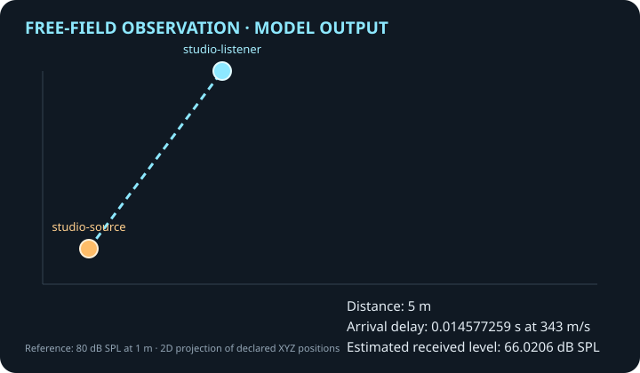

# Reproducible free-field acoustic observation

**Status: implemented model output.** This experiment runs the current C# `FreeFieldAcoustics.Observe` implementation. The committed JSON records the declared source and listener plus the computed observation. The SVG is rendered from that same serialized record and CI regenerates both artifacts for comparison.



## Declared scenario

- Source: `studio-source` at (0, 0, 0) metres.
- Listener: `studio-listener` at (3, 4, 0) metres.
- Reference level: 80 dB SPL at 1 metre.
- Sound speed: 343 m/s.
- Model: idealized free-field point source with spherical pressure spreading; received level is clamped at the reference distance.

## Computed observation

| Quantity | Model output |
|---|---:|
| Source-listener distance | 5 m |
| Propagation delay | 0.014577259475218658 s |
| Estimated received level | 66.020599913279625 dB SPL |
| Direction from listener toward source | (-0.6, -0.8, 0) |

The delay is distance divided by the configured sound speed. The level estimate follows `L(r) = L(r₀) − 20 log₁₀(max(r, r₀)/r₀)`. The direction vector points from the listener toward the source, consistent with the model's API.

## Reproduce

From the repository root:

```sh
dotnet run --project tools/AcousticObservationRunRecordGenerator/AcousticObservationRunRecordGenerator.csproj --configuration Release -- /tmp/acoustic-observation.json
dotnet run --project tools/AcousticObservationRunRecordGenerator/AcousticObservationRunRecordGenerator.csproj --configuration Release -- docs/experiments/acoustic-observation.run.json --check
python3 tools/render_acoustic_observation.py /tmp/acoustic-observation.json /tmp/acoustic-observation.svg
python3 tools/render_acoustic_observation.py /tmp/acoustic-observation.json docs/experiments/acoustic-observation.svg --check
```

## Limits

This experiment calculates propagation metadata only. It does not synthesize, transform, or play an audio waveform. It does not model room reflections, absorption, occlusion, frequency response, source/listener motion, Doppler, or the conversion of mechanical energy into sound. The separate browser audio sample is reference playback, not output from this model.
