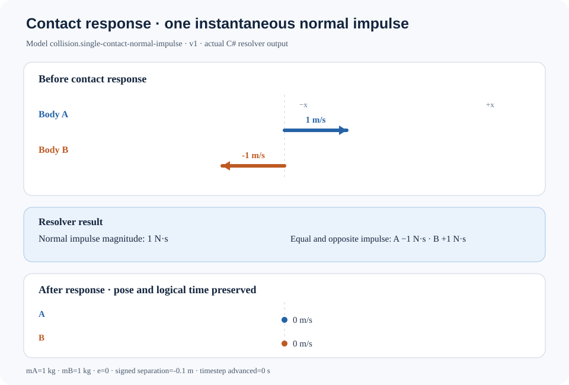

# Contact impulse: the instant that changes velocity

Two equal-mass bodies approach along a known contact normal. What can one contact response legitimately change—and what should it leave alone?

The SVG below is rendered from a JSON record emitted by the repository's actual `ContactImpulseResolver`. It is not a hand-drawn prediction and does not reimplement the solver. The scenario matches a focused acceptance test: body A has velocity +1 m/s, body B has velocity −1 m/s, both masses are 1 kg, the normal points from A to B along +X, the signed separation is −0.1 m, and restitution is zero.



## Declared case and observed result

| Quantity | Value |
|---|---:|
| Model | `collision.single-contact-normal-impulse`, version 1 |
| Body A / body B mass | 1 kg / 1 kg |
| Initial normal velocity A / B | +1 m/s / −1 m/s |
| Relative normal speed, B minus A | −2 m/s (closing) |
| Signed separation | −0.1 m (penetrating contact) |
| Restitution | 0 (perfectly inelastic normal response) |
| Resolved normal impulse magnitude | 1 N·s |
| Final normal velocity A / B | 0 m/s / 0 m/s |
| Physical time advanced by resolver | 0 s |

## Why the result follows

Let **n** be the unit contact normal from A to B, and let the relative velocity be **vᵣ = vB − vA**. The normal speed is:

`u = vᵣ · n`

For an active contact that is touching or penetrating and closing (`u < 0`), the impulse magnitude is:

`j = −(1 + e)u / (1/mA + 1/mB)`

For this case, `u = −2 m/s`, `e = 0`, and each mass is `1 kg`, so `j = 1 N·s`. The impulse on A points opposite the normal; the impulse on B points along the normal. Their magnitudes are equal and their directions opposite.

The normal velocity updates are:

`vA' = vA − n j/mA`

`vB' = vB + n j/mB`

So both X velocities become zero. This does **not** mean the bodies have been moved apart, that all motion is solved, or that all kinetic energy has been modeled as heat. The resolver preserves pose and angular velocity, does not advance time, and does not model friction, rotational inertia, tangential impulse, persistent contacts, multiple-contact coupling, or material deformation.

## What this result does—and does not—teach

**Prediction:** if the bodies have equal mass and approach at equal and opposite speeds, what impulse is required to stop their relative normal motion? The equation answers this without advancing the clock: each body receives an equal-magnitude, opposite-direction impulse.

**Misconception to avoid:** zero final normal velocity does not mean the model has explained where the initial kinetic energy went. A restitution-zero response is an idealized inelastic velocity rule. This resolver does not convert the kinetic-energy difference into heat, sound, fracture, or deformation; those require explicit, coupled models and an energy-accounting contract. Likewise, the drawing shows velocity arrows, not body geometry or separation correction.

A useful next experiment would compare restitution values while reporting both momentum and kinetic-energy changes. It should not label the energy difference as heat unless a thermal/material model actually receives that energy.

## Reproduce the picture

From the repository root:

```bash
dotnet run --project tools/ContactImpulseRunRecordGenerator/ContactImpulseRunRecordGenerator.csproj --configuration Release -- /tmp/contact-impulse.json
python3 tools/render_contact_impulse.py /tmp/contact-impulse.json /tmp/contact-impulse.svg
```

The generator calls `ContactImpulseResolver.Resolve` and serializes its output. The checked-in [run record](contact-impulse.run.json) is compared byte-for-byte with fresh output in CI. The renderer reads that record and draws the actual initial and final X velocities and impulse magnitude. It does not solve the response again.

## Evidence and limits

- [Resolver implementation](../Physics/Collision/ContactImpulseResolver.cs)
- [Focused acceptance tests](../tests/TheSingularityWorkshop.Physics.Tests/Collision/ContactImpulseResolverTests.cs)
- [C# run-record generator](../tools/ContactImpulseRunRecordGenerator/Program.cs)
- [SVG renderer](../tools/render_contact_impulse.py)
- [Contact observation contract](CONTACT_OBSERVATION.md)
- [Capability catalog](PHYSICS_CAPABILITY_CATALOG.md)

This is one deliberately narrow normal-response example, not a general rigid-body or collision solver. Its values demonstrate the implementation's declared case and are not measurements from a real collision.
