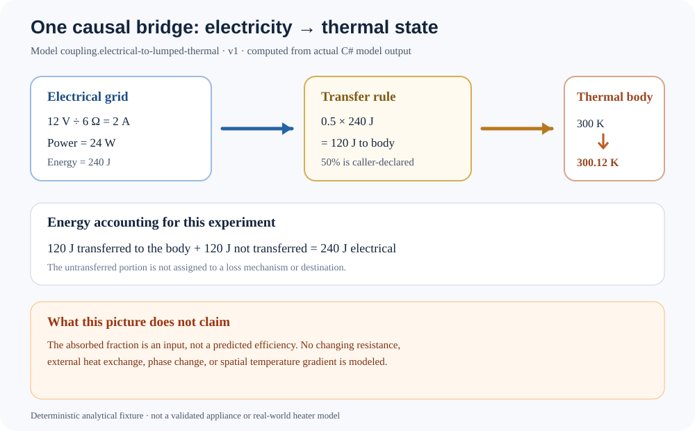

# Electrical energy becomes thermal energy: a bounded coupling experiment

This experiment connects two existing Physics domains instead of treating them as separate demonstrations: an ideal resistive electrical load supplies energy to a lumped thermal body.



## Declared case and computed result

| Quantity | Value |
|---|---:|
| DC bus voltage | 12 V |
| Load resistance | 6 Ω |
| Load current | 2 A |
| Electrical power | 24 W |
| Duration | 10 s |
| Electrical energy | 240 J |
| Declared absorbed fraction | 0.5 (50%) |
| Energy transferred to thermal body | 120 J |
| Energy not transferred to the thermal body | 120 J |
| Thermal body mass | 2 kg |
| Specific heat capacity | 500 J/(kg·K) |
| Initial temperature | 300 K |
| Final temperature | 300.12 K |

The electrical model calculates current and power from Ohm's law. The experiment integrates constant power over the declared interval:

`E = P \Delta t = 24\,\mathrm{W}\times10\,\mathrm{s}=240\,\mathrm{J}`

The caller-declared absorbed fraction determines the transfer:

`Q = fE = 0.5\times240\,\mathrm{J}=120\,\mathrm{J}`

For constant mass and specific heat capacity, the temperature rise is:

`\Delta T = Q/(mc_p) = 120/(2\times500)=0.12\,\mathrm{K}`

The result closes this experiment's accounting identity: transferred energy plus energy not transferred to the body equals the calculated electrical energy. **It does not** explain where the untransferred energy goes. That would require explicit models for those pathways.

## Reproduce and verify

From the repository root:

```bash
dotnet run --project tools/ElectricalThermalCouplingRunRecordGenerator/ElectricalThermalCouplingRunRecordGenerator.csproj --configuration Release -- /tmp/electrical-thermal.run.json
python3 tools/render_electrical_thermal_coupling.py /tmp/electrical-thermal.run.json /tmp/electrical-thermal.svg
```

The C# generator calls `ElectricalThermalCouplingExperiment.Run` and serializes its result. The checked-in [run record](electrical-thermal-coupling.run.json) is compared byte-for-byte with fresh output in CI; the SVG is rendered from that record rather than recalculating the physics.

## Assumptions and limits

- Ideal fixed-voltage DC bus and constant resistive load.
- The 50% absorbed fraction is a declared input, not an efficiency prediction.
- Energy not transferred to the body is not assigned to a loss mechanism or destination.
- No temperature-dependent resistance, thermal exchange with surroundings, phase change, or spatial temperature gradients.
- This is a deterministic integration fixture, not a validated appliance, heater, battery, or real-world material model.

## Evidence

- [Coupling implementation](../../Physics/Experiments/ElectricalThermalCouplingExperiment.cs)
- [Electrical grid model](../../Physics/Electricity/ElectricalGrid.cs)
- [Lumped thermal state](../../Physics/Thermodynamics/LumpedThermalState.cs)
- [Acceptance tests](../../tests/TheSingularityWorkshop.Physics.Tests/ElectricalThermalCouplingExperimentTests.cs)
- [Run-record generator](../../tools/ElectricalThermalCouplingRunRecordGenerator/Program.cs)
- [SVG renderer](../../tools/render_electrical_thermal_coupling.py)
- [Physics gap register](../PHYSICS_GAP_REGISTER.md)
