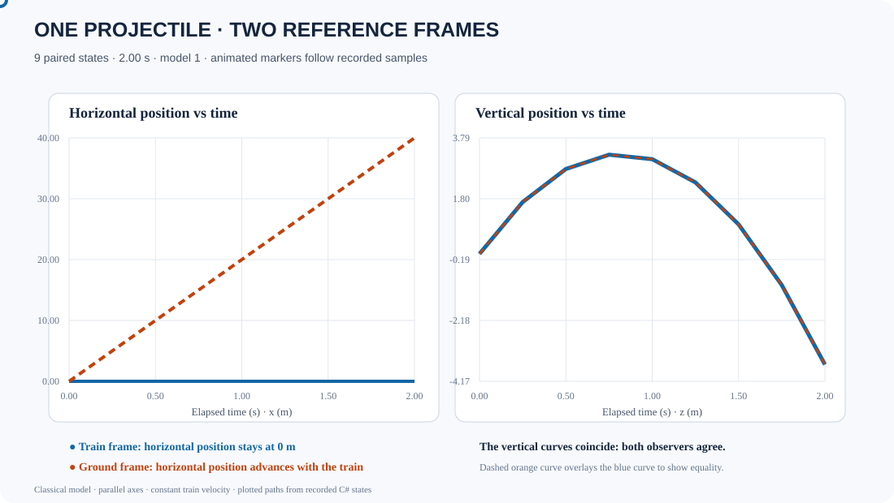

# Moving-train projectile: one motion, two observers

**Status:** paired train/ground experiment, versioned run-record model, generator, and focused tests implemented. CI executes the C# model and checks every paired sample. A paired observer SVG is now present as an analytical reference graphic; generating it directly from the serialized C# run record and checking it in CI remains the next step.

*The paired plot shows the default analytical case at the same nine logical timestamps. It is currently a checked-in analytical reference graphic; the next step is to generate the SVG from the actual serialized C# run record and verify drift in CI.*

## Question

A train moves at a constant 20 m/s. A ball is launched vertically at 8 m/s relative to the train. Ignoring air resistance, compare the description from a passenger with the description from someone beside the track.

The train-frame horizontal position stays at zero. The ground-frame horizontal position advances by 20 metres each second. The vertical position and velocity are equal in both frames at every shared timestamp.

## What runs

- [Paired experiment](../Physics/Experiments/MovingTrainProjectileExperiment.cs) runs the existing constant-acceleration trajectory once in train coordinates and derives the ground state for every sample using the Galilean transform.
- [Frame transform](../Physics/Math/GalileanFrameTransform.cs) converts positions and velocities between parallel axes with constant relative velocity.
- [Versioned run record](../Physics/Experiments/MovingTrainProjectileRunRecord.cs) stores both states for every logical timestamp.
- [Run-record generator](../../tools/MovingTrainProjectileRunRecordGenerator/Program.cs) executes the C# experiment and serializes its actual output.
- [Acceptance tests](../tests/TheSingularityWorkshop.Physics.Tests/MovingTrainProjectileExperimentTests.cs) check matching logical timestamps, horizontal train motion, preserved vertical motion, a non-zero train origin, and deterministic run-record serialization.
- [Versioned run record](../Physics/Experiments/MovingTrainProjectileRunRecord.cs) preserves the declared inputs, SI units, model/schema versions, and both observer states for every sample. It serializes actual experiment output rather than generating a separate illustrative trajectory.
- [Transform lesson](../GALILEAN_FRAME_TRANSFORM.md) explains the equations and their assumptions.

The ground-frame trajectory is not independently re-simulated. That avoids two numerical integrations drifting apart and makes the relationship between the observations explicit.

## Equations

For train velocity \(\mathbf{u}\), train-frame position \(\mathbf{x}_{train}(t)\), and the ground position of the train-frame origin at the epoch \(\mathbf{o}_0\):

\[
\mathbf{x}_{ground}(t)=\mathbf{o}_0+\mathbf{x}_{train}(t)+\mathbf{u}t
\]

\[
\mathbf{v}_{ground}(t)=\mathbf{v}_{train}(t)+\mathbf{u}
\]

## Scope and next step

This is a classical, non-relativistic model. The frames have parallel axes and constant relative velocity. It does not model train acceleration, drag, launch mechanics, collision, or terrain.

CI runs the generator and verifies that all nine paired samples share timestamps, satisfy the declared Galilean position transform, and preserve vertical velocity. Next: drive the paired SVG from this serialized run record and make CI verify every plotted sample against the C# output.
