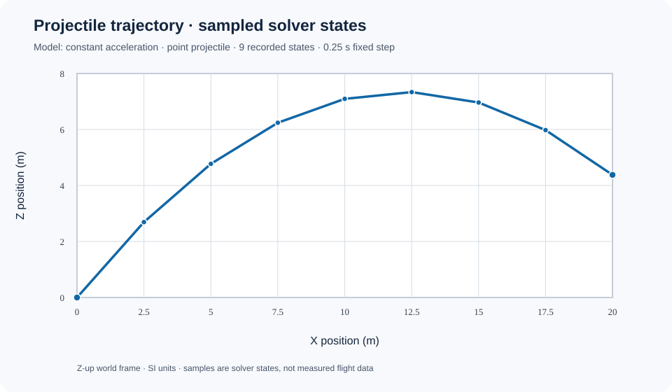

# Projectile trajectory: first recorded 3D experiment

This page documents one deliberately narrow run of `ProjectileTrajectoryExperiment`. The X/Z chart is generated from the serialized sample states, not from a second implementation of the physics equations. The Y coordinate remains part of the recorded state and is zero for this example.

<!-- BEGIN GENERATED RUN SUMMARY -->
## Declared experiment

| Input / outcome | Recorded value |
|---|---:|
| Model identity | `kinematics.constant-acceleration-projectile` (model version 1; schema 1) |
| Initial position | (0, 0, 0) m |
| Initial velocity | (10, 0, 12) m/s |
| Constant acceleration | (0, 0, -9.81) m/s^2 |
| Coordinate frame | world, Z-up |
| Fixed timestep | 0.25 s |
| Completed steps | 8 |
| Recorded samples | 9, including the initial state |
| Simulated duration | 2 s |
| Final position | (20, 0, 4.38) m |
| Final velocity | (10, 0, -7.62) m/s |

<!-- Record-derived: model=kinematics.constant-acceleration-projectile; samples=9; duration=2 s. -->
<!-- END GENERATED RUN SUMMARY -->

The solver's constant-acceleration relationships are:

- Position: **p(t) = p₀ + v₀t + ½at²**
- Velocity: **v(t) = v₀ + at**

Markers correspond to the exact recorded sample states. The connecting line is only a visual guide between those samples.



## Reproduce the illustration

The fixture at [projectile-trajectory.run.json](projectile-trajectory.run.json) uses the same JSON property contract as `ProjectileTrajectoryRunRecord.ToJson()`. It is a checked-in reproducible run record for this example. The renderer reads positions and timestamps from the record; it does not recalculate the trajectory.

From the repository root, regenerate the SVG:

```bash
python3 tools/render_projectile_trajectory.py \
  docs/experiments/projectile-trajectory.run.json \
  docs/experiments/projectile-trajectory.svg
```

The build runs the same renderer in `--check` mode to catch stale illustrations. To produce a chart for a newly executed experiment, save its `ProjectileTrajectoryRunRecord.ToJson()` output as JSON and pass that file instead of the checked-in fixture.

## Evidence and limitations

- [Experiment implementation](../../Physics/Experiments/ProjectileTrajectoryExperiment.cs)
- [Acceptance tests](../../tests/TheSingularityWorkshop.Physics.Tests/ProjectileTrajectoryExperimentTests.cs)
- [Renderer source](../../tools/render_projectile_trajectory.py)
- [Living theory and evidence contract](../LIVING_THEORY.md)

The acceptance tests compare each solver sample with the analytical solution and check repeatability, invalid inputs, and serialization. The fixture represents a deterministic analytical example, not external measurements.

This model does **not** implement aerodynamic drag, spin, a launch mechanism, collisions, terrain intersection, or impact physics. It should not be interpreted as evidence of real-world flight accuracy.
