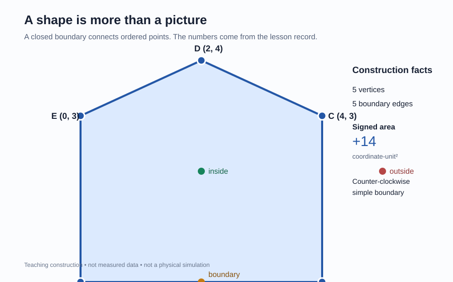

<!-- The Singularity Workshop moniker -->

# Shapes & Space: a boundary made from points

**Question:** How do a handful of locations become a shape, and how can we describe that shape without relying on its appearance?

## Explore the construction

Start with five points, named in boundary order: A → B → C → D → E → A. Connecting each point to the next—and closing the final edge back to A—creates a polygon.

| Vertex | Coordinates |
|---|---:|
| A | (0, 0) |
| B | (4, 0) |
| C | (4, 3) |
| D | (2, 4) |
| E | (0, 3) |

The coordinates are abstract **coordinate-units**. They are not metres, pixels, or measurements of a physical object.

## What the construction teaches

1. **A point** names a location in a chosen coordinate frame.
2. **A segment** joins two endpoints. Its length is the Euclidean distance between them.
3. **A boundary** is an ordered sequence of segments that closes.
4. **Winding** records whether the boundary travels counter-clockwise or clockwise.
5. **Signed area** changes sign when the same boundary order is reversed. Here the counter-clockwise order gives +14 coordinate-unit².
6. **Point location** distinguishes a point inside the polygon, on its boundary, or outside it.

The recorded construction classifies (2, 2) as inside, (2, 0) as boundary, and (5, 2) as outside. These are outputs of the repository's point-location predicate applied to the declared vertices.

## The mathematics behind the picture

For consecutive vertices (xᵢ,yᵢ), the signed shoelace area is:

Aₛ = ½ Σᵢ (xᵢ yᵢ₊₁ − yᵢ xᵢ₊₁),

where the final vertex connects back to the first. Positive area indicates counter-clockwise winding; negative area indicates clockwise winding.

For an edge from Pᵢ to Pᵢ₊₁, its Euclidean length is:

ℓᵢ = √((xᵢ₊₁ − xᵢ)² + (yᵢ₊₁ − yᵢ)²).

Area is not simply “the amount of blue.” It is a value computed from the ordered coordinates and a declared boundary interpretation.

## What is actually implemented

The construction is grounded in the tested Vector2d and Geometry2dPolygon APIs:

- SignedArea computes the signed shoelace result with exact accumulation over the supplied binary64 coordinates, then rounds the final result to binary64.
- IsSimple checks whether the closed boundary has only permitted adjacent endpoint meetings.
- LocatePoint applies the non-zero winding rule and returns inside, outside, or boundary.
- Triangulate decomposes a simple polygon into triangles while preserving winding and original effective vertex indices.

The checked-in JSON record is the source for the displayed construction and classifications. The SVG is a teaching view of that record; it is not a second geometry solver.

## Try these questions

- What happens to the signed area if you list the same vertices in reverse order?
- Which facts stay the same when the polygon is translated?
- Can two shapes have the same area but different boundaries?
- Why must the order of vertices matter?

## Assumptions and limits

- The coordinate frame is named lesson-plane; its units and physical interpretation are intentionally unspecified.
- The example is a simple convex polygon. Self-intersections, holes, concave boundaries, degeneracies, tolerances, and measurement uncertainty require separate lessons.
- The geometry predicates classify the supplied floating-point coordinates. Exact classification of those represented values does not make real-world measurements exact.
- This is a geometric construction, not a physical observation, a simulation, or evidence about causation.

## Reproduce and verify

The companion [run record](shapes-and-space.run.json) declares the vertices, point classifications, winding, signed area, and triangulation. The SVG is a teaching view of that record, not a measured or simulated scene.

---

