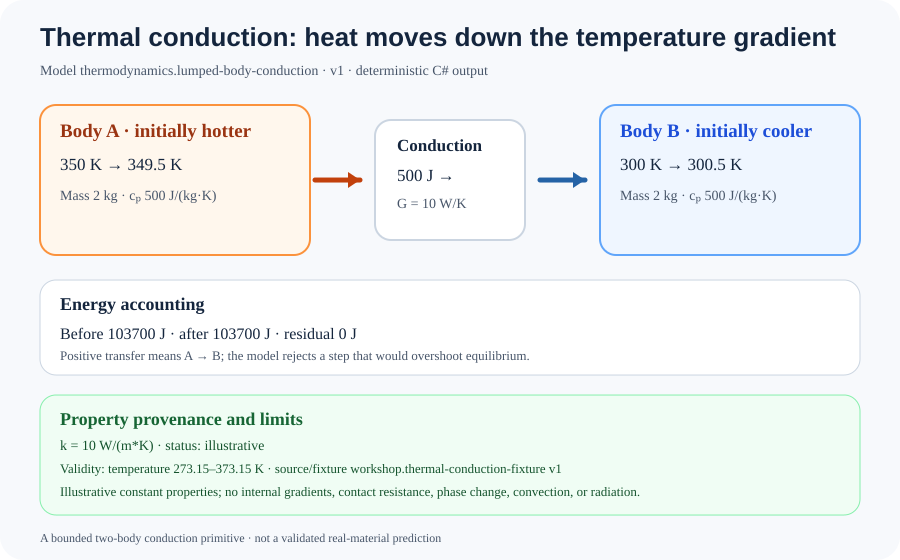

# Two-body thermal conduction: a bounded energy-transfer experiment

This experiment exercises a new causal thermal primitive: two lumped bodies exchange energy according to a declared conductivity, effective area, path length, and timestep.



## Declared case and computed result

| Quantity | Value |
|---|---:|
| First body initial temperature | 350 K |
| Second body initial temperature | 300 K |
| Mass of each body | 2 kg |
| Specific heat capacity of each body | 500 J/(kg·K), illustrative |
| Thermal conductivity | 10 W/(m·K), illustrative |
| Effective conducting area | 1 m² |
| Conducting path length | 1 m |
| Timestep | 1 s |
| Thermal conductance, kA/L | 10 W/K |
| Energy transferred from first body to second | 500 J |
| First body final temperature | 349.5 K |
| Second body final temperature | 300.5 K |
| Total sensible energy before / after | 103,700 J / 103,700 J |
| Energy accounting residual | 0 J |

The primitive evaluates (Q = kA(T_1-T_2)\Delta t/L). Positive (Q) means energy moves from the first body to the second; negative (Q) means the reverse. It rejects a timestep that would reverse the bodies' temperature ordering, rather than silently overshooting equilibrium.

The conductivity value is explicitly illustrative and tied to a source/fixture identifier, version, unit, and validity range in the [run record](thermal-conduction.run.json). It is not asserted as a measured property of a named material.

## Reproduce and verify

From the repository root:

```bash
dotnet run --project tools/ThermalConductionRunRecordGenerator/ThermalConductionRunRecordGenerator.csproj --configuration Release -- /tmp/thermal-conduction.actual.json
python3 tools/render_thermal_conduction.py /tmp/thermal-conduction.actual.json /tmp/thermal-conduction.actual.svg
```

CI regenerates the JSON from the C# primitive, compares it with the committed fixture, renders the SVG from the generated record, and compares the output to this checked-in image.

## Assumptions and limits

- Each body is represented by one uniform temperature and constant specific heat capacity.
- Conductivity, effective area, and path length are declared constants for the interval.
- The conductivity value and specific heat values are illustrative, not sourced or measured real-material data.
- The timestep must not overshoot thermal equilibrium.
- No spatial gradients inside a body, contact resistance, phase change, convection, radiation, or temperature-dependent properties are modeled.

## Evidence

- [Thermal conduction implementation](../../Physics/Thermodynamics/ThermalConduction.cs)
- [Material property definition](../../Physics/Materials/MaterialPropertyDefinition.cs)
- [Focused tests](../../tests/TheSingularityWorkshop.Physics.Tests/Thermodynamics/ThermalConductionTests.cs)
- [Run-record generator](../../tools/ThermalConductionRunRecordGenerator/Program.cs)
- [SVG renderer](../../tools/render_thermal_conduction.py)
- [Physics capability catalog](../PHYSICS_CAPABILITY_CATALOG.md)
